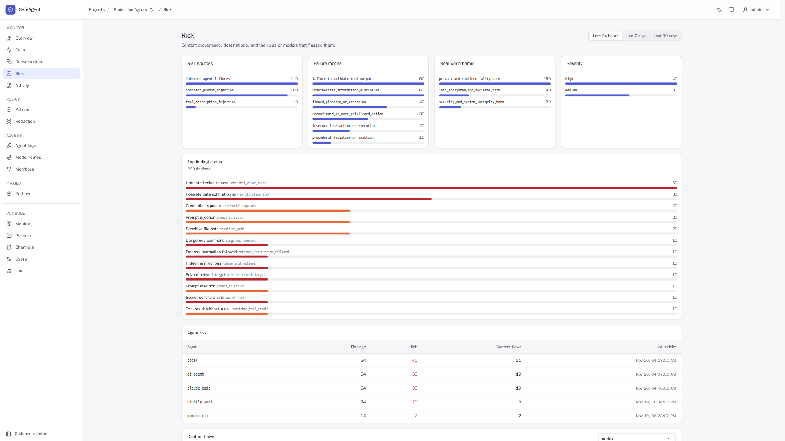
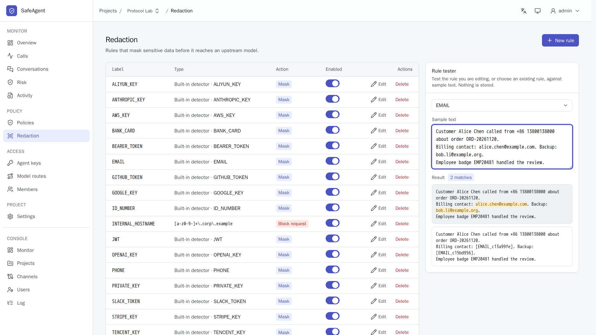
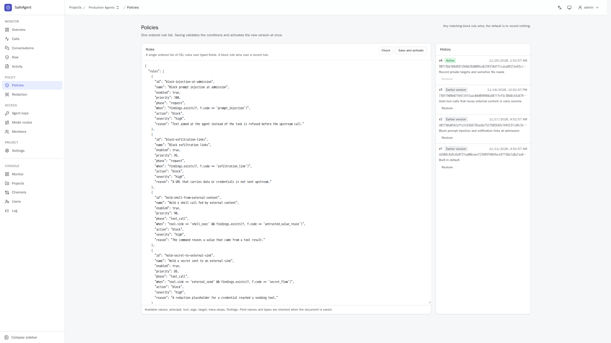

# SafeAgent

[中文](README_zh.md)

SafeAgent is a self-hosted security gateway for agent calls. It sits between agents and model providers, handles four chat protocols through one path, enforces project policy at request admission and before a tool call is released, redacts sensitive data reversibly, and records every call for later diagnosis.

An agent call consists of a task, input content, tool selections and tool results. SafeAgent enforces policy where a side effect can still be intercepted and diagnoses the full trajectory after the call ends. No change to the agent code is required.

## How it works

The gateway decodes four client protocols into one canonical model, applies redaction and policy there, and encodes the request for the upstream provider. The online path evaluates policy at request admission and before a completed tool call is released. When the call ends, a background task rebuilds the trajectory from audit events and diagnoses it. Enforcement decisions, findings, relations and console views all derive from the same observation, so an operator can inspect the input, decision and evidence for one call.

## Capabilities

- **Protocol conversion** — Chat Completions, Responses, Anthropic Messages and Gemini share one streaming path. Fields that the target format cannot represent are recorded as explicit losses.
- **Reversible redaction** — Built-in detectors and custom rules replace sensitive values before a request leaves the boundary and restore them in the response.
- **Online policy** — Two checkpoints inspect the request and each completed tool call. An ordered list of typed rules can block or record, and a saved version takes effect immediately.
- **Call diagnosis** — A background task rebuilds the call from audit events and stores findings with origin, sink, evidence and a reproducible input hash.
- **Relation analysis** — Edges connect external content to later side-effecting tool calls within one call. The risk page aggregates them by agent key.
- **Operator console** — The console manages projects, calls, conversations, risk, redaction, policy, keys and routes in English and Chinese.

## Console

|  |  |
| --- | --- |
|  |  |
|  |  |

## Design principles

- **Source and sink.** Every finding states where content came from, what the tool can do with it, and the evidence for that judgement.
- **Coverage and verdict.** Incomplete coverage, a detector error or an uncertain model answer produces `unknown`. `safe` requires complete coverage, no medium or high finding and no unsafe model answer; a high-severity finding produces `unsafe`.
- **Enforcement and diagnosis.** The online path stores policy decisions. The asynchronous path stores findings, relations and model labels. The console presents the two records separately.
- **Model veto only.** The decision model is asked only after deterministic rules allow a side-effecting tool call. It can add a block and cannot remove a rule decision; the authorization question excludes tool output.
- **Typed policy fields.** Field names and types are checked when a document is saved. Each project owns one ordered rule list.

## Deployment

The system consists of one Go binary and one PostgreSQL database. The same process serves the console at `/console/`, the gateway at `/v1/` and `/v1beta/`, and a health check at `/health`. It requires no message broker, Redis instance or separate background process. When the console must be reachable beyond loopback, serve it through a reverse proxy that handles TLS.

## Quick start

Requirements: Go 1.27.4, Node.js 22 or newer, GNU Make, and an existing PostgreSQL 17 database.

```sh
make deps
cp config.example.toml config.toml   # set database_url
make build
build/bin/safeagent -config config.toml serve
```

The first start creates the schema and prints the initial `admin` password once on standard output. Open <http://127.0.0.1:8080/console/>, create a project, channel, route and agent key, then connect an agent as described in the [getting-started guide](docs/human/getting-started.md).

The schema is a fresh baseline with no migration path; a schema change requires recreating the database. Raw audit payloads are stored as received, with access controlled by role. Upstream keys and the decision-model key are sealed with the instance key.

## Current design trade-offs

- **Single instance** — PostgreSQL is the coordination point. This version has no multi-instance mode or distributed queue.
- **Gateway scope** — SafeAgent observes only traffic that passes through the gateway; coverage depends on the deployment position.
- **Text-only redaction** — Images, audio and other binary payloads are not rewritten and must be handled by the caller.
- **Heuristic matching** — Relations use literal matches, and tool capabilities are inferred from names and arguments. Findings point to possible problems and may need confirmation.
- **Response review** — Response prose has no online checkpoint. Content cannot be recalled after it reaches the client, so review happens after the call.
- **Hidden reasoning** — Reasoning that the upstream provider does not return cannot be reconstructed.

## Verification

The last acceptance run used DeepSeek Flash (`deepseek-flash`) through its Chat Completions, Responses and Anthropic Messages endpoints. No Gemini upstream was configured; Gemini client coverage uses the three routes, and the Gemini channel path is covered by unit tests rather than a live provider.

| Check | Result |
| --- | --- |
| Unit, contract and frontend tests | `make verify` passed |
| Repository integration tests | `make lab-integration` passed |
| Protocol matrix: four client formats × three channel formats × stream/JSON, core and enabled extensions | 212 passed, 0 failed, 28 skipped |
| Agent clients: Claude Code, Codex, Gemini CLI and Pi against every configured route | 15 passed, 0 failed; the Gemini native deep task was skipped because no Gemini upstream was configured |
| Online policy | 24 passed, 0 failed |
| Diagnosis and redaction hits | 12 passed, 0 failed |
| Authentication, quotas, isolation and console permissions | 16 passed, 0 failed |
| Failover, truncation, tool holds, headers and default limits | 9 passed, 0 failed |
| Console | 17 pages at desktop and mobile widths; desktop create, edit, delete, revoke and disable flows; no page, API or overflow failure |
| Dependency and vulnerability scan | `make security` passed: SBOMs written, Go modules verified, npm audit empty and no symbol-reachable Go vulnerabilities |
| Cross-format performance sample | 24 of 24 client/route/mode combinations passed with no protocol error |

The 28 matrix skips are capability gaps, not passes: Messages has no structured-output field, Chat and Gemini clients have no provider-executed server tool, DeepSeek Flash did not execute `web_search` on the Responses channel, and Messages has no multi-choice or provider-state field. Every skip is listed with its reason in `matrix.json`.

The quick performance smoke runs 50 requests per side at concurrency 2. Errors and protocol completeness are the gates; P95 and throughput are recorded for comparison but are informational at this sample size.

| Native path      | P95, direct / gateway | Throughput, direct / gateway |
| ---------------- | --------------------- | ---------------------------- |
| Chat JSON        | 952 / 894 ms          | 3.81 / 3.79 req/s            |
| Chat stream      | 717 / 858 ms          | 4.14 / 3.88 req/s            |
| Responses JSON   | 1024 / 771 ms         | 3.30 / 3.93 req/s            |
| Responses stream | 756 / 821 ms          | 4.32 / 3.82 req/s            |
| Messages JSON    | 716 / 769 ms          | 4.34 / 4.00 req/s            |
| Messages stream  | 818 / 609 ms          | 4.19 / 4.48 req/s            |

## Documentation

- [Getting started](docs/human/getting-started.md)
- [Architecture](docs/human/architecture.md)
- [Console](docs/human/console.md)
- [Agent threat modeling](docs/human/threat-modeling.md)
- [Agent guide](docs/agent/README.md)

## License

[Apache License 2.0](LICENSE)
