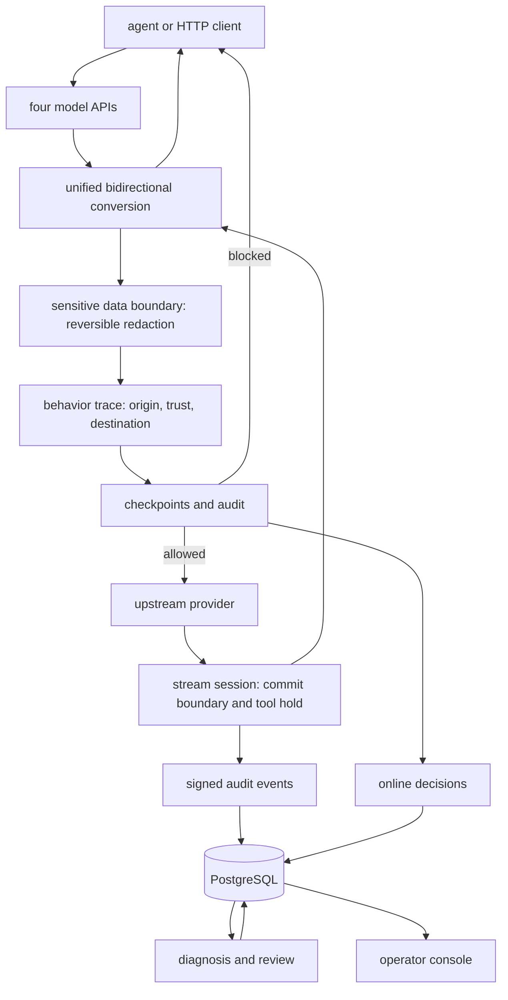
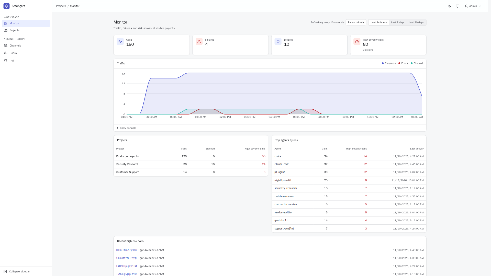

<h1 align="center">SafeAgent</h1>

<p align="center"><strong>Make every agent call in production usable, controllable and traceable</strong></p>

<p align="center">English · <a href="README_zh.md">中文</a></p>

SafeAgent is a self-hostable security gateway platform built for agent behavior control. It unifies model APIs from different vendors, redacts data before a request leaves the organization, and turns an agent's call trace, tool actions and policy decisions into verifiable audit evidence.

## The problems it solves

In production, agents are given accounts, tools and internal network access. Beyond generating text, they read documents, send messages, change configuration and call business systems. Once such an action runs, its effect usually lands in a business system and cannot be recalled.

| Production problem | Current state and impact | Capability |
| --- | --- | --- |
| Fragmented interfaces | four model APIs and several agent clients coexist; pairwise adaptation grows with the number of combinations | unified bidirectional conversion |
| Sensitive data egress | request bodies reach model providers in full; redaction and restoration are implemented per client, with inconsistent coverage | sensitive data boundary |
| Invisible behavior | the initiator, target and impact of a tool call cannot be linked; ordinary logs carry no integrity guarantee | behavior tracing and audit |

The three problems sit at the interface, the data flow and the record of behavior. SafeAgent places them on one call path and lets the gateway handle them together.

## Why SafeAgent

Built separately, a protocol gateway sees only the request and response, an agent-side guard sees only the tool call, and a logging platform cannot prove the record was not altered. SafeAgent runs conversion, the data boundary and audit on one call path with one shared context, so policy applies per call and takes effect across every client.

## Core capabilities

### Unified bidirectional conversion

Chat Completions, Responses, Anthropic Messages and Gemini convert in both directions through one internal model. A client and an upstream may use different formats, and each side encodes requests and responses on its own terms.

- All four interfaces convert in both directions, with the same semantics for streaming and non-streaming.
- Generation conversions record dropped or rewritten fields in the loss ledger.
- Same-format Chat, Messages and Gemini traffic that needs no rewrite passes through as-is; Responses always takes the canonical path because the gateway owns request state.
- The provider catalog maintains endpoints, authentication, capability profiles and model discovery.

### Sensitive data boundary

Before a request leaves the gateway, detectors identify and replace sensitive data, so the model and upstream only see the redacted view. The response restores the original values from the mapping, and the client receives the complete result.

- Reversible redaction spans requests and responses; policy decisions run on the redacted view.
- Built-in detectors cover common personal data and credentials; projects can add custom rules.
- Upstream keys and decision-model credentials are sealed with the instance key.

### Behavior tracing and audit

Every call is rebuilt as one protocol-neutral trace that records where content came from, its trust level and where a tool can send data. Policy runs at four checkpoints (request, tool result, tool call and non-streaming response), with the timeline, session chain and audit chain kept with it.

- Trace: content origin, trust level and tool destination.
- Checkpoints: request, tool result, tool call and non-streaming response; rules block or record.
- Timeline: admission, upstream attempts, first token, tool calls, policy decisions and termination in order.
- Session chain: calls from the same task are linked automatically; the console shows the call tree.
- Audit chain: events are signed one by one, with integrity checks and tamper location.
- Diagnosis: a background job rebuilds the trajectory and stores findings, data flows and evidence.

## How it differs

| Project | Focus | Difference from SafeAgent |
| --- | --- | --- |
| AxonHub | multi-provider access, routing, cost and operations | also uses a unified model and raw pass-through; SafeAgent adds policy at the tool boundary inside the gateway |
| Sub2API | subscription quota, account pools and billing | also supports multiple protocols; SafeAgent uses one canonical model and makes online tool-call decisions |
| AgentGuard | client hook plus central attribute-based access control | similar attributes; SafeAgent keeps policy in the gateway, so adopters do not integrate an SDK |
| AgentDoG | trajectory-level safety diagnosis and risk taxonomy | SafeAgent adopts the trajectory view and taxonomy without training a guard model |

Versions, licenses and mechanism details are in [the landscape](docs/human/landscape.md).

## How it works



A call follows this path:

1. The request is decoded into one internal model, and sensitive values are replaced before the boundary.
2. The system rebuilds the call as a trace: who supplied the content, whether it is trusted, and where a tool can send data.
3. The request checkpoint runs detectors and project rules; added tool results are checked again before they reach the upstream.
4. The model streams back; text and reasoning are forwarded at once, and a complete tool call waits.
5. An allowed tool call is released; otherwise it is dropped and the client receives a protocol-level error.
6. Events, online decisions and the diagnosis job are written to the same record; the worker rebuilds the trajectory and stores findings and evidence.

## Console

|  |  |
| --- | --- |
|  |  |
|  |  |

## Quick start

Requirements:

- Go 1.27.4
- Node.js 22 or newer
- GNU Make
- PostgreSQL 17

```sh
make deps
cp config.example.toml config.toml   # set database_url
make build
build/bin/safeagent -config config.toml serve
```

The example configuration enables secure cookies. The two deployment modes need different settings:

- Loopback over plain HTTP: turn the option off first.
- Public deployment: keep it on behind a TLS reverse proxy.

The first start creates the schema and prints the initial administrator account and password once on standard output. Then:

1. Open <http://127.0.0.1:8080/console/> and sign in with that password.
2. Create a project, channel, route and agent key.
3. Connect an agent as described in the [getting-started guide](docs/human/getting-started.md).

## Deployment and boundaries

- One Go process serves the console, the gateway and a health check. No message broker, Redis instance or separate background process is required.
- Upstream keys and the decision-model key are sealed with the instance key.
- Raw audit payloads are stored as received, and access is role-based.
- The schema is a fresh baseline with no migration path; a schema change requires recreating the database.
- Coverage depends on where the gateway is deployed. Images, audio and other binary payloads are not inspected or rewritten.
- Streaming response text cannot be recalled once it reaches the client; only a non-streaming response can be blocked before it is written.

## Verification

Static and contract checks, race tests, database integration tests and the Docker acceptance lab cover the protocol matrix, agent clients, policy, diagnosis, security, faults, the console, load and audit chains. `make verify` runs the local layers; the [verification guide](docs/human/verification.md) describes the lab and the performance procedure.

## Documentation

- [Getting started](docs/human/getting-started.md)
- [Architecture](docs/human/architecture.md)
- [Protocol conversion](docs/human/protocol-conversion.md)
- [Safety model](docs/human/agent-safety.md)
- [Landscape](docs/human/landscape.md)
- [Verification](docs/human/verification.md)
- [Development guide](docs/agent/README.md)

## License

[Apache License 2.0](LICENSE)
