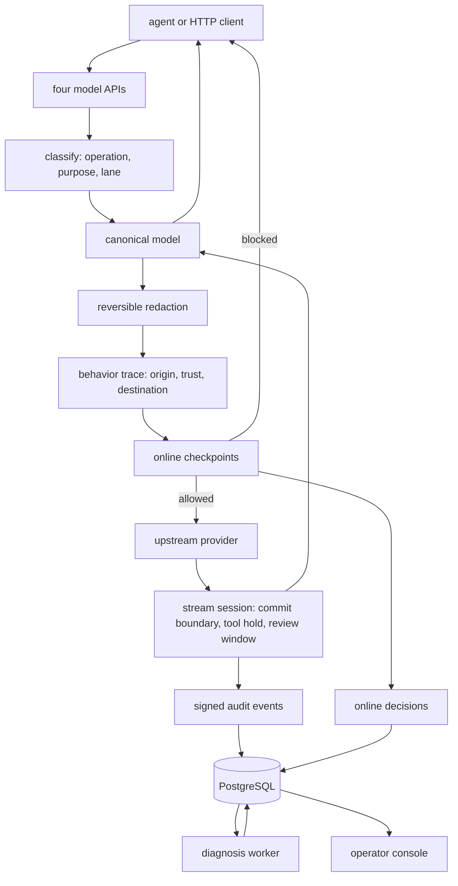

<h1 align="center">SafeAgent</h1>

<p align="center"><strong>Make every agent call usable, controllable and traceable</strong></p>

<p align="center">English · <a href="README_zh.md">中文</a></p>

SafeAgent is a self-hosted security gateway for agent behavior. It sits between agent clients and model providers, converts the four wire formats agents use, masks sensitive data before it leaves the organization, and turns every call into a signed, replayable record. Operators get one place to watch traffic, investigate what an agent did, and stop a tool action before it reaches a business system.

## What it solves

Agents in production are given accounts, tools and network access. They read documents, send messages, change configuration and call internal services, and the effects of those actions are usually durable before anyone notices them.

| Production problem | What goes wrong | What SafeAgent does |
| --- | --- | --- |
| Fragmented interfaces | Four model APIs and several agent clients coexist; pairwise adaptation grows with every combination | one canonical model with bidirectional conversion, streaming and loss reporting |
| Sensitive data egress | Requests leave with full text; redaction is reimplemented per client and inconsistently | reversible masking at the boundary, with policy evaluated on the masked view |
| Invisible behavior | The initiator, destination and effect of a tool call cannot be linked, and plain logs prove nothing | call classification, protocol-neutral tracing, online checkpoints and a signed audit chain |

These problems meet on one call path. SafeAgent handles them there, in the gateway, so a policy applies to every client without an SDK and the audit record is produced by the same component that enforced the decision.

## Why SafeAgent

Built separately, a protocol gateway sees only the request, an agent guard sees only the tool call, and a log platform cannot prove a record was not altered. SafeAgent runs conversion, the data boundary, the behavior trace and the audit trail on one path with one shared context.

The gateway also separates agent activity from protocol plumbing. Primary calls are diagnosed and counted. Background work an agent performs during a conversation — subagents, compaction, title generation — stays visible but is not treated as primary activity. Auxiliary endpoints such as token counting, model listing or the Responses lifecycle never create conversations and never inflate failure rates.

## Core capabilities

### Unified protocol conversion

Chat Completions, Responses, Anthropic Messages and Gemini convert in both directions through one internal model. A client and an upstream may use different formats, and each side is encoded on its own terms.

- All four interfaces convert in both directions, with the same semantics for streaming and non-streaming traffic.
- Dropped or rewritten fields are recorded in a per-call loss ledger and reported to the client.
- Same-format Chat, Messages and Gemini requests that need no rewrite pass through as raw bytes; Responses always takes the canonical path because the gateway owns request state.
- Provider endpoints, authentication, capability profiles and model discovery are maintained as editable catalog rows.
- A project may review a bounded leading window of a streaming response before the first byte; the default is direct streaming.

### Sensitive data boundary

Before a request leaves the gateway, detectors replace sensitive values; the model and the upstream only see the masked text. The response restores the original values from the call's mapping, so the client receives the complete result.

- Reversible masking spans requests, streaming responses and auxiliary payloads; policy and diagnosis read the masked view.
- Built-in detectors cover common personal data and credentials; projects add regular expressions and choose replace, block or alert for each rule.
- A masked value keeps a deterministic identity, so repeated occurrences are counted and displayed once per conversation instead of accumulating on every continuation.
- Each call stores a snapshot of the rules it ran under, and historical calls are displayed with those rules rather than the current ones.
- Upstream keys and decision-model credentials are sealed with the instance key supplied at startup.

### Behavior tracing and audit

Every call is rebuilt as one protocol-neutral trace that records where content came from, whether it is trusted, and what a tool call can do. Policy runs at four checkpoints: request, tool call, tool result and response, with an optional reviewed window for streaming responses.

- Trace: content origin, trust level and tool destination, inferred from names, arguments and normalized targets.
- Conversations: calls are linked into a session; a conversation is rendered as one projection of calls, turns, items, tools, attempts, decisions, findings and masked values.
- Audit chain: every audit event is HMAC-chained per call, and a call stores its own chain head and event count. Tampering and deleted tails are detected, and an offline command verifies stored chains without starting the gateway.
- Diagnosis: a background worker rebuilds the trace from the same events, expands a bounded ancestor conversation, runs deterministic detectors, optionally asks a decision model, and stores findings, flows, coverage and a verdict.
- Audit events also serve as replay steps: each step names the trajectory nodes it touched, and the projection keeps those steps beside the calls.

### Editable control plane

Suppliers and routing policy are separate graphs.

- Providers describe protocol endpoints, capabilities and discovery. Built-in providers arrive as editable rows, and a custom provider can be added for an OpenAI-compatible or self-hosted endpoint.
- Channels hold credentials, base URLs, limits and timeouts. Models describe upstream names, kinds and prices. Model formats are derived from the provider endpoints instead of stored separately.
- A route maps a project-facing model name, plus optional aliases, to ordered targets. Each target names a channel and a model with a priority, a weight and an optional format and output limit.
- Removing a channel or model is a soft delete with an impact preview; routes that referenced it degrade visibly instead of disappearing. A dangling supply or routing reference is reported as a warning and does not prevent startup.
- Changes take effect without restarting the process.

### Console and operations

The console gives operators a view of traffic and failures, call and conversation records, risk findings and data flows, policy versions, redaction rules, models, channels, routes and access control. Raw audit payloads are visible to administrators only, and successful state-changing console operations are written to the operation log.

## How it works



A call follows this path:

1. The gateway authenticates the agent key, decodes the request into the canonical model and classifies it by endpoint operation, purpose and lane.
2. Sensitive values are replaced before the request crosses the boundary. The gateway rebuilds the call as a trace: who supplied the content, whether it is trusted, and where a tool can send data.
3. The public model name resolves to a route. The request checkpoint runs detectors and project rules; tool results added by the request are checked before they reach the upstream.
4. The model streams back. Text and reasoning are forwarded at once unless the project's review window is open, while a complete tool call waits for its verdict.
5. An allowed tool call is released; otherwise it is dropped and the client receives a protocol-shaped error.
6. At the end, placeholders are restored, and events, decisions and the diagnosis job are written in one transaction. The conversation is updated for conversational lanes only, and the worker diagnoses finished main calls.

## Quick start

Requirements:

- Go 1.27.4
- Node.js 22 or newer
- GNU Make
- PostgreSQL 17

```sh
make deps
cp config.example.toml config.toml   # set database_url and instance_key
# instance_key: openssl rand -base64 32
make build
build/bin/safeagent -config config.toml serve
```

The example configuration enables secure cookies. Local plain-HTTP use needs the option turned off; a public deployment keeps it on behind a TLS reverse proxy.

The first start creates the schema, seeds the built-in provider catalog and prints the initial administrator account and password once on standard output. Then:

1. Open <http://127.0.0.1:8080/console/> and sign in with that password.
2. Add a channel with a key, catalog models and a project route; built-in providers are already available.
3. Create an agent key and connect an agent as described in the [getting-started guide](docs/human/getting-started.md).

## Deployment and boundaries

- One Go process serves the console, the gateway and a health check, and runs the diagnosis worker. No message broker, Redis instance or separate background process is required.
- The instance key is supplied by the configuration file and is never stored in the database. Upstream keys and the decision-model key are sealed with it.
- PostgreSQL is the only durable store. Audit events are the source of truth, and the schema is a fresh baseline with no migration path; a schema change requires recreating the database.
- Raw audit payloads are stored as received, and access is role-based.
- Coverage depends on where the gateway is deployed. Images, audio and other binary payloads are not inspected or rewritten.
- A project can block a streaming response before the first byte by enabling a bounded stream review window. Text after that window cannot be recalled; only a non-streaming response is checked in full before it is written.
- Human approval queues, cross-call semantic relations and multi-agent trajectory linking are not implemented.

## Repository layout

| Path | Contents |
| --- | --- |
| `cmd/safeagent` | the server binary: serve, schema, OpenAPI contract and audit verification |
| `cmd/securitycheck` | the dependency and vulnerability report gate |
| `internal/` | the gateway, control plane, console services, storage and the domain packages |
| `web/` | the React operator console |
| `testenv/` | the Docker acceptance lab |
| `docs/` | human guides and the agent reference |

## Verification

Static and contract checks, race tests, database integration tests and the Docker acceptance lab cover the protocol matrix, agent clients, auxiliary endpoints, policy, diagnosis, security, faults, the console, load and audit chains. `make verify` runs the local layers; the [verification guide](docs/human/verification.md) explains what each layer proves and what it does not.

## Documentation

- [Getting started](docs/human/getting-started.md)
- [Architecture](docs/human/architecture.md)
- [Protocol conversion](docs/human/protocol-conversion.md)
- [Safety model](docs/human/agent-safety.md)
- [Landscape](docs/human/landscape.md)
- [Verification](docs/human/verification.md)
- [Development guide](docs/agent/README.md)

## License

[Apache License 2.0](LICENSE)
