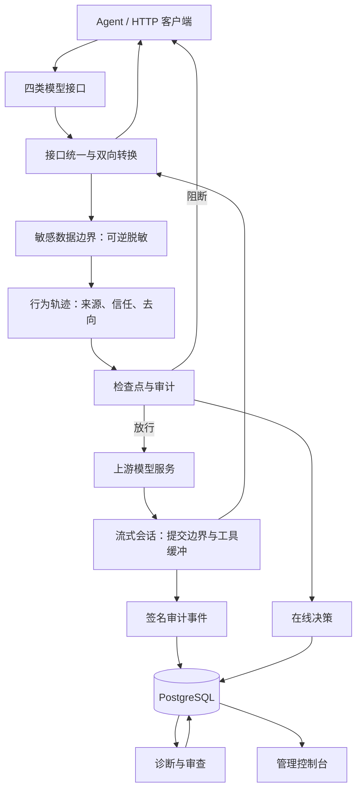
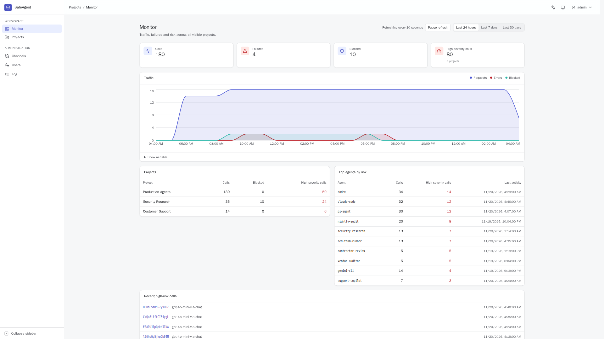
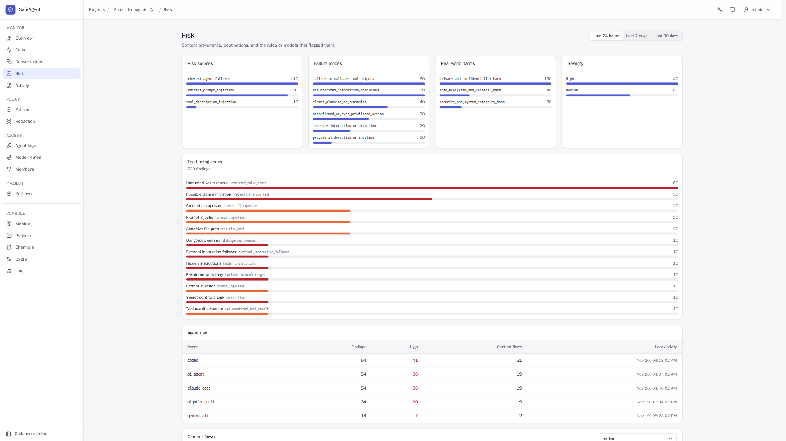
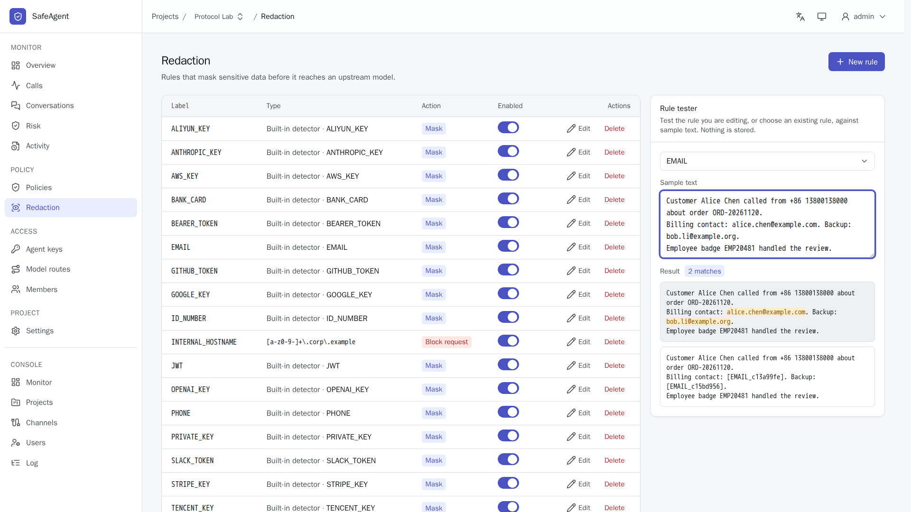
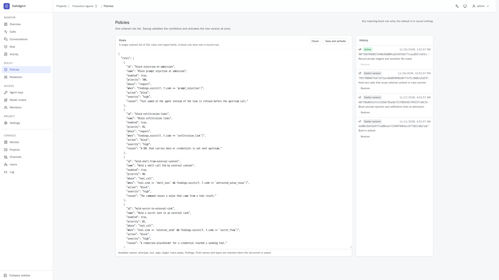

<h1 align="center">SafeAgent</h1>

<p align="center"><strong>让生产环境中的每一次 Agent 调用都可用、可控、可追溯</strong></p>

<p align="center">中文 · <a href="README.md">English</a></p>

SafeAgent 是一个面向 Agent 行为管控、可自托管的安全网关平台。它统一了不同厂商的模型接口，在请求离开企业边界前完成数据脱敏，并把 Agent 的调用轨迹、工具动作与策略判定固化为可核查的审计证据。

## 它解决什么问题

Agent 进入生产环境后，通常会被授予账号、工具和内网访问权限。除了生成文本，它还会读取文档、发送消息、修改配置、调用业务系统；这些动作一旦执行，影响就落在业务系统里，事后难以撤回。

| 生产中的问题 | 现状与影响                                                               | 对应能力           |
| ------------ | ------------------------------------------------------------------------ | ------------------ |
| 接口碎片化   | 四类模型接口与多种 Agent 客户端并存，逐对适配的工作量随组合数增长        | 接口统一与双向转换 |
| 敏感数据外泄 | 请求原文直达模型提供商，脱敏与原文恢复由各客户端分别实现，覆盖范围不一致 | 敏感数据边界       |
| 行为不可见   | 工具调用的发起方、执行目标与影响范围无法关联，普通日志缺少完整性保障     | 行为追溯与审计     |

三项问题分别出现在接口接入、数据流向和行为记录上。SafeAgent 将它们放在同一条调用路径上，由网关统一处理。

## 为什么需要 SafeAgent

三项能力分开建设时，协议网关只看到请求与响应，Agent 侧护栏只看到工具调用，日志平台也无法证明记录未被修改。SafeAgent 把接口转换、数据边界与行为审计放在同一条调用路径上，共享同一份上下文，使策略按调用生效并覆盖所有客户端。

## 核心能力

### 接口统一与双向转换

Chat Completions、Responses、Anthropic Messages 和 Gemini 通过同一套内部模型完成双向转换。客户端与上游可以采用不同格式，两侧各自编码请求与响应。

- 四种接口均支持双向转换，流式与非流式遵循同一套语义。
- 生成类转换丢弃或改写的字段记入损失台账。
- 同格式且无需改写的 Chat、Messages 与 Gemini 流量直接透传；Responses 因请求状态由网关接管，总走规范路径。
- 提供商目录维护端点、鉴权方式、capability profile 与模型发现。

### 敏感数据边界

请求离开网关前，检测器识别并替换敏感数据，模型与上游只能接触脱敏后的内容；响应返回时按映射恢复原文，客户端获得完整结果。

- 可逆脱敏覆盖请求与响应，策略判定基于脱敏视图。
- 内置检测器覆盖常见个人信息与凭据，项目可扩展自定义规则。
- 上游密钥与决策模型凭据由实例密钥加密保存。

### 行为追溯与审计

每次调用都还原为一条协议无关的轨迹，记录内容的来源、信任级别与工具去向。系统在请求、工具结果、工具调用和非流式响应四个检查点执行策略，时间线、会话链与审计链一并留存。

- 轨迹：记录内容来源、信任级别与工具去向。
- 检查点：请求、工具结果、工具调用与非流式响应，规则可阻断或记录。
- 时间线：准入、上游尝试、首 token、工具调用、策略决定与终止按序还原。
- 会话链：同一任务的多次调用自动串联，控制台展示调用树。
- 审计链：事件逐条签名，支持完整性校验与篡改定位。
- 诊断：后台重建轨迹，输出发现、数据流向与证据。

## 与同类项目的区别

| 项目       | 侧重                               | 与 SafeAgent 的差异                                                  |
| ---------- | ---------------------------------- | -------------------------------------------------------------------- |
| AxonHub    | 多提供商接入、路由、成本与运维     | 同样采用统一模型与原始透传；SafeAgent 在网关内增加工具边界的策略控制 |
| Sub2API    | 订阅配额、账号池与计费             | 同样支持多种协议；SafeAgent 使用单一规范模型，并对工具调用做在线判定 |
| AgentGuard | 客户端 hook 配合中央属性式访问控制 | 属性维度相近；SafeAgent 将策略放在网关，接入方无需集成 SDK           |
| AgentDoG   | 轨迹级安全诊断与风险分类           | SafeAgent 采用其轨迹视角与分类方法，不训练 guard model               |

更完整的版本、许可证和机制对比见[同类方案](docs/human/landscape_zh.md)。

## 工作方式



一次调用依次经过：

1. 请求被解码为统一内部模型，敏感值在离开边界前替换。
2. 系统还原这次调用的轨迹：内容由谁提供、是否可信、工具可以通向哪里。
3. 请求检查点执行检测器与项目规则；新增的工具结果在转发上游前再次检查。
4. 模型开始流式返回，文本与推理即时转发，完整工具调用进入等待。
5. 判定通过后放行工具调用；否则丢弃，并向客户端返回协议内的错误。
6. 事件、在线决策与诊断任务写入同一条记录，后台重建轨迹并保存发现与证据。

## 控制台

|                                                                   |                                                                |
| ----------------------------------------------------------------- | -------------------------------------------------------------- |
|        |  |
|  |      |

## 快速开始

需要以下环境：

- Go 1.27.4
- Node.js 22 或更新版本
- GNU Make
- PostgreSQL 17

```sh
make deps
cp config.example.toml config.toml   # 填写 database_url
make build
build/bin/safeagent -config config.toml serve
```

示例配置默认开启安全 Cookie，两种部署方式需要不同设置：

- 本机地址、普通 HTTP：先在配置中关闭该选项。
- 公网部署：保留该选项，并置于 TLS 反向代理之后。

首次启动会创建数据库结构，并在标准输出打印一次初始管理员账号与密码。随后：

1. 打开 <http://127.0.0.1:8080/console/>，使用该密码登录。
2. 创建项目、渠道、路由和 Agent 密钥。
3. 按[快速上手](docs/human/getting-started_zh.md)接入 Agent。

## 部署与边界

- 一个 Go 进程同时提供控制台、网关和健康检查，不需要消息队列、Redis 或独立后台任务。
- 上游密钥和决策模型密钥使用实例密钥加密保存。
- 原始审计数据按原样保存，访问受角色控制。
- 数据库结构是全新基线，不提供迁移路径；结构变化需要重建数据库。
- 覆盖范围取决于网关部署的位置；图片、音频和其他二进制内容不参与检查或替换。
- 流式响应正文一旦到达客户端就无法撤回，只有非流式响应能在写出前阻断。

## 验证

静态与契约检查、竞态测试、数据库集成测试和 Docker 验收环境共同覆盖协议矩阵、Agent 客户端、策略、诊断、安全、故障、控制台、负载与审计链。`make verify` 运行本地检查；验收环境与性能口径见[验收方法](docs/human/verification_zh.md)。

## 文档

- [快速上手](docs/human/getting-started_zh.md)
- [架构设计](docs/human/architecture_zh.md)
- [协议转换](docs/human/protocol-conversion_zh.md)
- [安全模型](docs/human/agent-safety_zh.md)
- [同类方案](docs/human/landscape_zh.md)
- [验收方法](docs/human/verification_zh.md)
- [开发指南](docs/agent/README.md)

## 许可证

[Apache License 2.0](LICENSE)
