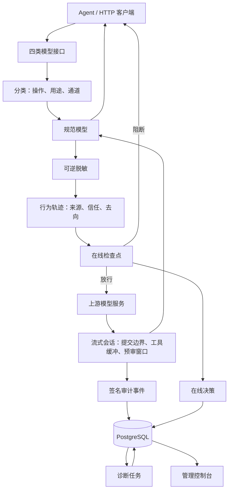

<h1 align="center">SafeAgent</h1>

<p align="center"><strong>让生产环境中的每一次 Agent 调用都可用、可控、可追溯</strong></p>

<p align="center">中文 · <a href="README.md">English</a></p>

SafeAgent 是一个面向 Agent 行为管控、可自托管的安全网关。它位于 Agent 客户端与模型提供商之间，统一四类模型接口，在请求离开企业边界前完成脱敏，并把每次调用固化为签名的、可回放的记录。运维人员因此可以在一个地方观察流量、追查 Agent 做过什么，并在工具动作落到业务系统之前把它拦下。

## 它解决什么问题

Agent 进入生产环境后，通常会被授予账号、工具和内网访问权限。它会读取文档、发送消息、修改配置、调用内部服务；这些动作一旦执行，影响往往已经落在业务系统里，事后难以撤回。

| 生产中的问题 | 具体表现                                                          | SafeAgent 的做法                                         |
| ------------ | ----------------------------------------------------------------- | -------------------------------------------------------- |
| 接口碎片化   | 四类模型接口与多种 Agent 客户端并存，逐对适配的工作量随组合数增长 | 单一规范模型的双向转换，覆盖流式与非流式，并记录转换损失 |
| 敏感数据外泄 | 请求原文直达模型提供商，脱敏由各客户端重复实现且覆盖不一致        | 在边界处做可逆脱敏，策略在脱敏视图上判定                 |
| 行为不可见   | 工具调用的发起方、执行目标与影响无法关联，普通日志缺少完整性保障  | 调用分类、协议无关的轨迹、在线检查点与签名审计链         |

这些问题都发生在同一条调用路径上。SafeAgent 在网关内统一处理，因此策略无需接入方集成 SDK 即可覆盖所有客户端，审计记录与策略执行也来自同一个组件。

## 为什么需要 SafeAgent

三项能力分开建设时，协议网关只看到请求，Agent 侧护栏只看到工具调用，日志平台也无法证明记录未被修改。SafeAgent 把接口转换、数据边界、行为轨迹与审计放在同一条路径上，共享同一份上下文。

网关还会把 Agent 的真实行为与协议杂务区分开。主调用会被诊断并计入统计；Agent 在对话过程中执行的后台工作（子 Agent、上下文压缩、标题生成）保持可见，但不作为主活动处理；Token 计数、模型列表、Responses 生命周期等辅助端点从不创建会话，也不会抬高失败率。

## 核心能力

### 接口统一与双向转换

Chat Completions、Responses、Anthropic Messages 和 Gemini 通过同一套内部模型完成双向转换。客户端与上游可以采用不同格式，两侧各自编码请求与响应。

- 四种接口均支持双向转换，流式与非流式遵循同一套语义。
- 生成类转换丢弃或改写的字段记入本次调用的损失台账，并反馈给客户端。
- 同格式且无需改写的 Chat、Messages 与 Gemini 请求按原始字节透传；Responses 因请求状态由网关接管，总走规范路径。
- 供应商端点、鉴权方式、能力描述与模型发现以可编辑的目录记录维护。
- 项目可对一段有上限的流式响应首段窗口做首字节前预审；默认仍是直接流式输出。

### 敏感数据边界

请求离开网关前，检测器会替换敏感值，模型与上游只能接触脱敏后的内容；响应返回时按本次调用的映射恢复原文，客户端获得完整结果。

- 可逆脱敏覆盖请求、流式响应与辅助请求体，策略与诊断读取脱敏视图。
- 内置检测器覆盖常见个人信息与凭据，项目可以补充正则规则，并为每条规则选择替换、阻断或告警。
- 脱敏值具有确定性标识，同一值在会话中只统计和展示一次，不会随每次续写重复累加。
- 每次调用保存当时生效的规则快照，历史调用按当时的规则展示。
- 上游密钥与决策模型凭据使用启动时提供的实例密钥加密保存。

### 行为追溯与审计

每次调用都还原为一条协议无关的轨迹，记录内容的来源、信任级别与工具去向。系统在请求、工具调用、工具结果和响应四个检查点执行策略；流式响应还可以开启有上限的首段预审。

- 轨迹：记录内容来源、信任级别与工具去向，去向由工具名、参数与规范化目标推断。
- 会话：多次调用串联为同一会话；一份投影同时呈现调用、轮次、条目、工具、尝试、决定、发现与脱敏值。
- 审计链：每条审计事件按调用逐条 HMAC 链接，调用自身保存链头与事件数；可检测篡改与尾部删除，也能在不启动网关的情况下离线校验已存调用链。
- 诊断：后台任务从同一批事件重建轨迹，展开有界的祖先会话，运行确定性检测器，按配置询问决策模型，并保存发现、数据流、覆盖情况与判定。
- 审计事件同时作为回放步骤，每一步标明它触及的轨迹节点；投影把这些步骤与调用一并保存。

### 可编辑的控制面

供给与路由策略是两张分开的图。

- 供应商描述协议端点、能力与模型发现。内置供应商以可编辑的记录出现，也可以添加自定义供应商来接入兼容 OpenAI 或自建的模型服务。
- 渠道保存凭据、基础地址、限额与超时；模型描述上游名称、类型与价格，支持的格式由供应商端点推导，不再单独存储。
- 路由把一个项目对外的模型名（及其别名）映射到一组有序目标。每个目标指定渠道与模型，并带有优先级、权重、可选的格式与输出上限。
- 删除渠道或模型是软删除，执行前给出影响预览；引用它的路由会显示为降级，不会直接消失。悬空的供给或路由引用以告警呈现，不会阻止进程启动。
- 配置变更无需重启进程即可生效。

### 控制台与运维

控制台提供流量与失败概览、调用与对话记录、风险发现与数据流、策略版本、脱敏规则、模型、渠道、路由与访问控制。原始审计数据仅管理员可见，成功执行的状态变更操作会写入操作日志。

## 工作方式



一次调用依次经过：

1. 网关校验 Agent 密钥，把请求解码为规范模型，并按端点操作、用途与通道完成分类。
2. 敏感值在请求跨越边界前被替换；网关还原这次调用的轨迹：内容由谁提供、是否可信、工具可以通向哪里。
3. 公开模型名解析到路由。请求检查点执行检测器与项目规则；请求新增的工具结果在转发上游前再次检查。
4. 模型开始流式返回。文本与推理通常即时转发；项目开启预审时首段先缓冲。完整工具调用进入等待。
5. 判定通过后放行工具调用；否则丢弃，并向客户端返回协议内的错误。
6. 结束时还原占位符，并在同一事务中写入事件、在线决策与诊断任务。只有对话类通道会更新会话，后台任务随后诊断已完成的主调用。

## 快速开始

需要以下环境：

- Go 1.27.4
- Node.js 22 或更新版本
- GNU Make
- PostgreSQL 17

```sh
make deps
cp config.example.toml config.toml   # 填写 database_url 和 instance_key
# instance_key: openssl rand -base64 32
make build
build/bin/safeagent -config config.toml serve
```

示例配置默认开启安全 Cookie。本机普通 HTTP 使用前需要关闭该选项；公网部署则保留该选项，并置于 TLS 反向代理之后。

首次启动会创建数据库结构、写入内置供应商目录，并在标准输出打印一次初始管理员账号与密码。随后：

1. 打开 <http://127.0.0.1:8080/console/>，使用该密码登录。
2. 添加带密钥的渠道、模型目录与项目路由；内置供应商已经可用。
3. 创建 Agent 密钥，并按[快速上手](docs/human/getting-started_zh.md)接入 Agent。

## 部署与边界

- 一个 Go 进程同时提供控制台、网关与健康检查，并运行诊断任务，不需要消息队列、Redis 或独立后台进程。
- 实例密钥由配置文件提供，不会写入数据库；上游密钥和决策模型密钥使用它加密保存。
- PostgreSQL 是唯一的持久化存储。审计事件是唯一事实来源，数据库结构是全新基线，不提供迁移路径；结构变化需要重建数据库。
- 原始审计数据按原样保存，访问受角色控制。
- 覆盖范围取决于网关部署的位置；图片、音频和其他二进制内容不参与检查或替换。
- 项目可开启有上限的流式预审窗口，在写出首字节前阻断流式响应；窗口之外的文本仍无法撤回，只有非流式响应会在写出前完整检查。
- 人工审批队列、跨调用的语义关联与多 Agent 轨迹串联尚未实现。

## 仓库结构

| 路径                | 内容                                                                 |
| ------------------- | -------------------------------------------------------------------- |
| `cmd/safeagent`     | 服务端二进制：启动服务、输出 schema、生成 OpenAPI 契约、离线校验审计 |
| `cmd/securitycheck` | 依赖与漏洞报告闸门                                                   |
| `internal/`         | 网关、控制面、控制台服务、存储与各领域包                             |
| `web/`              | React 运维控制台                                                     |
| `testenv/`          | Docker 验收实验环境                                                  |
| `docs/`             | 面向人的指南与面向 Agent 的参考                                      |

## 验证

静态与契约检查、竞态测试、数据库集成测试和 Docker 验收环境共同覆盖协议矩阵、Agent 客户端、辅助端点、策略、诊断、安全、故障、控制台、负载与审计链。`make verify` 运行本地检查；各层证明了什么、不证明什么，见[验收方法](docs/human/verification_zh.md)。

## 文档

- [快速上手](docs/human/getting-started_zh.md)
- [架构设计](docs/human/architecture_zh.md)
- [协议转换](docs/human/protocol-conversion_zh.md)
- [安全模型](docs/human/agent-safety_zh.md)
- [同类方案](docs/human/landscape_zh.md)
- [验收方法](docs/human/verification_zh.md)
- [开发指南](docs/agent/README.md)

## 许可证

[Apache License 2.0](LICENSE)
