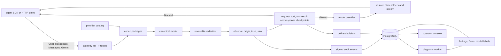

# Agent guide

SafeAgent is a self-hosted gateway between agents and model providers. It converts four wire formats, redacts and restores text, records every admitted call, enforces a project policy online and diagnoses finished calls asynchronously.

The documents below describe the current implementation. They assume no prior knowledge of the repository and are ordered from the model to the operational details.

## System shape



The request path is synchronous through admission. Provider text streams back; a complete tool call is held for its checkpoint, and tool results added by a request are checked before forwarding. The worker is a separate loop over the `analysis_jobs` table in the same process; it never applies online policy.

## Reading order

1. [`model.md`](model.md) — trace, origin, trust, sink, finding, flow and the three axes.
2. [`analysis.md`](analysis.md) — detectors, engine, verdicts, online checkpoints, asynchronous diagnosis and the decision model.
3. [`policy.md`](policy.md) — the rule list, typed CEL fields, four phases, lifecycle and permissions.
4. [`storage.md`](storage.md) — tables, cascades, idempotency, retention and secrets.
5. [`audit.md`](audit.md) — event contract, hash chain, timeline and `verify-audit`.
6. [`protocol.md`](protocol.md) — canonical model, stream session, codecs, clean EOF and conversion losses.
7. [`providers.md`](providers.md) — the provider catalog, endpoint matrix, channel overrides and discovery.
8. [`development.md`](development.md) — commands, configuration, tests and extension points.
9. [`testenv.md`](testenv.md) — the Docker acceptance lab, functional suites and the performance smoke.
10. [`papers.md`](papers.md) — which external concepts are implemented and where.
11. [`roadmap.md`](roadmap.md) — known limits and the next engineering steps.
12. [`glossary.md`](glossary.md) — English and Chinese terms.

## Repository layout

```text
cmd/safeagent          server, schema, OpenAPI and audit verification
cmd/securitycheck      vulnerability report gate

internal/
  analysis/            findings, flows, detectors, engine, policy and decision model
    builtin/           deterministic detectors
    decision/          decision-model boundary and adapters
    policy/            typed CEL rule compiler
  app/                 composition root, lifecycle and dependency tests
  llm/
    model/             canonical IR, events, ledger, signatures, assembler and journal
    codec/             codec contract, shared helpers and the four codecs
    provider/          provider and endpoint catalog
      builtin/         one file per built-in provider
    stream/            the streaming session: commit, hold, restore, raw, keepalive
  observation/         protocol-neutral trace model
  observe/             the only protocol-to-observation adapter
  pipeline/            admission, policy, routing, attempts, audit and auxiliary endpoints
  platform/            infrastructure without domain knowledge
    config/            configuration loader
    limit/             rate and concurrency limiter
    netguard/          pinned dialer and private-address checks
    routing/           channel selection, breakers and sticky sessions
    secure/            instance-key sealing and random identifiers
  redact/              reversible redaction engine and detectors
  service/             application use cases
    console/           management use cases in one package
    diagnosis/         asynchronous diagnosis and the analysis worker
  storage/             persistence
    auditevent/        event contract, hash chain, decoder and timeline
    entity/            persistence records
    repository/        PostgreSQL queries and the schema baseline
  testkit/             in-memory gateway fixtures
  transport/
    console/           management API, DTOs and OpenAPI contract
    http/              gateway HTTP and WebSocket routes

web/                   React console
testenv/               Docker acceptance lab (database, agent CLIs, browser, load generator)
```

Supporting packages are grouped by role. `platform` contains utilities that know nothing about agents, calls or findings. `storage` contains the database contract and its queries. The top-level domain libraries are `analysis`, `observation`, `observe`, `redact`, `llm/*` and `pipeline`.

## Dependency rules

- `internal/llm/model` depends only on the standard library.
- `internal/llm/codec` and `internal/llm/provider` depend on the model; neither depends on the stream engine or the gateway.
- `internal/llm/stream` depends on the model and the codec contract; it reaches policy only through callbacks.
- `internal/pipeline` depends on `llm/*` and storage; it does not import transport or the application.
- `internal/observation`, `internal/analysis`, `internal/observe`, `internal/redact` and `internal/platform/*` sit beside the layers, not above them.
- `internal/analysis` and `internal/observation` must not depend on `llm/*`, directly or transitively. The architecture tests enforce this.
- `internal/transport/console` and `internal/service/console` must not import the wire model or the stream engine.
- Repository methods are verbs and domain types are nouns. A layer never imports the layer above it.

## Operating model

- One process. The diagnosis worker runs in the same binary and claims jobs from PostgreSQL.
- PostgreSQL is the only durable store. Audit events are the source of truth; every event is HMAC-chained and a call carries its own chain head.
- A call is recorded once it is admitted. Authentication and decode failures before admission are returned but not persisted.
- The schema is a fresh baseline. Startup compares the stored fingerprint and refuses a mismatch or a table set without a fingerprint, so a schema change requires recreating the database.
- The decision model is optional. Without it, diagnosis is fully deterministic.
- Agent keys are stored as hashes and identify the caller. The console uses a session cookie, an `X-SafeAgent-Request` header and an Origin check for state-changing requests.
- `X-SafeAgent-Session` groups calls from one agent key; it is not an identity and never replaces the agent key.

## Commands

`go run ./cmd/safeagent -config config.toml serve` runs the service. `schema` prints the baseline DDL, `openapi` writes the contract, and `verify-audit` checks stored event chains. The complete workflow is documented in [`development.md`](development.md).

## Related

- [Human architecture guide](../human/architecture.md)
- [Getting started](../human/getting-started.md)
- [Project README](../../README.md)
