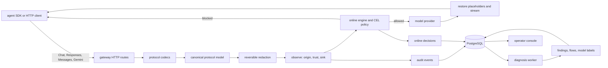

# Agent guide

SafeAgent is a self-hosted gateway between agents and model providers. It converts four chat protocols, redacts and restores text, records every admitted call, enforces a project policy online and diagnoses finished calls asynchronously.

The documents below describe the current implementation. They assume no prior knowledge of the repository and are ordered from the model to the operational details.

## System shape



The request path is synchronous through the request checkpoint. The provider response is streamed back while complete tool calls are held for the tool checkpoint. The worker is a separate loop over the `analysis_jobs` table in the same process; it never applies online policy.

## Reading order

1. [`model.md`](model.md) — trace, origin, trust, sink, finding, flow and the three axes.
2. [`analysis.md`](analysis.md) — detectors, engine, verdicts, online checkpoints, asynchronous diagnosis and the decision model.
3. [`policy.md`](policy.md) — the single rule list, typed CEL fields, lifecycle and permissions.
4. [`storage.md`](storage.md) — tables, cascades, idempotency, retention and secrets.
5. [`protocol.md`](protocol.md) — canonical model, codecs, media, clean EOF and conversion losses.
6. [`development.md`](development.md) — commands, configuration, tests and extension points.
7. [`testenv.md`](testenv.md) — the Docker acceptance lab, functional suites and the relative performance gate.
8. [`papers.md`](papers.md) — what AgentDoG and AgentGuard say, and what this project adopts.

## Repository layout

```text
cmd/safeagent          server, schema output and OpenAPI export
cmd/securitycheck      vulnerability report gate

internal/
  analysis/            findings, flows, detectors, engine, policy and decision model
    builtin/           deterministic detectors
    decision/          decision-model boundary and adapters
    policy/            typed CEL rule compiler
  api/                 HTTP transports
    console/           management API, DTOs and OpenAPI contract
    gateway/           gateway routes
  app/                 composition root, lifecycle and dependency tests
  observation/         protocol-neutral trace model
  observe/             the only protocol-to-observation adapter
  platform/            infrastructure without domain knowledge
    config/            configuration loader
    limit/             rate and concurrency limiter
    routing/           channel selection, breakers and sticky sessions
    secure/            instance-key sealing and random identifiers
  protocol/            canonical wire model
    format/            codecs for the four supported protocols
  redact/              reversible redaction engine and detectors
  service/             application use cases
    console/           management use cases in one package
    diagnosis/         asynchronous diagnosis and the analysis worker
    gateway/           online request pipeline
  storage/             persistence
    auditevent/        JSON contract of stored audit events
    entity/            persistence records
    repository/        PostgreSQL queries and the schema baseline
  testkit/             in-memory gateway fixtures

web/                   React console
testenv/               Docker acceptance lab (database, agent CLIs, browser, load generator)
```

Supporting packages are grouped by role. `platform` contains utilities that know nothing about agents, calls or findings. `storage` contains the database contract and its queries. The only top-level domain libraries are `analysis`, `observation`, `observe`, `protocol` and `redact`.

## Dependency rules

- `internal/protocol` depends only on the standard library.
- `internal/observation`, `internal/analysis`, `internal/observe`, `internal/redact` and `internal/platform/*` sit beside the layers, not above them.
- `internal/observation`, `internal/analysis` and `internal/observe` do not import the service, storage, transport or application layers.
- `internal/analysis` must not depend on `protocol`, directly or transitively. The architecture tests enforce this.
- `internal/api/console` and `internal/service/console` must not import the protocol model.
- Repository methods are verbs and domain types are nouns. A layer never imports the layer above it.

## Operating model

- One process. The diagnosis worker runs in the same binary and claims jobs from PostgreSQL.
- PostgreSQL is the only durable store. Audit events are the source of truth; an analysis is rebuilt from them together with the call's redaction snapshot and the agent key's principal.
- A call is recorded once it is admitted. Authentication, decode and admission failures before that point are returned but not persisted.
- The schema is recreated on change. Startup compares the stored fingerprint and refuses a mismatch or a table set without a fingerprint.
- The decision model is optional. Without it, diagnosis is fully deterministic.
- Agent keys are stored as hashes and identify the caller. The console uses a session cookie, an `X-SafeAgent-Request` header and an Origin check for state-changing requests.

## Commands

`go run ./cmd/safeagent -config config.toml serve` runs the service. `schema` prints the baseline DDL and `openapi` writes the contract. The complete workflow is documented in [`development.md`](development.md).

## Related

- [Human architecture guide](../human/architecture.md)
- [Getting started](../human/getting-started.md)
- [Project README](../../README.md)
