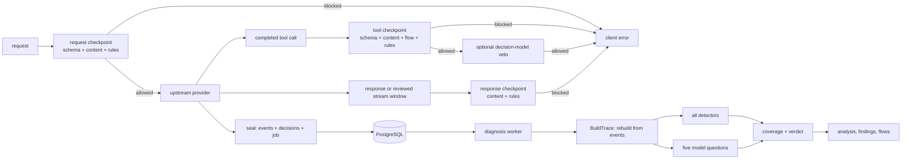

# Analysis

The analysis layer has two halves. The gateway runs a deterministic pass at admission and before releasing a tool call or a response; the asynchronous worker diagnoses the finished main call. Both read the same observation model and the same detectors. Diagnosis is the only half that asks the five trajectory questions; the online half may ask the decision model one authorization question.

## Call classification

`internal/classify` is the only vocabulary for why a request exists. The gateway writes it, the console filters by it and the metric queries count by it.

| Axis | Values | Meaning |
| --- | --- | --- |
| operation | `generation`, `count_tokens`, `models`, `model`, `responses_retrieve`, `responses_input_items`, `responses_cancel`, `responses_delete`, `embeddings`, `moderations` | the endpoint family the request addressed |
| purpose | `chat`, `subagent`, `compaction`, `title`, `memory`, `count_tokens`, `model_list`, `embedding`, `moderation`, `unknown` | why a generation request was issued |
| purpose source | `declared`, `heuristic`, `default` | how the purpose was established |
| lane | `main`, `side`, `auxiliary` | the role of the call in a conversation |
| outcome | `ok`, `blocked`, `rejected`, `client_error`, `upstream_error`, `unsupported`, `not_found`, `rate_limited`, `cancelled` | the terminal reason |

The classifier reads declared headers first: `X-Openai-Subagent`, `X-Claude-Code-Agent-Id`, `X-Deepseek-Harness-Compact`, `X-Openai-Memgen-Request` and the `thread_source` field of `X-Codex-Turn-Metadata`. The only inferred purpose is `title`, recognized by no tools, an output budget of at most 512 tokens and a title-style instruction in the leading prompt. Anything else is `chat` with source `default`. A misclassification can only move a generation call into a background lane; it cannot move an auxiliary call into the main lane.

An auxiliary operation is always lane `auxiliary`, with a purpose derived from the operation. A generation call is lane `side` for subagent, compaction, title and memory purposes, and lane `main` otherwise.

| Lane | Conversation | Diagnosis | Traffic request/failure counts | Call list |
| --- | --- | --- | --- | --- |
| `main` | writes it | written | counted | shown by default |
| `side` | writes it, inherits the session | not written | not counted; cost is counted | shown with a lane badge |
| `auxiliary` | never writes one; `session_id` stays empty | skipped | not counted | hidden unless requested |

`client_error`, `upstream_error`, `rate_limited` and `rejected` are failures: the call ended without an answer. `rejected` covers an upstream that refused a request it understood and a response that exceeded a delivery bound. A policy block, a deliberate protocol refusal (`unsupported`, `not_found`) and a cancellation are completed or cancelled calls, not gateway failures. `settlementFor` is the single mapping from a protocol error to a call's terminal state and outcome.

Routing follows the same lane rule: the explicit `X-SafeAgent-Model` header wins, then the exact route name or an alias; only side and auxiliary calls may fall back to the project's `default_route_id`, and a fallback is recorded as `resolution=fallback`. A main call whose model is not configured fails with `model_not_found`. [Providers](providers.md) owns the graph these names resolve against.

## Detectors

Three detectors live in `internal/analysis/builtin` and register themselves at init.

| Detector | Scope | Codes |
| --- | --- | --- |
| `schema` | tool structure and JSON Schema | `invalid_tool_arguments`, `missing_required_argument`, `argument_type_mismatch`, `argument_constraint_violation`, `undeclared_tool`, `tool_choice_violation`, `unmatched_tool_result` |
| `content` | prose and tool values, split by origin | `prompt_injection`, `hidden_instructions`, `dangerous_command`, `sensitive_path`, `private_network_target`, `credential_exposure`, `exfiltration_link` |
| `flow` | relations inside one call | `untrusted_value_reuse`, `external_instruction_followed`, `secret_flow` |

`analysis_incomplete` is emitted by the engine or by a detector that cannot finish. It is not a risk claim and carries no axes; unless a high-severity finding is already present, it makes the verdict `unknown`, never `safe`.

The content detector splits by role. Injection phrases, hidden Unicode and exfiltration links are searched in system, developer, user, tool-description and tool-result text. Assistant prose is checked for hidden Unicode only; it is not scored for injection or links. Dangerous commands, sensitive paths, private addresses and credentials are searched only where they can act: tool arguments and tool output. Ordinary prose that mentions `curl … | sh` is not treated as an executed command. Tool descriptions come from the call's stored request, so a continuation is analysed with the same declarations the online gate saw.

The schema checker enforces required fields, JSON types, enum/const, numeric bounds, string length and pattern, array and object bounds, and `additionalProperties`/`items: false`. `anyOf` and `oneOf` are evaluated on a quiet probe: a branch matches only when it produced no violation and did not stop on an unsupported keyword. `$ref` and other unsupported keywords produce an `analysis_incomplete` finding, not a pass. Trailing JSON is rejected.

Detector failures (panic, timeout, unknown code, invalid origin) become coverage errors and an `analysis_incomplete` finding. They never disappear.

## Engine

`Engine.Evaluate` runs the requested detectors, each with a five-second timeout, and normalizes the findings by fingerprint. A misspelled id in `Options.Only` is itself a coverage error, so a caller cannot accidentally run nothing and call it complete. A trace over 20,000 items is a coverage error. The per-analysis cap is 500 findings; exceeding it adds `findings_truncated` to the coverage errors.

The engine returns a `Coverage` beside the findings:

| Field       | Meaning                                                                        |
| ----------- | ------------------------------------------------------------------------------ |
| `Evaluated` | detectors that completed                                                       |
| `Skipped`   | detectors that did not run, with the reason                                    |
| `Errors`    | coverage errors such as an unknown detector id, a timeout or a truncated trace |
| `Complete`  | true only when no coverage error was recorded                                  |

A safe verdict requires complete coverage.

The asynchronous path adds `history_truncated` to the coverage errors when an ancestor request is missing, the chain exceeds 200 calls, the decoded history exceeds 32 MiB, or reading the chain fails. That keeps a partially reconstructed conversation from producing a complete-looking `safe`.

## Verdict

| Result | Condition |
| --- | --- |
| `unsafe` | a high-severity finding, or complete coverage and a decision model answer with `P(unsafe) ≥ 0.7` and confidence `≥ 0.6` when the provider reported confidence, or `P(unsafe) ≥ 0.7` when it did not |
| `unknown` | incomplete coverage, only medium findings, an `analysis_incomplete` finding, a model probability `≥ 0.3` that did not qualify as unsafe, a failed model call or an exhausted budget |
| `safe` | complete coverage, no medium/high finding, and the model did not answer unsafe |

A medium-only analysis is deliberately `unknown`: the deterministic rules saw something worth a human look but could not establish the outcome. A high model probability with low confidence is also `unknown`, not `safe`.

## Online checkpoints

The gateway has four checkpoints. [Policy](policy.md) owns their conditions and failure semantics; this section records what the analysis pass contributes.

1. **Request**: after decode and redaction, run `schema` + `content`, then the `request` phase.
2. **Tool call**: when the model emits a complete tool call, run `schema` + `content` + `flow`, then the `tool_call` phase, then optionally the decision-model veto.
3. **Tool result**: when the request adds one or more tool results, run `content` over the trace and the `tool_result` phase. The new results are supplied to CEL. A block rejects the request before routing or quota reservation.
4. **Response**: for a non-streaming client response, and for a reviewed leading stream window, run `content` and the `response` phase before the body or the first byte is written. The `response` CEL object carries status, finish, shown text and counts. A block seals the call as blocked, charges the reported usage and returns a protocol-shaped error.

The stream review window is per project (`stream_review_bytes`, `stream_review_timeout_ms`): zero bytes disables it. The window is reviewed when it fills, when the next frame arrives after the timeout, or when a short stream ends. After it commits, later text is not checked online.

Only online decisions are stored; no online analysis row exists. A rule or detector error blocks only when the project has a blocking rule for that phase; otherwise the gateway records a `guard_unavailable` decision and continues. The decision model can only add a block; its failure never blocks.

## Diagnosis

`service/diagnosis.Service.AnalyzeCall` reads the call, calls `BuildTrace`, hashes the rebuilt trace and runs every detector plus the optional decision model. `BuildTrace` is the single rebuild primitive; the call detail and the trajectory projection call the same function.

`BuildTrace` decodes the request and response events, uses the call's immutable redaction snapshot when one exists, builds the call's own trace, and expands the ancestor chain with `adapter.History`. The returned `Rebuild` holds:

| Field       | Meaning                                          |
| ----------- | ------------------------------------------------ |
| `Trace`     | the call plus its bounded ancestor history       |
| `Own`       | only the items this call stored                  |
| `Request`   | the call's decoded request event                 |
| `Response`  | the stored response event, when the call has one |
| `Origins`   | one locator per leading expanded-history item    |
| `Hits`      | this call's relocated redaction hits             |
| `Truncated` | true when history expansion stopped early        |

History expansion stops at 200 ancestors, the 32 MiB decoded-payload budget, or a pruned/missing link; any stop sets `history_truncated`. A missing request event, or a completed main exchange without a response event, makes the rebuild fail and is stored as a `failed` analysis instead of an absent row.

Every request event stores the tool declarations the call used, so a continuation's analysis sees the same tools as the online gate even though the messages it added are only a tail.

The analysis identity is `(call_id, input_hash, detector_version, decision_model)`. `InputHash` covers only judgement-relevant content: task, principal, turns (including origin and trust), tool declarations, context, outcome and the previous call id. It excludes timestamps, the current call and analysis ids, locators and write order, so a rebuilt call hashes the same. Retrying a job returns the existing analysis with its findings loaded, without duplicating it.

A detector pass that could not finish writes a `completed` analysis with coverage errors and an `analysis_incomplete` finding; without a high-severity finding, the verdict is `unknown`. A policy save never appears in the analysis versions: the versions are the adapter, detector set, catalogue, taxonomy and decision model name.

### Re-analysis and batches

`POST /console/api/projects/{project_id}/calls/{call_id}/analyses` runs diagnosis again. A new detector set or decision model creates a new row; the unique identity keeps retries idempotent. `Diff` aligns two analyses by fingerprint and refuses to compare different inputs, adapter, detector, catalogue or taxonomy versions.

An `analysis_batches` row groups a bounded set of calls and records progress; it never merges their findings into one synthetic call. The batch and its jobs are written in one transaction, the scope is capped by call count and event bytes, and running calls are excluded. Re-analysis and batch creation share a per-user console limit of 30 requests per minute and return `429 rate_limited` beyond it.

## Trajectory

`service/console.TrajectoryService` projects one conversation from stored calls, audit events, findings and redaction hits. It reads at most 200 conversational calls and 32 MiB of decoded request/response payload, excludes auxiliary calls, and caches the projection in process keyed by the session, call count, newest call update and highest event sequence. The redaction index shares the same loader and cache. Exceeding a budget sets `Truncated` and a warning instead of silently dropping history.

The projection has one node and edge vocabulary, so every view built from it shares identities:

| Node kinds | Edge kinds |
| --- | --- |
| `session`, `call`, `turn`, `request`, `response`, `tool_call`, `tool_result`, `attempt`, `decision`, `finding`, `redaction` | `contains`, `continues`, `produces`, `consumes`, `blocks`, `flows`, `retried` |

Node ids are stable and derived: `call:<id>`, `turn:<call>:<index>`, `item:<call>:<section>:<ordinal>`, `tool:<call>:<tool_call_id>`, `tool-result:<call>:<tool_call_id>`, `attempt:<call>:<index>`, `decision:<id>`, `finding:<id>`, `redaction:<value_id>`. A continuation edge is marked `inferred` when the recorded parent is outside the retained window. `Steps` are the call's audit timeline entries, each carrying the node ids that step touched.

The transport serves it at `/console/api/projects/{project_id}/conversations/{session_id}/trajectory`; the redaction index is at `/console/api/projects/{project_id}/conversations/{session_id}/redactions`. Both are read-only.

## Decision model

`internal/analysis/decision` defines the only model boundary. A client is one method, `Ask`, which receives the state and the questions and returns the answers, the usage and an error. The state contains the call id, the task, the principal, the declared tools, the turns and a separate `Untrusted` list for tool output. The redacted view is used by default; the administrator may choose the raw view. Tool parameters and targets use their shown counterparts when redaction changed them. The authorization question is asked with a state that excludes tool output, earlier tool calls and the model's own text, so injected content cannot vote on its own release.

The fixed questions are `unsafe` (a Noul question that returns a probability), `source`, `mode`, `harm` (a choice over the full taxonomy plus `none`) and `severity` (a score). Tool authorization asks one boolean Noul question. A required answer needs either a calibrated Noul value or a probability with confidence; choice and score answers may omit confidence, and a missing number is never read as zero. A Noul answer carries only a probability, so the adapter records `confidence_known = false` and the verdict's confidence gate applies only when the provider reported one. A TypeSafe score answer is a level index; the adapter normalizes it with the returned legend before the severity thresholds are applied.

Two adapters are implemented:

- `typesafe` posts a System One request to the configured endpoint (the default is `https://api.typesafe.ai/v1/systemone`). The request is `{model, state, questions}`, with `questions` keyed by question id and each entry carrying `instructions` plus `criteria` for choice and score. The response is `{model, answers, usage}`. The model name is pinned in the project configuration.
- `openai` posts a chat completion to any compatible endpoint and requires the same JSON answer in the assistant message.

Endpoints must be HTTP(S) without credentials. Private, loopback, link-local, multicast, carrier-NAT and unspecified destinations are rejected unless the administrator enables `allow_private`. The dialer resolves at connection time, refuses private answers and connects to the checked address, so a changed DNS answer cannot redirect the call.

The API key is sealed with AES-256-GCM under the instance key and is never returned by the API. A daily token budget is reserved before the call and settled from the reported usage; an exhausted budget produces `budget_exhausted` and an `unknown` verdict. A configured but unreadable key is a model failure, not a silent "disabled".

The model's answers are stored as `ModelLabels`. The deterministic axes and the model labels are displayed side by side.

## Failure matrix

Unless a high-severity finding is present, an incomplete pass yields `unknown`.

| Failure | Online | Diagnosis |
| --- | --- | --- |
| redaction rules do not compile | 500 `rules_unavailable` | analysis failed |
| unredactable value or blocking redaction rule | 422/403, call sealed | decision and terminal event record it; no finding is synthesized |
| detector timeout/panic with a block rule in the phase | block `guard_unavailable` | `analysis_incomplete`, unknown |
| detector timeout/panic with only record rules | record `guard_unavailable`, continue | `analysis_incomplete`, unknown |
| CEL compile/eval error | fail-closed by phase, as above | not applied |
| trace rebuild failure | not used | failed analysis |
| history truncated | not used | `history_truncated`, unknown |
| decision model timeout/error | record `decision_model_unavailable`, continue | failed model state, unknown |
| decision model budget exhausted | record `decision_model_unavailable`, continue | `budget_exhausted`, unknown |
| tool hold byte limit reached | 413 `tool_call_too_large`, no failover | not used |
| seal failure | `audit_failed`; the call is marked failed | not applicable; a call without a sealed chain is not diagnosed |

## Related

- [Model](model.md)
- [Policy](policy.md)
- [Providers](providers.md)
- [Storage](storage.md)
