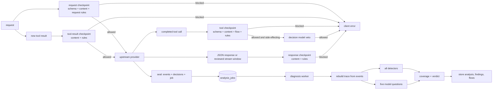

# Analysis

The analysis layer has two halves. The gateway runs a deterministic pass before forwarding a request, before releasing a tool call, before accepting a request's tool results and before writing a response: in full for a non-streaming response, or over the reviewed leading window of a streaming response. The asynchronous worker diagnoses the finished call. Both use the same detectors and the same observation model. Only the asynchronous half runs the five-question diagnosis; the online half may ask the decision model one authorization question.



## Detectors

Three detectors live in `internal/analysis/builtin` and register themselves at init.

| Detector | Scope | Codes |
| --- | --- | --- |
| `schema` | tool structure and JSON Schema | `invalid_tool_arguments`, `missing_required_argument`, `argument_type_mismatch`, `argument_constraint_violation`, `undeclared_tool`, `tool_choice_violation`, `unmatched_tool_result` |
| `content` | prose and tool values, split by origin | `prompt_injection`, `hidden_instructions`, `dangerous_command`, `sensitive_path`, `private_network_target`, `credential_exposure`, `exfiltration_link` |
| `flow` | relations inside one call | `untrusted_value_reuse`, `external_instruction_followed`, `secret_flow` |

`analysis_incomplete` is emitted by the engine or by a detector that cannot finish. It is not a risk claim and carries no axes; unless a high-severity finding is already present, it makes the verdict `unknown`, never `safe`.

The content detector splits by role. Injection phrases, hidden Unicode and exfiltration links are searched in system, developer, user, tool-description and tool-result text. Assistant prose is checked for hidden Unicode only; it is not scored for injection or links. Dangerous commands, sensitive paths, private addresses and credentials are searched only where they can act: tool arguments and tool output. Ordinary prose that mentions `curl … | sh` is not treated as an executed command.

The schema checker enforces required fields, JSON types, enum/const, numeric bounds, string length and pattern, array and object bounds, and `additionalProperties`/`items: false`. `anyOf` and `oneOf` are evaluated on a quiet probe: a branch matches only when it produced no violation and did not stop on an unsupported keyword. `$ref` and other unsupported keywords produce an `analysis_incomplete` finding, not a pass. Trailing JSON is rejected.

Detector failures (panic, timeout, unknown code, invalid origin) become coverage errors and an `analysis_incomplete` finding. They never disappear.

## Engine

`Engine.Evaluate` runs the requested detectors, each with a five-second timeout, and normalizes the findings by fingerprint. A misspelled id in `Options.Only` is itself a coverage error, so a caller cannot accidentally run nothing and call it complete. The per-analysis cap is 500 findings; exceeding it adds `findings_truncated` to the coverage errors.

```go
type Coverage struct {
    Evaluated []string
    Skipped   []string
    Errors    []string
    Complete  bool
}
```

`Complete` is false when any error was recorded. A safe verdict requires complete coverage.

The asynchronous path adds `history_truncated` to the coverage errors when an ancestor request is missing, the chain exceeds 200 calls, or reading the chain fails. That keeps a partially reconstructed conversation from producing a complete-looking `safe`.

## Verdict

| Result | Condition |
| --- | --- |
| `unsafe` | a high-severity finding, or complete coverage and a decision model answer with `P(unsafe) ≥ 0.7` and confidence `≥ 0.6` when the provider reported confidence, or `P(unsafe) ≥ 0.7` when it did not |
| `unknown` | incomplete coverage, only medium findings, an `analysis_incomplete` finding, a model probability `≥ 0.3` that did not qualify as unsafe, a failed model call or an exhausted budget |
| `safe` | complete coverage, no medium/high finding, and the model did not answer unsafe |

A medium-only analysis is deliberately `unknown`: the deterministic rules saw something worth a human look but could not establish the outcome. A high model probability with low confidence is also `unknown`, not `safe`.

## Online path

The gateway has four checkpoints.

1. **Request**: decode, redact, build the trace and run `schema` + `content`, then evaluate rules of phase `request`.
2. **Tool call**: add the assistant tool call to the trace and run `schema` + `content` + `flow`, then evaluate rules of phase `tool_call`, then optionally ask the decision model to veto.
3. **Tool result**: when the request adds one or more tool results, run `content` over the trace and evaluate phase `tool_result`. The `results` CEL list carries the redacted text of each new result. A block rejects the request before routing or quota reservation.
4. **Response**: for a non-streaming client response, after the tool gate and before writing, run `content` over the request plus response and evaluate phase `response`. The `response` CEL object carries status, finish, shown text and counts. A block seals the call as blocked, charges the reported usage, and returns a protocol-shaped error.

**Stream review** (optional): when a project sets `stream_review_bytes` above zero, the gateway buffers the leading streaming text until the window fills, until the next frame arrives after `stream_review_timeout_ms`, or until a short stream ends. It then runs `content` and phase `response` before committing the response. The preview's `response.status` is `in_progress`, `response.finish` is empty, and the text is the shown view. A block prevents the first byte, records the preview as a blocked response, and returns a protocol-shaped error. After the window commits, later text is not checked online.

Only online decisions are stored. No online analysis row exists. A rule error blocks only when the project has a blocking rule for that phase; a project that only records keeps going and stores a `guard_unavailable` decision. The decision model can only add a block; its failure never blocks.

Streaming text after the review window is not checked online. Once a token has reached the client it cannot be recalled. The asynchronous pass stores the response and flags concealed Unicode in it; injection phrases and exfiltration links are searched only outside assistant prose.

## Asynchronous analysis

`service/diagnosis.Service.AnalyzeCall` rebuilds the trace from events, resolves the principal from the agent key, expands the ancestor conversation with `observe.History`, runs every detector and, when configured, the decision model.

Every request event stores the tool declarations it used. A continuation's analysis therefore sees the same tools as the online gate, even though the messages it added are only a tail. The schema, tool-description and decision-model tool catalogue checks are not skipped.

The identity is `(call_id, input_hash, detector_version, decision_model)`. `InputHash` covers only judgement-relevant content: task, principal, turns (including origin and trust), tool declarations, context, outcome and the previous call id. It excludes timestamps, the current call and analysis ids, locators and write order, so a rebuilt call hashes the same. Retrying a job returns the existing analysis with its findings loaded, without duplicating it.

Failures are stored: a missing request event, a completed call without its response event, or a trace that cannot otherwise be rebuilt writes a `failed` analysis with an `unknown` verdict and the error text. A pruned or missing ancestor marks the history as truncated and adds a coverage error; it cannot produce a complete-looking `safe` result. A detector pass that could not finish writes a `completed` analysis with coverage errors and an `analysis_incomplete` finding; without a high-severity finding, the verdict is `unknown`.

A new save of the policy does not appear in the analysis versions: analysis is diagnosis, and policy is enforcement. The versions recorded are the adapter, detector set, catalogue, taxonomy and decision model name.

### Re-analysis

`POST /console/api/projects/{project_id}/calls/{call_id}/analyses` runs the diagnosis again. A new detector set or decision model creates a new row; the unique identity keeps retries idempotent. `Diff` aligns two analyses by fingerprint and refuses to compare different inputs or detector/catalogue versions.

A batch (`analysis_batches`) groups a bounded set of calls and records progress; it never merges their findings into one synthetic call. The batch and its jobs are written in one transaction, the scope is capped by call count and event bytes, and running calls are excluded. Re-analysis and batch creation share a per-user console limit of 30 requests per minute and return `429 rate_limited` beyond it.

## Decision model

`internal/analysis/decision` defines the only model boundary:

```go
type Client interface {
    Ask(ctx, state State, questions []Question) (Answers, Usage, error)
}
```

The state contains the task, principal, declared tools, turns and a separate `Untrusted` list for tool output. The redacted view is used by default; the administrator may choose the raw view. Tool parameters and targets use their shown counterparts when redaction changed them. The authorization question is asked with a state that excludes tool output, earlier tool calls and the model's own text, so injected content cannot vote on its own release.

The fixed questions are `unsafe` (a Noul question that returns a probability), `source`, `mode`, `harm` (a choice over the full taxonomy plus `none`) and `severity` (a score). Tool authorization asks one boolean Noul question. A required answer needs either a calibrated Noul value or a probability with confidence; choice and score answers may omit confidence, and a missing number is never read as zero. A Noul answer carries only a probability, so the adapter records `confidence_known = false` and the verdict's confidence gate applies only when the provider reported one. A TypeSafe score answer is a level index; the adapter normalizes it with the returned legend before the severity thresholds are applied.

Two adapters are implemented:

- `typesafe` posts a System One request to the configured endpoint (the default is `https://api.typesafe.ai/v1/systemone`). The request is `{model, state, questions}`, with `questions` keyed by question id and each entry carrying `instructions` plus `criteria` for choice and score. The response is `{model, answers, usage}`. The model name is pinned in the project configuration.
- `openai` posts a chat completion to any compatible endpoint and requires the same JSON answer in the assistant message.

The TypeSafe envelope follows the provider's System One contract. The OpenAI adapter uses the strict JSON envelope described above. Both adapters are tested against fake servers, so a provider's wire change stays inside `internal/analysis/decision/client.go`.

Endpoints must be HTTP(S) without credentials. Private, loopback, link-local, multicast, carrier-NAT and unspecified destinations are rejected unless the administrator enables `allow_private`. The dialer resolves at connection time, refuses private answers and connects to the checked address, so a changed DNS answer cannot redirect the call.

The API key is sealed with AES-256-GCM under the instance key and is never returned by the API. A daily token budget is reserved before the call and settled from the reported usage; an exhausted budget produces `budget_exhausted` and an `unknown` verdict. A configured but unreadable key is a model failure, not a silent "disabled".

The model's answers are stored as `ModelLabels`. The deterministic axes and the model labels are displayed side by side.

## Failure matrix

Unless a high-severity finding is present, an incomplete pass yields `unknown`.

| Failure | Online | Asynchronous |
| --- | --- | --- |
| redaction rules do not compile | 500 `rules_unavailable` | analysis failed |
| unredactable value or blocking redaction rule | 422/403, call sealed | decision and terminal event record it; no finding is synthesized |
| detector timeout/panic with a block rule in the phase | block `guard_unavailable` | `analysis_incomplete`, unknown |
| detector timeout/panic with only record rules | record `guard_unavailable`, continue | `analysis_incomplete`, unknown |
| CEL compile/eval error | fail-closed by phase, as above | not applied |
| trace rebuild failure | not used | failed analysis |
| history truncated | not used | `history_truncated`, unknown |
| decision model timeout/error | record `decision_model_unavailable`, continue | `failed`, unknown |
| decision model budget exhausted | record `decision_model_unavailable`, continue | `budget_exhausted`, unknown |
| tool hold byte limit reached | 413 `tool_call_too_large`, no failover | not used |
| seal failure | `audit_failed`; call marked failed | repair may enqueue on the next start |

The optional stream review uses the same response checkpoint and failure rules. A review block is recorded as a blocked response, but no body byte is written.

## Related

- [Model](model.md)
- [Policy](policy.md)
- [Papers](papers.md)
