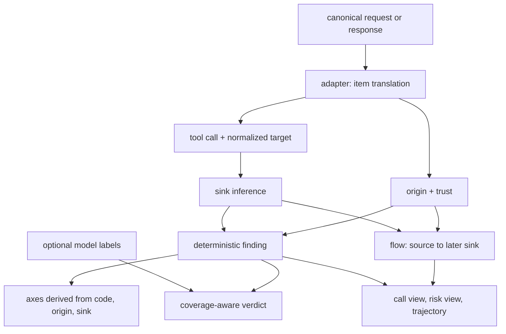

# Model

`internal/observation` is the protocol-neutral model of one call. Nothing in it knows a wire format. `internal/observation/adapter` is the only adapter between the canonical request/response and this model; the online gateway and the replay path both build traces through it, so an online verdict and a stored finding describe the same nodes.

## Trace

A trace is one call as the detectors and the policy see it:

| Field | Meaning |
| --- | --- |
| `ID` | trace identity; online it is the call id |
| `Task` and `TaskShown` | the leading instruction text and its shown representation |
| `Turns` | the ordered turns of items |
| `Tools` | the declared tool specs |
| `Steps` | the ordered tool chain rebuilt from the turns by `Trace.RebuildSteps` |
| `Outcome` | terminal state, error code and finish reason |
| `Context` | request metadata detectors may need, such as `tool_choice`, `parallel_tool_calls` and `history_truncated`; part of the input hash |
| `Principal` | the authenticated project, agent key, role and trust level |
| `PreviousCallID` | the client's `previous_response_id` or the linked parent |

A `Turn` has a role and ordered `Item`s. An `Item` is text, reasoning, refusal, tool call, tool result, media or a native provider object; a tool result carries nested items.

`PreviousCallID` lets the schema detector avoid reporting a tool result as unmatched when the call is a continuation. `Context` is displayable and hashed, but it is never a policy principal: only the authenticated values enter `Principal`.

A `Trace` built for a diagnosis contains the call's own items plus the leading ancestor history within its bounded budget; `Rebuild.Own` in `internal/service/diagnosis` keeps only the items the call stored. See [Analysis](analysis.md) for the rebuild contract.

## Origin, trust and sink

Every item records where its content entered:

| Origin                | Meaning                                    |
| --------------------- | ------------------------------------------ |
| `system`, `developer` | instructions supplied with the request     |
| `user`                | the task text                              |
| `assistant`           | the model's own text and tool calls        |
| `tool_result`         | output returned by a tool                  |
| `tool_description`    | a declared tool's description              |
| `environment`         | a coverage or analysis note, not a message |

`Trust` is `trusted`, `untrusted` or `unknown`. Tool results and tool descriptions are untrusted: they are data even when their text looks like an instruction.

Every tool call records a `Sink`, inferred from the tool name, its arguments and the normalized target:

| Sink | Inferred from |
| --- | --- |
| `external_send` | a URL or host target, or a send/upload/post style name outside a file or command target |
| `shell_exec` | a command target, or a shell/exec style name |
| `file_write` | a file target on a write/save/delete style tool |
| `file_read` | a file target on any other tool |
| `credential_access` | a secret/credential/token style name |
| `payment` | a pay/transfer/refund style name |
| `none` | no arguments and no recognized capability |
| `unknown` | arguments exist but no destination can be identified |

Name matching is token based: `truncate` is not read as `run`. The inference is a heuristic, not a guarantee. A policy that needs a strong claim matches findings instead of relying on the sink alone.

`ToolCall.Target`, `ToolCall.Input` and `ToolSpec.Parameters` hold the raw values. Their `Shown` counterparts (`TargetShown`, `InputShown`, `ParametersShown`) are filled when redaction changed the value; a tool description also carries its redaction spans. Consumers that may expose data to a project member, a policy rule or a third-party model use the shown value. The adapter normalizes a destination in `TargetOf` and its siblings: a URL keeps its host and a cleaned path, with the query dropped, so a random nonce cannot create a new graph node.

## Item identity

`observation.Locator` is the stable identity of one item, part or reference:

| Field     | Meaning                                                                    |
| --------- | -------------------------------------------------------------------------- |
| `CallID`  | the call that stored the item; an ancestor item keeps the ancestor call id |
| `Section` | `request`, `response`, `instructions`, `params` or `tools`                 |
| `Ordinal` | stored item ordinal inside the section                                     |
| `Path`    | nested part, for example `tool_call.arguments`                             |
| `ToolID`  | logical tool call id when the item belongs to one                          |

An ancestor item keeps the ancestor call id, so a finding, a redaction hit and a trajectory node can name the same item even when the trace was expanded with history. The online path writes the call id and ordinal; the replay path reads the stored values, which is why both produce the same identity. `SectionInstructions` names the instruction item prepended to the turns; `SectionParams` and `SectionTools` name request parameters and tool declarations, which are stored outside the turn list.

## Shown values and value identity

`observation.Value` carries both representations of one text:

| Field             | Meaning                                                         |
| ----------------- | --------------------------------------------------------------- |
| `Raw`             | the text as the client or upstream exchanged it                 |
| `Shown`           | the redacted text a project member may see                      |
| `Redactions`      | `Span`s over `Raw`: start, end, label, value id and secret flag |
| `ShownRedactions` | the same occurrences over `Shown`                               |

A shown span carries `Start`, `End`, `Label`, `Action` and `ValueID`. `ValueID` is the identity of a masked value: an HMAC over the instance secret, the project namespace, the rule label and the matched text. It is stable for the whole project, so the same value keeps the same id in every call and the console can deduplicate occurrences without reading the rules again. The id is also the digest used by the placeholder (`[LABEL_xxxxxxxx]`, longer on a short-digest collision); the raw value is never needed to rebuild the view. The online redactor and the replay path derive a placeholder the same way, so applying the stored hits to a stored payload reproduces the shown view the call actually saw.

Redaction hits are relocated onto the items a call stores: a hit on a request item keeps that item's section, ordinal and path, and a hit on an ancestor item is dropped because the ancestor recorded it when it was admitted. A call therefore reports only the values it introduced, and `calls.redaction_values` is the number of distinct value ids in that call. The conversation-level redaction index groups stored hits by value id; it is a projection over the same per-call records, not an accumulated list.

## Finding

A deterministic finding has these fields:

| Field | Meaning |
| --- | --- |
| `Fingerprint` | hash of detector, code, origin, sink, semantic location (including the locator path) and match ordinal |
| `Code` | catalogue code such as `prompt_injection` |
| `Origin`, `Trust`, `Sink` | the source, trust and destination axes the code applies to |
| `Axes` | the three-axis labels: risk source, failure mode and harm |
| `Severity` | `low`, `medium` or `high` |
| `Confidence` | how strongly the detector asserts the code |
| `Detector` | detector id and version |
| `Evidence` | the byte ranges and display-safe quotes supporting the finding |
| `Attribution` | turn, item, tool call and locator the finding is attributed to |
| `Flow` | the source-to-sink edge when the finding is backed by one |

The fingerprint does not depend on a byte offset, a timestamp or an analysis id, so re-analysing the same call keeps the same identities and two items with the same code do not collapse into one finding. Evidence and attribution carry the `Locator` of the item they point at; `Turn` and `Item` remain for detector logic and for rows written before identity existed.

An `Evidence` entry records the view it indexes (`raw` or `redacted`), its byte range, and a quote that is always safe to display: a match overlapping a redacted span is stored as `[redacted]`. Nested tool arguments carry their shown text separately, so evidence never quotes a value that the call view hides.

## Flow

A flow is one edge from external content to a tool call that can act on it, computed inside one call:

| Field | Meaning |
| --- | --- |
| `SourceTurn`, `SourceItem` | the position the detector matched |
| `SourceLocator` | the stored identity of the source item, resolved by diagnosis before persisting |
| `SourceOrigin`, `SourcePath` | where the content entered and its path inside the item |
| `SinkToolCallID` | the tool call that can act on the content |
| `Sink` | the destination class of that tool call |
| `Relation` | `value_reuse` or `instruction_follow` |
| `ContentHash` | hash of the matched source excerpt; the excerpt itself is not stored |
| `Confidence` | the detector's confidence in the edge |

The detector looks back over tool output and tool descriptions, extracts specific identifiers (URLs, paths, e-mail addresses, hostnames and mixed letter/digit tokens of at least eight bytes) and compares them with the arguments of each later side-effecting tool call. A shared specific token produces `value_reuse`; a token taken from the sentence that carries an injected instruction produces `instruction_follow`.

Co-occurrence alone does not create a relation. The comparison count is capped at 5,000 pairs and the relation scan stops at 200 findings. Either cap adds an `analysis_incomplete` finding; the detector does not report an empty relation set as complete.

## Axes

The full AgentDoG taxonomy is kept: eight risk sources, fourteen failure modes and ten harms. The deterministic mapping is narrower than the taxonomy:

- `prompt_injection` and `hidden_instructions` derive the risk source from their origin;
- `untrusted_value_reuse` and `external_instruction_followed` derive it from their origin and take the harm from the sink;
- every other code has a fixed mechanism and harm, and an inherent-agent risk source.

An axis that cannot be justified is left empty. `analysis_incomplete` carries no axes: it is a coverage statement, not a risk claim. The decision model separately labels the whole trajectory; its answers are stored beside the findings and never overwrite them.

## Principal

`Principal` contains only values the gateway knows after authentication:

| Field        | Meaning                              |
| ------------ | ------------------------------------ |
| `ProjectID`  | the project the agent key belongs to |
| `AgentKeyID` | the authenticated agent key          |
| `Role`       | the key's role                       |
| `TrustLevel` | the key's trust level                |

Client-supplied metadata is not copied into the principal. It is available in `Trace.Context` for display and hashing. The policy CEL environment exposes the principal, tool, target, tool chain, findings and phase; it has no `metadata` or `context` variable, so a rule cannot be satisfied by a value the client writes.

## Related

- [Analysis](analysis.md)
- [Policy](policy.md)
- [Storage](storage.md)
- [Agent guide](README.md)
