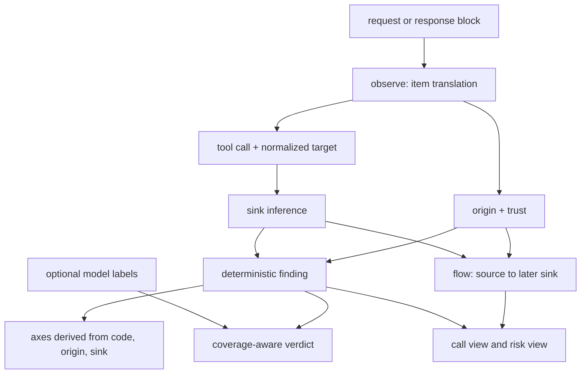

# Model

`internal/observation` is the protocol-neutral model of one call. Nothing in it knows a wire format. `internal/observe` is the only adapter between the four protocols and this model.



## Trace

```go
type Trace struct {
    ID             string
    Task           string
    TaskShown      string
    Turns          []Turn
    Tools          []ToolSpec
    Steps          []ToolStep
    Outcome        Outcome
    Context        map[string]any
    Principal      Principal
    PreviousCallID string
}
```

A `Turn` has a role and ordered `Item`s. An `Item` carries one of text, reasoning, refusal, tool call, tool result, media or a native provider block. `ToolResult.Content` contains nested items. `Steps` is the ordered tool chain, rebuilt from the turns by `Trace.RebuildSteps`.

`PreviousCallID` is the client's `previous_response_id` or the linked parent. The schema detector uses it to avoid reporting a tool result as unmatched when the call is a continuation.

`Context` holds request metadata that detectors may need, such as `tool_choice`, `parallel_tool_calls` and `history_truncated`. It is part of the input hash.

## Origin, trust and sink

Every item records where its content came from:

| Origin                | Meaning                                        |
| --------------------- | ---------------------------------------------- |
| `system`, `developer` | instructions supplied with the request         |
| `user`                | the task text                                  |
| `assistant`           | the model's own text and tool calls            |
| `tool_result`         | output returned by a tool                      |
| `tool_description`    | a declared tool's description                  |
| `environment`         | a problem found while analyzing, not a message |

`Trust` is `trusted`, `untrusted` or `unknown`. Tool results and tool descriptions are always untrusted: they are data, even when their text looks like an instruction.

Every tool call records a `Sink`, inferred only from the tool name, its arguments and the normalized target:

| Sink | Inferred from |
| --- | --- |
| `external_send` | a URL or host target, or a send/upload/post style name outside a file or command target |
| `shell_exec` | a command target, or a shell/exec style name |
| `file_write` | a file target on a write/save/delete style tool |
| `file_read` | a file target on any other tool |
| `credential_access` | a secret/credential/token style name |
| `payment` | a pay/transfer/refund style name |
| `none` | no arguments and no recognized capability |
| `unknown` | arguments exist but no destination can be identified |

Name matching is token based: `truncate` is not read as `run`. The inference is still a heuristic, not a guarantee. A policy that needs a strong claim must match findings; the inferred value alone is not sufficient.

`ToolCall.Target`, `ToolCall.Input` and `ToolSpec.Parameters` hold the raw values. Their `Shown` counterparts (`TargetShown`, `InputShown`, `ParametersShown`) are filled when redaction changes the value; tool descriptions also carry the redaction spans used by evidence. `ToolStep` carries both target views for the same reason. Consumers that may expose data to a project member, a policy rule or a third-party model use the shown value.

## Finding

```go
type Finding struct {
    Fingerprint string
    Code        string
    Origin      observation.Origin
    Trust       observation.Trust
    Sink        observation.Sink
    Axes        Axes
    Severity    string
    Confidence  float64
    Detector    DetectorRef
    Evidence    []Evidence
    Attribution []Attribution
    Flow        *Flow
}
```

`Fingerprint` hashes the detector, code, origin, sink, semantic location (including the item's locator path) and match ordinal. It does not depend on a byte offset, a timestamp or an analysis id, so re-analyzing the same call keeps the same identities and two content blocks with the same code do not collapse into one finding.

`Evidence` locates the match with byte offsets in the raw value and stores a quote that is always safe to display: a match overlapping a redacted span is stored as `[redacted]`. Nested tool arguments carry their shown text separately, so evidence never quotes a value that the call view hides.

## Flow

A flow is one edge from external content to a tool call that can act on it:

```go
type Flow struct {
    SourceTurn, SourceItem int
    SourceOrigin           observation.Origin
    SourcePath             string
    SinkToolCallID         string
    Sink                   observation.Sink
    Relation               string // value_reuse | instruction_follow
    ContentHash            string
    Confidence             float64
}
```

Flows are computed inside one call. The detector looks back over tool output and tool descriptions, extracts specific identifiers (URLs, paths, e-mail addresses, hostnames and mixed letter/digit tokens of at least eight bytes) and compares them with the arguments of each later side-effecting tool call. A shared specific token produces `value_reuse`; a token taken from the sentence that carries an injected instruction produces `instruction_follow`.

Co-occurrence alone does not create a relation. The comparison count is capped at 5,000 pairs, and the relation scan stops at 200 findings. Either cap adds an `analysis_incomplete` finding; the detector does not report an empty relation set.

## Three axes

The full AgentDoG taxonomy is kept: eight risk sources, fourteen failure modes and ten harms. The deterministic mapping is narrower than the taxonomy:

- `prompt_injection` and `hidden_instructions` derive the risk source from their origin;
- `untrusted_value_reuse` and `external_instruction_followed` derive it from their origin and take the harm from the sink;
- every other code has a fixed mechanism and harm, and an inherent-agent risk source.

An axis that cannot be justified is left empty. `analysis_incomplete` carries no axes at all: it is a coverage statement, not a risk claim. The decision model separately labels the whole trajectory; its answers are stored beside the findings and never overwrite them.

## Principal

`Principal` contains only values the gateway knows after authentication:

```go
type Principal struct {
    ProjectID  string
    AgentKeyID string
    Role       string
    TrustLevel int
}
```

Client-supplied metadata is not copied into the principal. It is available in `Trace.Context` for display and hashing, but a policy condition that trusts `metadata.user_id` would be trusting the client.

## Related

- [Analysis](analysis.md)
- [Policy](policy.md)
- [Agent guide](README.md)
