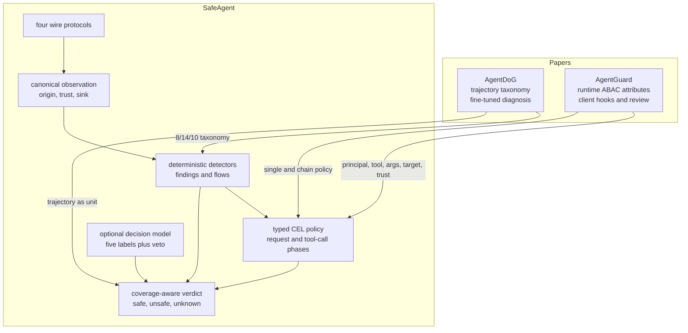

# Papers and design lineage

Two papers shape the analysis model. This page separates what each paper reports, what its reference repository implements, and what SafeAgent actually adopts. It also states the limits of the comparison: this repository has not reproduced either paper's benchmark, and none of the design claims below is a claim of research novelty.

## AgentDoG

**Paper.** Dongrui Liu et al., _AgentDoG: A Diagnostic Guardrail Framework for AI Agent Safety and Security_, [arXiv:2601.18491v2](https://arxiv.org/abs/2601.18491), 40 pages and 26 figures. The paper defines a trajectory \(\mathcal{T}=\{t_1,\ldots,t_n\}\) of action–observation pairs and treats the whole trajectory as the unit of safety analysis. It reports a three-axis taxonomy with 8 risk sources, 14 failure modes and 10 real-world harms, an ATBench benchmark of 500 trajectories (250 safe and 250 unsafe, 8.97 turns on average), and fine-tuned guard models at 4B, 7B and 8B parameters. The reported binary ATBench accuracy is 87–93%; fine-grained failure-mode accuracy is 28.8–32.4%. The paper states that its input is text-only and leaves multimodal and GUI agents to future work.

**What the paper contributes.** The taxonomy is diagnostic: risk source answers where the influence entered, failure mode answers what the agent did, and harm answers what followed. A binary safety label is not its only output. The paper also studies step- and sentence-level attribution for identifying influential parts of a trajectory. The models are produced with supervised fine-tuning and released with the benchmark.

**Reference repository.** The `AI45Lab/AgentDoG` repository is Apache-2.0. The paper itself carries the arXiv non-exclusive distribution license. The repository and paper are separate artifacts; a derived work should check the current license at the source.

**What SafeAgent borrows.** SafeAgent keeps the 8/14/10 vocabulary and the idea that one agent call, including its tool chain, is the subject of analysis. Deterministic findings fill only the axes that their evidence can justify. The full trajectory labels are requested from an optional decision model and stored beside, not over, those findings.

**What SafeAgent does not adopt.** SafeAgent does not train or ship a guard model, does not claim AgentDoG's accuracy, and does not implement the paper's step-level attribution algorithm. Its evidence is a byte range plus a redaction-safe quote, and its relation edges connect concrete source content to a later tool call. These are different, narrower evidence mechanisms.

## AgentGuard

**Paper.** Jiaqi Luo, Songyang Peng, Jiarun Dai, Zhile Chen, Zhuoxiang Shen, Geng Hong, Xudong Pan, Yuan Zhang and Min Yang, _AgentGuard: An Attribute-Based Access Control Framework for Tool-Use LLM-Based Agent_, [arXiv:2605.28071v1](https://arxiv.org/abs/2605.28071), 3 pages, submitted 27 May 2026. The paper describes a client–server design in which a small client hook observes runtime events and the server evaluates policies over principal attributes, tool attributes, arguments, target addresses and session history. It names rule-based detection, LLM-assisted detection and manual verification as complementary mechanisms, and describes decisions to allow, deny or send a case for review. The version examined reports no quantitative benchmark.

**Reference repository.** The `WhitzardAgent/AgentGuard` repository is GPL-3.0, while the paper's availability section says MIT. The discrepancy matters for a derived work and is recorded rather than resolved here. The repository README also describes hard denials and lists integrations and plugin phases beyond the short paper; those repository claims are not attributed to the paper.

**What SafeAgent borrows.** SafeAgent uses the runtime attribute vocabulary (principal, tool, arguments, target and trust) and the idea of evaluating policy over single tool calls and tool chains. It keeps a central server-side policy view and an audit trail, and it treats the agent as a client of that control plane.

**What SafeAgent does not adopt.** SafeAgent has one typed CEL rule list; it does not provide a separate DSL or visual form builder. It has no manual review queue, no LLM-assisted rule synthesis, and no client SDK. Its gateway intercepts the wire protocols directly, so an agent does not install a language-specific hook. The design also separates online enforcement from asynchronous diagnosis; the paper describes both pre- and post-execution checks but does not prescribe this split.

## Design comparison

| Dimension | AgentDoG | AgentGuard | SafeAgent |
| --- | --- | --- | --- |
| Analysis unit | whole trajectory of action–observation pairs | runtime events, one tool or a tool chain | one call, plus a bounded ancestor conversation; online and asynchronous views |
| Classification | 8/14/10 taxonomy from fine-tuned models | attributes and policy decisions; no three-axis taxonomy | deterministic axes derived from code, origin and sink; optional full-trajectory model labels |
| Evidence | step and sentence attribution | matched rules and audit metadata | finding offsets and redaction-safe quotes; explicit source-to-sink flow edges |
| Online role | a guard model can monitor accumulated trajectories | pre-execution hooks and server decisions | request admission and completed tool-call release; only tool-call frames wait for a verdict |
| Policy | not the paper's focus | declarative DSL or forms; rule, LLM and manual mechanisms | one ordered list of typed CEL rules; save-and-activate versions; member and administrator roles |
| Model relationship | fine-tuned guard models are the detector | LLM-assisted detection is one mechanism among three | optional provider-agnostic model; its answers never overwrite deterministic findings |
| Online model power | can classify and block | server can allow, deny or escalate | model can only add a veto after deterministic rules allowed; its failure cannot release a block |
| Verdict | binary safety plus diagnostic labels | allow, deny or review | `safe`, `unsafe` or `unknown`, with coverage and model state recorded |
| Evaluation in paper | ATBench and R-Judge/ASSE comparisons | none reported in the short paper | no benchmark reproduction; unit, integration and acceptance tests cover behavior |

## What this project adds

These are system-design choices made here, not claims of a new learning algorithm.

1. **A protocol-neutral observation.** Four wire formats, including streaming and conversion losses, map onto one trace. Origin, trust and sink travel with each item, so the same detector and policy code can judge Chat Completions, Responses, Messages and Gemini traffic.
2. **Two enforcement points.** The gateway checks the request before the provider is called and checks each completed tool call before its frames are released. Text already received by the client is not claimed to be revocable; only the tool-call frames are held.
3. **Source-to-sink findings.** A deterministic finding records where content entered, what a tool could do with it, the axes its evidence supports, and a stable fingerprint. Flow edges connect external content to later side-effecting calls without asserting cross-call causality.
4. **A three-valued verdict.** Coverage is part of the result. A missing event, a pruned ancestor, a detector failure, a cap or an uncertain model answer produces `unknown` unless a high-severity finding already establishes `unsafe`. `safe` requires complete coverage.
5. **Enforcement separated from diagnosis.** The online path stores decisions. The worker rebuilds a call from immutable audit events and stores findings, relations and model labels. Policy is never applied by the diagnostic pass, so a diagnostic result cannot silently change online enforcement.
6. **A veto-only model with a restricted question.** The model is asked only after deterministic rules allow a side-effecting call. Its authorization state excludes tool output, earlier tool calls and the assistant's own text, so external content cannot vote on its own release.
7. **Typed, versioned policy.** A saved document is compiled against Go structs, activated in one transaction, and pinned for in-flight calls. Members can change record rules without acquiring the ability to add, remove or weaken blocking rules.
8. **Replayable evidence with redaction.** Findings carry reproducible input hashes and versions; evidence quotes a match unless it overlaps a redacted span. A re-analysis is a new row with an explicit comparison boundary.

## Non-claims

- SafeAgent does not reproduce AgentDoG's model, ATBench results or attribution method.
- SafeAgent does not reproduce AgentGuard's SDK integrations, DSL, manual-review queue or reported behavior; it borrows the attribute vocabulary and the policy-over-tools idea.
- The paper facts above are external claims checked against the cited versions on 2026-11-20. A derived work should re-check the papers, repository licenses and benchmark numbers at the source.
- The relation detector is heuristic. Value reuse and instruction following are evidence to review, not proof of an attack.

## Current trade-offs

The flow detector is literal and can miss paraphrases. Tool capabilities are inferred from names, arguments and targets. The decision model returns calibrated answers without a rationale. Response prose is reviewed after the call; concealed Unicode is checked asynchronously, while prose is not scored for injection or exfiltration. These limits belong to the analysis model and are also stated in [Model](model.md).

## Related

- [Model](model.md)
- [Analysis](analysis.md)
- [Agent guide](README.md)
