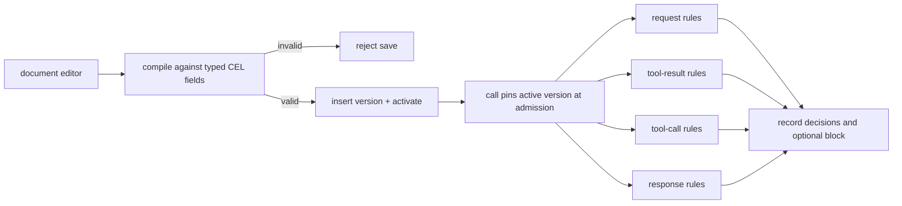

# Policy

A project owns two independent safety configurations: a list of redaction rules applied at admission, and one ordered policy document evaluated at the checkpoints. This page owns both.

## Policy document



The API lives under `/console/api`:

```http
POST /console/api/projects/{project_id}/policies
Content-Type: application/json
X-SafeAgent-Request: 1

{"document":{"rules":[{"id":"block-shell","name":"Shell from untrusted content","enabled":true,"priority":100,"phase":"tool_call","when":"tool.sink == 'shell_exec' && findings.exists(f, f.code == 'untrusted_value_reuse')","action":"block","severity":"high","reason":"external content reached a shell"}]},"note":"optional"}
```

A new project is seeded with version 1 containing an empty rule list, so every project starts with an inspectable document.

### Phases

| Phase | When it runs | What is available |
| --- | --- | --- |
| `request` | after the request is decoded and redacted, before routing | principal, trace, request findings; empty tool/target/args |
| `tool_call` | after a tool call is complete, before its frames are released | everything, including the pending tool call and its sink |
| `tool_result` | when the request adds tool results, before routing and quota | principal, trace, findings, plus `results` (the new results in request order); empty tool/target/args |
| `response` | before a non-streaming response body is written, or before the first byte of a streaming response when stream review is enabled | principal, trace, findings, plus `response` (status, finish, shown text, counts); empty tool/target/args |

A tool result that arrives in a request is checked at `tool_result`; a provider-executed server tool result is held at `tool_call` after the provider has already run it.

Streaming responses have a `response` phase only when the project enables stream review. The preview carries `status = "in_progress"`, an empty `finish`, and the leading shown text. A blocking rule prevents the response from being committed; after the window is released, later text has no online phase.

A project stores `stream_review_bytes` (0 disables review, at most 64 KiB) and `stream_review_timeout_ms` (at most 5000 ms, default 300). The window is reviewed when it fills, when the next frame arrives after the timeout, or when a short stream ends. Both settings are administrator-only and are applied at admission, so a change does not affect a running call.

### Typed fields

Conditions are CEL over Go structs. Field names and types are checked when the document is saved; a misspelled field is rejected. The CEL names are lower case:

| Variable | Fields |
| --- | --- |
| `principal` | `project_id`, `agent_key_id`, `role`, `trust_level` |
| `tool` | `name`, `kind`, `sink`, `capabilities`, `boundary`, `sensitivity`, `integrity` |
| `target` | `kind`, `value`, `scheme`, `host`, `path`, `command` |
| `args` | map of flattened scalar arguments, keyed by dotted path |
| `trace` | `steps` (list of `call_id`, `name`, `kind`, `sink`, `target_kind`, `target_value`, `has_result`, `is_error`) |
| `findings` | list of `code`, `origin`, `sink`, `severity`, `source`, `mode`, `harm`, `confidence` |
| `results` | list of `call_id`, `name`, `is_error`, `text`, `trust` |
| `response` | `status`, `finish`, `text`, `item_count`, `tool_calls`, `truncated` |
| `env` | `phase` |

`results` and `response` exist in every phase; they are empty outside their phase. `results.text` and `response.text` are the redacted/showed view, so a rule never receives a value the call page hides.

The principal comes from the authenticated agent key. Client-supplied metadata is not copied into it, so a rule cannot be satisfied by a field the client writes. `args` is the only untyped value: nested objects and lists are flattened to scalar entries; a rule that needs the exact JSON shape should match a finding code instead.

### Semantics

- The default is no decision.
- Every matching record rule produces one stored decision.
- If any block rule matches, the phase blocks; only the highest-priority block is stored as the blocking decision, while record decisions still appear in the call view.
- A `request` or `tool_result` block returns a protocol-shaped error before the upstream is called. A `tool_call` block prevents the call from reaching the client; before the stream commits it returns an HTTP error, and after the stream commits the error is in-band.
- A `response` block withholds the generated JSON, records a non-retrievable response summary, settles the reported usage and returns a protocol error. For a stream review block, the buffered preview is stored as a blocked response, nothing is committed to the client, and the rejection uses the protocol error shape.
- Rules are ordered by `priority` descending, then `id`; order only decides which block is reported.

### Lifecycle

- `POST /console/api/projects/{project_id}/policies` validates the document, writes the next version and activates it in the same transaction. There is no draft state.
- `POST /console/api/projects/{project_id}/policies/{version}/rollback` saves an older document as a new version. History is never rewritten.
- The gateway pins the active version at admission, so a save during a call does not change that call.
- Policy editing, validation, testing and restore are administrator-only. Members can read the active document and its history. The decision model is administrator-only too.

Version allocation locks the project row, so two concurrent saves cannot choose the same version. Compilation happens on save and once per policy version; an invalid saved document cannot exist. Startup compiles the newest document of every project, so an unreadable row stops the process before the first request arrives.

### Limits and failure

A document carries at most 200 rules, a condition is at most 16 KiB and the encoded document is at most 256 KiB; compilation rejects anything larger. Each checkpoint evaluates its phase rules under a 50 ms budget.

A detector or CEL error blocks the phase only when the document contains a blocking rule for that phase. A record-only project stores a `guard_unavailable` decision and continues. A policy that cannot be compiled when loaded fails the request with `policy_unavailable`; it is never silently replaced by an empty policy.

## Redaction rules

Redaction runs before the request is forwarded, before any policy rule reads its text. A project owns a set of rules over a fixed vocabulary:

- A rule is `builtin` (a named detector) or `regex` (an operator expression, optionally with a named capture group).
- `label` is the placeholder name and must be an upper-case identifier of up to 23 bytes.
- `action` is `replace` (mask and restore), `block` (refuse the request) or `alert` (record only).
- Every rule has an `enabled` flag and a version for optimistic updates.

A new project enables the built-in detectors marked as default-on with action `replace`; detectors that are likely to produce false positives (IP addresses, generic credentials, high-entropy tokens) start disabled. Rules are capped at 100, a regex pattern at 4096 bytes, a label is checked when the rule is saved, and a pattern that matches empty text is rejected. Positions that carry opaque state — redacted-reasoning text, tool names and ids, media URLs and file ids, citation URLs, model names and request control fields — are immutable: a rule that matches there returns `redaction_immutable` rather than rewriting a value the gateway cannot restore.

The engine applies the same rules to request text, tool descriptions, tool parameters and auxiliary JSON bodies. A request that matches an `alert` rule keeps its content and records a hit; a request that matches a `block` rule is refused with the rule label; a request that matches a `replace` rule is forwarded with a deterministic placeholder, and a generation response restores the original value. Placeholders are scoped to one call and are restored in streaming text and JSON. An auxiliary response is returned unchanged; the embeddings and moderations endpoints answer with vector or score data rather than the text the placeholder replaced.

Only an administrator may create, keep or delete a blocking rule, because it refuses whole requests. Members may manage replace and alert rules and use the rule tester. The seal transaction writes a redaction snapshot of the rule set that was in force at admission, with its version and hash, so a historical call is replayed and re-analysed under the rules that were active when it was recorded. See [Model](model.md) for the value identity and shown ranges a hit carries.

## Related

- [Model](model.md)
- [Analysis](analysis.md)
- [Storage](storage.md)
- [Audit](audit.md)
