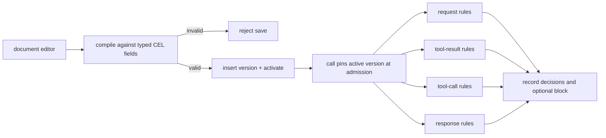

# Policy

A project has one ordered rule list.



The API lives under `/console/api`:

```http
POST /console/api/projects/{project_id}/policies
Content-Type: application/json
X-SafeAgent-Request: 1

{"document":{"rules":[{"id":"block-shell","name":"Shell from untrusted content","enabled":true,"priority":100,"phase":"tool_call","when":"tool.sink == 'shell_exec' && findings.exists(f, f.code == 'untrusted_value_reuse')","action":"block","severity":"high","reason":"external content reached a shell"}]},"note":"optional"}
```

A new project is seeded with version 1 containing an empty rule list, so every project starts with an inspectable document.

## Phases

| Phase | When it runs | What is available |
| --- | --- | --- |
| `request` | after the request is decoded and redacted, before routing | principal, trace, request findings; empty tool/target/args |
| `tool_result` | when the request adds tool results, before routing and quota | principal, trace, findings, plus `results` (the new results in request order); empty tool/target/args |
| `tool_call` | after a tool call is complete, before its frames are released | everything, including the pending tool call and its sink |
| `response` | before a non-streaming response body is written | principal, trace, findings, plus `response` (status, finish, shown text, counts); empty tool/target/args |

Streaming response text has no phase. A tool result that arrives in a request is checked at `tool_result`; a provider-executed server tool result is held at `tool_call` after the provider has already run it.

## Typed fields

Conditions are CEL over Go structs. Field names and types are checked when the document is saved; a misspelled field is rejected. The CEL names are lower case:

| Variable | Fields |
| --- | --- |
| `principal` | `project_id`, `agent_key_id`, `role`, `trust_level` |
| `tool` | `name`, `kind`, `sink`, `capabilities`, `boundary`, `sensitivity`, `integrity` |
| `target` | `kind`, `value`, `scheme`, `host`, `path`, `command` |
| `args` | map of flattened scalar arguments, keyed by dotted path |
| `trace` | `steps` (list of `call_id`, `name`, `kind`, `sink`, `target_kind`, `target_value`, `has_result`, `is_error`) |
| `findings` | list of `code`, `origin`, `sink`, `severity`, `source`, `mode`, `harm`, `confidence` |
| `results` | list of `call_id`, `name`, `is_error`, `text`, `trust` |
| `response` | `status`, `finish`, `text`, `item_count`, `tool_calls`, `truncated` |
| `env` | `phase` |

`results` and `response` exist in every phase; they are empty outside their phase. `results.text` and `response.text` are the redacted/shown view, so a rule never receives a value the call page hides.

The principal comes from the authenticated agent key. Client-supplied metadata is not copied into it, so a rule cannot be satisfied by a field the client writes. `args` is the only untyped value: nested objects and lists are flattened to scalar entries; a rule that needs the exact JSON shape should match a finding code instead.

## Semantics

- The default is no decision.
- Every matching record rule produces one stored decision.
- If any block rule matches, the phase blocks; only the highest-priority block is stored as the blocking decision, while record decisions still appear in the call view.
- A `request` or `tool_result` block returns a protocol-shaped error before the upstream is called. A `tool_call` block prevents the call from reaching the client; before the stream commits it returns an HTTP error, and after the stream commits the error is in-band.
- A `response` block withholds the generated JSON, records a non-retrievable response summary, settles the reported usage and returns a protocol error.
- Rules are ordered by `priority` descending, then `id`; order only decides which block is reported.

## Lifecycle

- `POST /console/api/projects/{project_id}/policies` validates the document, writes the next version and activates it in the same transaction. There is no draft state.
- `POST /console/api/projects/{project_id}/policies/{version}/rollback` saves an older document as a new version. History is never rewritten.
- The gateway pins the active version at admission, so a save during a call does not change that call.
- Policy editing, validation, testing and restore are administrator-only. Members can read the active document and its history. The decision model is administrator-only too.

Version allocation locks the project row, so two concurrent saves cannot choose the same version. Compilation happens on save and once per policy version; an invalid saved document cannot exist. Startup compiles the newest document of every project, so an unreadable row stops the process before the first request arrives.

## Resource limits

A document carries at most 200 rules, a condition is at most 16 KiB and the encoded document is at most 256 KiB; compilation rejects anything larger. Each checkpoint evaluates its phase rules under a 50 ms budget. Exceeding it is a guard failure, handled like any other evaluation error.

## Failure

A detector or CEL error blocks the phase only when the document contains a blocking rule for that phase. A record-only project stores a `guard_unavailable` decision and continues. A policy that cannot be compiled when loaded fails the request with `policy_unavailable`; it is never silently replaced by an empty policy.

## Related

- [Model](model.md)
- [Analysis](analysis.md)
- [Audit](audit.md)
