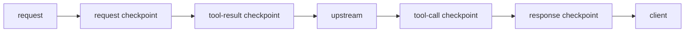

# Agent safety

[中文](agent-safety_zh.md)

An agent safety problem usually develops along a chain: external content enters the context, the model treats it as an instruction, and a tool with a legitimate purpose sends data out, rewrites a file or runs a command. Each step can look reasonable on its own; the risk appears once they combine.

SafeAgent takes the call and its tool chain as the unit of analysis and enforces policy before the side effect happens. It judges the observable request, tool call, tool result and response, and it records which judgments remain incomplete.

## Threat model

The failures a deployment needs to guard against:

- **Direct or indirect prompt injection.** User input, tool output or a tool description contains instructions aimed at the agent.
- **Tool misuse.** The model selects a tool it should not use, passes overly broad arguments, or splices external content into a command or URL.
- **Over-privileged or unconfirmed action.** A powerful tool is released without an explicit authorization decision.
- **Data exfiltration.** Credentials, private fields or internal identifiers are sent to an external destination.
- **Untrusted tool chains.** Tool output is corrupted, or the tool description itself is controlled by an attacker.
- **Irreversible execution.** A provider-executed server tool has already run; the gateway can withhold the result but cannot undo the execution.

## Origin, trust and sink

Every observed item carries an origin and a trust level, and every tool call carries a sink. The three together are the model that detectors and policy rules read.

| Property | Values | Rule |
| --- | --- | --- |
| Origin | system, developer, user, assistant, tool result, tool description, analysis environment | who produced the item |
| Trust | trusted, untrusted, unknown | tool results and tool descriptions are always untrusted; unclassified content is unknown |
| Sink | external send, shell execution, file read, file write, credential access, payment, no side effect, unknown | inferred from the tool name, arguments and normalized target |

Sink inference is heuristic. A rule that needs a strong conclusion matches a finding code and uses the sink as supporting evidence rather than as proof on its own.

## Four checkpoints

- **Request.** Checks the task, instructions, declared tools and every message, and can refuse the whole request before the upstream is contacted.
- **Tool call.** Checks a call once its arguments are complete and the frames are still held, so it can stop a client-side side effect; a stream that was already committed ends with a protocol error.
- **Tool result.** When the request adds tool results, checks their content before forwarding, and can refuse the whole request so the model never sees the blocked output.
- **Response.** Checks a non-streaming response before it is written, and can refuse the body while upstream usage is still settled. When a project enables stream review, the same checkpoint checks a bounded leading window of a streaming response before its first byte.

Text after the reviewed streaming window has no online checkpoint. A token that reached the client cannot be recalled, so it is diagnosed after the call. A provider-executed server tool has already run by the time the gateway sees its result; the gateway can withhold the result, not the execution.

## Policy and verdict

Each project keeps one ordered rule table. A rule is a condition over the authenticated principal, the tool, its arguments and target, the tool chain, findings, tool results and response metadata; field names and types are checked when the document is saved. The available actions are block and record, and there is no human approval step that holds a call open.

A call ends with one of three verdicts:

| Verdict | Condition |
| --- | --- |
| `unsafe` | a high-severity finding, or a sufficiently probable unsafe model answer with complete coverage |
| `unknown` | incomplete coverage, medium-only findings, an uncertain model answer or a failed model call |
| `safe` | complete coverage, no medium or high finding and no unsafe model answer |

Without a high-severity finding, an unchecked path yields `unknown`. The verdict describes the evidence the system has, not a guarantee about the agent.

Online decisions are stored with the call. Diagnosis is a separate record and never changes what the gateway already enforced.

## Decision model

The decision model is optional. It is consulted only after deterministic rules allow a side-effecting tool call, and it can add a block; it cannot release something a rule blocked.

The authorization question deliberately excludes tool output and the model's own earlier text and tool calls, so external content cannot argue for its own release. If the model times out, returns malformed output or exhausts its budget, a call blocked by the rules stays blocked; a call the rules allowed proceeds, and the missing judgment is recorded. When diagnosis evaluates the same evidence later, an unavailable model cannot produce a `safe` verdict; without a high-severity finding the result is `unknown`.

After the call, diagnosis can ask the same model for a trajectory-level label: whether the trajectory is unsafe, its risk source, failure mode, potential harm and severity. The labels are stored next to the deterministic findings, with the model state, and do not overwrite them. The three-axis vocabulary is adapted from AgentDoG; the runtime attribute view of principal, tool, arguments, target and history follows the attribute-based approach described by AgentGuard. SafeAgent does not train or ship a guard model.

## Diagnosis and evidence

A deterministic finding carries a detector code, a severity, a stable fingerprint, a byte range and a display-safe quote. The fingerprint hashes the detector, code, origin, sink and semantic location rather than a text offset, so the same finding keeps the same identity across analyses. A quote that overlaps a redacted span is shown as `[redacted]`.

A flow edge connects external content inside one call to a later side-effecting tool call. It states that a value was reused or that an instruction was followed; it does not infer causality across calls. Findings, flows, model labels and a coverage record together form the evidence behind a verdict; the coverage record explains which parts did not run.

The call timeline shows admission, routing, upstream attempts, first token, tool calls and results, policy decisions, cancellation, response summary and termination in order. Audit events are HMAC-chained, and the call stores its chain head and event count when it ends; the offline check locates a modified event or a deleted tail. The timeline itself is metadata-only, and raw text remains governed by role-based visibility.

## Limits

- Relation detection is literal; paraphrased, translated or tool-transformed values can be missed.
- Tool sinks come from names, arguments and targets; a misleading tool name can misclassify a call.
- Images, audio and other binary payloads are not redacted or inspected.
- Stream review covers only its configured leading window; text after the window has no online output check, and non-streaming responses are checked in full.
- The gateway only observes traffic that passes through it. Coverage of an agent depends on how completely it is routed through the gateway.

## Related

- [Architecture](architecture.md)
- [Protocol conversion](protocol-conversion.md)
- [Verification](verification.md)
