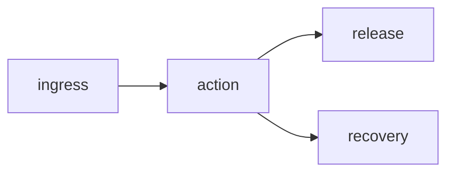

# Agent safety

[中文](agent-safety_zh.md)

An agent safety incident develops along a chain. External content enters the context, the model treats it as an instruction, memory keeps it after compaction, and an action sends data out or changes a system. Looking at one request cannot explain why the action happened on turn 700. SafeAgent records the state transfers that made it possible and enforces policy before the side effect.

## Threat model

A deployment needs to guard against:

- direct or indirect prompt injection, including tool descriptions and recalled memory;
- tool misuse, over-broad arguments and destructive or costly actions;
- constraint loss during context compaction;
- memory poisoning and authority collapse;
- data exfiltration through a public sink;
- privilege escalation through delegation;
- approval replay after a rollback or retry;
- retained inference state after a rollback;
- capture gaps that make the record look complete when it is not.

## Origin, trust and sink

Every segment carries an integrity label and a confidentiality label, and every action carries a sink:

| Property | Values | Meaning |
| --- | --- | --- |
| Integrity | trusted, untrusted, unknown | who produced it and whether it may influence an action |
| Confidentiality | public, private, user_identity | what may leave the boundary |
| Sink | external send, shell, file read/write, credential access, payment, no effect, unknown | what the action can touch |

Labels travel with content through compaction, memory and tool I/O. A label can only become stronger. Sink inference is heuristic; it supports a finding but is not proof on its own.

## Gates and recovery

- **Ingress** admits observations and context assembly and checks tool results before the model sees them. Memory reads are recorded by a harness and projected rather than admitted by the online gate.
- **Action** checks a proposed tool call while it is still held. It can block, require approval, or allow.
- **Release** checks a response or tool result before it leaves the gateway. A blocked stream is withheld; an already-sent prefix cannot be recalled.
- **Recovery** is not an online veto. When a rollback or delegation return is appended, the reducer records an obligation and the invariant projector records a finding; a missing or opaque cache marks the recovery incomplete.

Text after a reviewed stream window has no online release check. A provider-executed server tool may already have run; the gateway can withhold the result, not the execution.

## Policy and verdict

Each project keeps one ordered rule table over the authenticated principal, tool, target, trace, findings, results and response. A rule can block or record. An action that violates an invariant can require approval; the approval is bound to the exact invocation and can be consumed once.

The console computes one verdict for a trajectory from its findings and coverage:

| Verdict | Condition |
| --- | --- |
| `unsafe` | a high-severity finding |
| `unknown` | coverage below the threshold, a capture gap, a failed check, or a medium-only finding |
| `safe` | coverage meets the threshold and no medium or high finding |

Without complete coverage, an unchecked path yields `unknown`. The verdict describes the evidence, not a guarantee.

## Decision model

The decision model is optional and only runs on the ambiguous tail. It can add a block to an action the deterministic rules allowed; it can never release a blocked action. The gateway records the veto outcome and rule id, not the model prompt or output. A timeout, malformed answer or exhausted budget leaves the deterministic result intact and is recorded as unavailable. A model is never the sole gate for an irreversible action.

## Evidence and verification

A finding points at one event and its input segments. Evidence never quotes a masked range. Edges connect content, actions, authorization and approval. The event chain is signed per trajectory, and checkpoints cover ranges with a separate checkpoint key. An evidence bundle exports the range for offline verification; a modified event, missing segment or broken checkpoint is named explicitly.

Coverage is measured from expected and observed boundaries plus recorder gaps. A trajectory below its threshold cannot be `safe`, and an irreversible action without approval is blocked.

## Known limits

- Relation detection is literal; paraphrased or transformed values can be missed.
- Sink inference is heuristic; a misleading tool name can misclassify an action.
- Images, audio and other binary payloads are not masked or inspected.
- Stream review covers only its configured leading window.
- The gateway only observes traffic and state transfers that reach it. Coverage depends on the deployment's recorder placement.
- Production Claude Code, Codex, MCP and eBPF adapters are not included; the Go harness SDK is the integration surface.

## Further reading

- [Architecture](architecture.md)
- [Protocol conversion](protocol-conversion.md)
- [Verification](verification.md)
