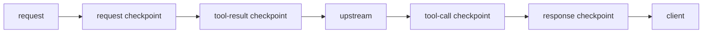

# Agent safety

[中文](agent-safety_zh.md)

An agent safety problem usually runs along a chain: external content enters the context, the model treats it as an instruction, and a tool with a legitimate use sends data out, rewrites a file or runs a command. Each step often has a good reason on its own; the risk appears once they combine.

SafeAgent takes the call and its tool chain as the unit of analysis and enforces policy before the side effect.

## Threat model

Failures to guard against:

- **Direct or indirect prompt injection**: user input, tool output or a tool description contains instructions aimed at the agent.
- **Tool misuse**: the model selects a tool it should not use, passes overly broad arguments, or splices external content into a command or URL.
- **Over-privileged or unconfirmed action**: a powerful tool is released without an explicit authorization decision.
- **Data exfiltration**: credentials, private fields or internal identifiers are sent to an external destination.
- **Untrusted tool chains**: tool output is corrupted, or the tool description itself is controlled by an attacker.
- **Irreversible execution**: a provider-executed server tool has already run; the gateway can withhold the result but cannot undo the execution.

The gateway judges the observable request, tool call, tool result and response. It does not treat a model's self-description as evidence, and it records which judgments remain incomplete.

## Origin, trust and sink

Every observed item carries an origin and a trust level; every tool call carries a sink.

| Property | Values | Rule |
| --- | --- | --- |
| Origin | system, developer, user, assistant, tool result, tool description, analysis environment | identifies who produced the item |
| Trust | trusted, untrusted, unknown | tool results and tool descriptions are always untrusted; unclassified content is unknown |
| Sink | external send, shell execution, file read, file write, credential access, payment, no side effect, unknown | inferred from the tool name, arguments and normalized target |

Sink inference is heuristic. A policy that needs a strong conclusion matches a finding code and uses the sink as supporting evidence.

## Four checkpoints

- **Request**: checks the task, instructions, declared tools and every message, and can refuse the whole request.
- **Tool result**: when the request adds tool results, checks their content before forwarding, and can refuse the whole request so the model never sees the blocked output.
- **Tool call**: checks the call when arguments are complete and frames are still held, and can stop a client-side side effect; a committed stream ends with a protocol error.
- **Response**: checks a non-streaming response before writing it, and can refuse the body while upstream usage is still settled.

Streaming response text has no online checkpoint. A token that reached the client cannot be recalled and is diagnosed after the call.

## Policy and verdict

Each project maintains one ordered rule table. Rules can read the authenticated principal, tool, arguments, target, tool chain, findings, tool results and response metadata; field names and types are checked when the document is saved. The actions are `block` and `record`; there is no human approval step.

The verdict has three values:

| Verdict | Condition |
| --- | --- |
| `unsafe` | a high-severity finding, or a sufficiently probable unsafe model answer with complete coverage |
| `unknown` | incomplete coverage, medium-only findings, an uncertain model or a failed model call |
| `safe` | complete coverage, no medium or high finding and no unsafe model answer |

Without a high-severity finding, an unchecked path yields `unknown`.

## Decision model

The decision model is optional. It is consulted only after deterministic rules allow a side-effecting tool call. It can add a block and cannot remove a rule decision.

The authorization judgment excludes tool output, earlier assistant text and earlier tool calls, so external content cannot support its own release. When the model times out, returns a malformed answer or exhausts its budget, a blocked call stays blocked and an unfinished judgment stays `unknown`.

Asynchronous diagnosis also asks the model for trajectory labels: whether the call is unsafe, its risk source, failure mode, potential harm and severity. Model conclusions are stored beside the deterministic findings and do not overwrite them.

## Evidence and timeline

A deterministic finding contains a byte offset, a display-safe quote, the detector version and a stable fingerprint. A quote that overlaps a redacted span is shown as `[redacted]`.

A relation edge connects external content inside one call to a later side-effecting tool call. It states only that a value was reused or an instruction was followed; it does not infer cross-call causality.

The call timeline shows admission, upstream attempts, first token, tool calls and results, policy decisions, cancellation, response summaries and termination in order. Audit events are HMAC-chained, and the call stores its chain head and event count when it ends; the offline audit check locates a modified or deleted event. The timeline is metadata-only; raw text remains governed by role-based visibility.

## Relationship to AgentGuard and AgentDoG

AgentDoG provides a three-axis taxonomy: risk source, failure mode and real-world harm. SafeAgent adopts this vocabulary and the idea that a trajectory is the unit of analysis.

SafeAgent does not train or ship the paper's guard models and does not reproduce its benchmark or numbers. A deterministic finding fills only the dimensions its evidence supports; an empty axis records that the dimension has not been established.

AgentGuard provides an attribute-based access-control view: principal, tool, arguments, target and session history, with policies over one tool and over a chain. SafeAgent adopts these runtime attributes and places policy in the protocol gateway, so agents need no language-specific SDK.

The separate DSL, visual rule builder and manual review queue described in the AgentGuard paper are outside the current scope.

The detailed trade-offs and references are in [the landscape](landscape.md).

## Current boundaries

- Relation detection is literal; paraphrased, translated or tool-transformed values can be missed.
- Tool sinks are inferred from names and arguments; a misleading tool name can misclassify a call.
- Images, audio and other binary payloads are not redacted or inspected.
- A provider-executed server tool has already run; the gateway can withhold its result only.
- Streaming responses have no online output check; non-streaming responses can be blocked.
- The gateway observes only traffic that passes through it.

The next steps are in the [roadmap](../agent/roadmap.md): streaming response review, semantic and cross-call relations, multi-agent trajectories and repeatable evaluation.

## Related

- [Architecture](architecture.md)
- [Protocol conversion](protocol-conversion.md)
- [Landscape](landscape.md)
- [Verification](verification.md)
