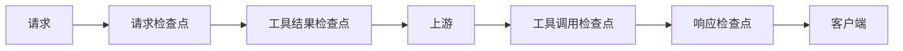

# Agent 安全模型

[English](agent-safety.md)

Agent 的安全问题通常沿一条链路展开：外部内容进入上下文，模型把它当作指令，一个有正当用途的工具随后发送数据、改写文件或执行命令。这些步骤单独执行时往往都有正当理由，风险在组合之后出现。

SafeAgent 以一次调用及其工具链为分析单位，并在副作用发生前实施拦截。

## 威胁模型

需要防范的失败方式：

- **直接或间接提示注入**：用户输入、工具返回值或工具描述中包含针对 Agent 的指令。
- **工具滥用**：模型选择不该调用的工具、传入过宽参数，或把外部内容拼接进命令和 URL。
- **越权与未确认操作**：高权限工具在没有明确授权的情况下被放行。
- **数据外泄**：凭据、隐私字段或内部标识被发送到外部地址。
- **不可信工具链**：工具输出被污染，或工具描述本身由攻击者控制。
- **执行后不可逆**：提供商执行的服务端工具已经运行，网关只能扣留结果，无法撤销执行。

网关依据可观察的请求、工具调用、工具结果和响应作出判断，不把模型自述当作证据，并明确记录未完成的判断。

## 来源、信任与去向

每个观察条目都带来源和信任级别，每个工具调用都带一个去向。

| 属性 | 取值                                                           | 规则                                                 |
| ---- | -------------------------------------------------------------- | ---------------------------------------------------- |
| 来源 | 系统、开发者、用户、助手、工具结果、工具描述、分析环境         | 标识内容由谁产生                                     |
| 信任 | 可信、不可信、未知                                             | 工具结果和工具描述始终不可信，无法归类的内容记为未知 |
| 去向 | 外发、命令执行、文件读、文件写、凭据访问、支付、无副作用、未知 | 由工具名、参数和归一化目标推断                       |

去向推断是启发式的。需要强结论的策略应匹配发现代码，把去向作为辅助证据。

## 四个检查点

- **请求**：检查任务、指令、声明的工具和全部消息，可以拒绝整个请求。
- **工具结果**：请求新增工具结果时，在转发上游前检查其内容，可以拒绝整个请求，模型不会看到被阻断的输出。
- **工具调用**：工具参数完整、帧尚未释放时检查，可以阻止客户端执行副作用；已提交流以协议内错误结束。
- **响应**：非流式响应写出前检查，可以拒绝正文，上游用量仍会结算。

流式响应正文没有在线检查点。已到达客户端的 token 无法撤回，只能在调用结束后诊断。

## 策略与判定

每个项目维护一张有序规则表。规则可以读取认证主体、工具、参数、目标、工具链、发现、工具结果和响应元数据，字段名与类型在保存时校验。规则动作只有 `block` 和 `record`，不包含人工审批环节。

判定分为三值：

| 判定      | 条件                                                 |
| --------- | ---------------------------------------------------- |
| `unsafe`  | 存在高危发现，或覆盖完整时模型给出足够高的不安全概率 |
| `unknown` | 覆盖不完整、只有中危发现、模型不确定或调用失败       |
| `safe`    | 覆盖完整、没有中高发现且模型未判定不安全             |

没有高危发现时，未检查的路径产生 `unknown`。

## 决策模型

决策模型是可选的。只有在确定性规则放行有副作用的工具调用之后，系统才会询问决策模型。模型可以追加阻断，不能撤销规则决定。

授权判断不包含工具输出、先前的助手文本和先前的工具调用，外部内容无法为自己的放行提供依据。模型超时、格式错误或预算耗尽时，已被规则阻断的调用保持阻断，尚未完成的判断保持 `unknown`。

异步诊断还会请模型给出轨迹级标签：是否不安全、风险来源、失败模式、潜在危害和严重度。模型结论与确定性发现并列保存，不覆盖后者。

## 证据与时间线

确定性发现包含字节偏移、可安全展示的引文、检测器版本和稳定指纹。引文与脱敏区间重叠时显示为 `[redacted]`。

关系边把一次调用内的外部内容与后续有副作用的工具调用连接起来，只陈述“值被复用”或“指令被跟随”，不推断跨调用因果。

调用时间线按顺序展示准入、上游尝试、首 token、工具调用与结果、策略决定、取消、响应摘要和终止。审计事件逐条进行 HMAC 链接，调用结束时写入链头与事件数，离线审计校验可以定位被修改或删除的事件。时间线只含元数据，原始正文仍按角色可见性控制。

## 与 AgentGuard、AgentDoG 的关系

AgentDoG 提供风险来源、失败模式、现实危害三轴分类法。SafeAgent 采用这套词汇，以及把轨迹作为分析单位的思路。

SafeAgent 不训练或附带论文中的 guard model，也不复现其基准与数字。确定性发现只填写证据能够支撑的维度，空轴表示该维度尚未确立。

AgentGuard 提供属性式访问控制视角，包括主体、工具、参数、目标和会话历史，以及单工具与工具链两类策略。SafeAgent 采用这套运行时属性，把策略放在协议网关中，Agent 无需安装语言相关 SDK。

AgentGuard 论文中的独立 DSL、可视化规则构建器和人工复核队列不在当前范围内。

两个项目的详细取舍与参考文献见[同类方案](landscape_zh.md)。

## 当前边界

- 关系检测基于字面匹配，改写、翻译或经工具转换后的值可能遗漏。
- 工具去向由名称和参数推断，误导性的工具名称可能导致误判。
- 图片、音频和其他二进制内容不参与脱敏或检查。
- 提供商执行的服务端工具已经运行，网关只能扣留结果。
- 流式响应没有在线输出检查，非流式响应可以阻断。
- 网关只观察经过它的流量。

后续方向见 [roadmap](../agent/roadmap.md)：流式响应检查、语义与跨调用关系、多 Agent 轨迹和可重复评测。

## 相关

- [架构](architecture_zh.md)
- [协议转换](protocol-conversion_zh.md)
- [同类方案](landscape_zh.md)
- [验收方法](verification_zh.md)
