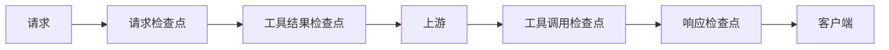

# Agent 安全模型

[English](agent-safety.md)

Agent 的安全问题往往沿着一条链展开：外部内容进入上下文，模型把它当成指令，随后一个用途正当的工具把数据发出去、改写文件或执行命令。每一步单看都有理由，风险在它们连起来时出现。

SafeAgent 以一次调用及其工具链为分析单位，并在副作用发生之前执行策略。它判断可观察的请求、工具调用、工具结果和响应，并如实记录哪些判断还不完整。

## 威胁模型

部署需要防范的失败情形：

- **直接或间接提示注入**：用户输入、工具输出或工具描述中夹带针对 Agent 的指令。
- **工具误用**：模型选用了不该用的工具，参数范围过大，或把外部内容拼进命令、URL。
- **越权或未确认操作**：高权限工具在缺少明确授权判断的情况下被放行。
- **数据外泄**：凭据、隐私字段或内部标识被发送到外部目标。
- **不可信的工具链**：工具输出被污染，或工具描述本身由攻击者控制。
- **不可逆执行**：提供商执行的服务端工具已经运行；网关可以扣留结果，但无法撤销执行。

## 来源、信任与去向

每个被观察的条目都带来源和信任级别，每个工具调用都带去向。这三者构成检测器与策略规则共同读取的模型。

| 属性 | 取值                                                                     | 规则                                               |
| ---- | ------------------------------------------------------------------------ | -------------------------------------------------- |
| 来源 | 系统、开发者、用户、助手、工具结果、工具描述、分析环境                   | 条目由谁产生                                       |
| 信任 | 可信、不可信、未知                                                       | 工具结果与工具描述一律不可信；无法归类的内容为未知 |
| 去向 | 外部发送、Shell 执行、文件读取、文件写入、凭据访问、支付、无副作用、未知 | 由工具名称、参数与规范化目标推断                   |

去向推断是启发式的。需要强结论的规则会匹配特定的发现代码，把去向只作佐证，不单凭它下判断。

## 四个检查点

- **请求**：检查任务、指令、声明的工具以及每一条消息，可以在访问上游之前拒绝整个请求。
- **工具调用**：参数完整且帧仍被扣留时检查这次调用，因此能在客户端执行工具之前拦住副作用；已经提交的流只能以协议内错误结束。
- **工具结果**：请求新增工具结果时，在转发之前检查其内容，并可以拒绝整个请求，让模型根本看不到被阻断的输出。
- **响应**：非流式响应在写出之前检查，可以在上游用量仍会结算的前提下拒绝正文。项目开启流式预审后，同一个检查点会在首字节之前检查流式响应的首段窗口。

预审窗口之后的文本没有在线检查点。已经送达客户端的 token 无法收回，只能在调用结束后诊断。提供商执行的服务端工具在网关看到结果时已经运行，网关能扣留结果，不能撤销执行。

## 策略与判定

每个项目维护一张有序规则表。一条规则是对已认证主体、工具、参数与目标、工具链、发现、工具结果和响应元数据的条件表达式，保存文档时校验字段名与类型。动作只有阻断和记录两种，系统不会为了等待人工审批而挂起一次调用。

调用最终落在三种判定之一：

| 判定      | 条件                                                     |
| --------- | -------------------------------------------------------- |
| `unsafe`  | 存在高危发现，或覆盖完整且模型给出足够可信的不安全结论   |
| `unknown` | 覆盖不完整、只有中危发现、模型结论不确定，或模型调用失败 |
| `safe`    | 覆盖完整、没有中危或高危发现，也没有不安全模型结论       |

没有高危发现时，未经检查的路径一律得到 `unknown`。判定只反映系统掌握的证据，并不构成对 Agent 的保证。

在线决策随调用一起保存。诊断是另一条独立记录，不会改变网关已经执行的策略。

## 决策模型

决策模型是可选项。只有确定性规则放行了有副作用的工具调用之后才会询问它，而且它只能追加阻断，不能放行规则已经阻断的调用。

授权判断刻意排除工具输出，以及模型自己更早的文本和工具调用，外部内容因此无法为自身的放行提供理由。模型超时、返回格式错误或耗尽预算时，规则已经阻断的调用保持阻断；规则放行的调用照常继续，缺失的判断会被记录下来。诊断随后评估同一批证据时，模型不可用就不会给出 `safe`；没有高危发现时结果为 `unknown`。

调用结束后，诊断可以让同一个模型给出轨迹级标签：整条轨迹是否不安全，以及风险来源、失败模式、潜在伤害与严重程度。标签连同模型状态一起保存，与确定性发现并列而不覆盖它们。三轴词汇改编自 AgentDoG；主体、工具、参数、目标和历史的运行时属性视角沿用 AgentGuard 所描述的属性化访问控制思路。SafeAgent 不训练也不附带护栏模型。

## 诊断与证据

确定性发现包含检测器代码、严重程度、稳定的指纹、字节区间以及对展示安全的引文。指纹哈希检测器、代码、来源、去向与语义位置，不包含文本偏移，因此同一个发现跨多次分析保持同一身份。与脱敏区间重叠的引文显示为 `[redacted]`。

数据流边把一次调用中的外部内容连到之后某个有副作用的工具调用，只说明某个值被复用或某条指令被遵循，不推断跨调用的因果关系。发现、数据流、模型标签与覆盖记录共同构成判定的依据，覆盖记录会说明哪些部分没有运行。

调用时间线按顺序展示准入、路由、上游尝试、首 token、工具调用与结果、策略决定、取消、响应摘要和终止。审计事件用 HMAC 串成链，调用结束时保存链头与事件数；离线检查能定位被修改的事件或被删除的尾部。时间线只包含元数据，原始文本仍按角色可见性控制。

## 边界

- 关系检测是字面匹配；经过转述、翻译或工具改写的值可能漏检。
- 工具去向由名称、参数与目标推断；误导性的工具名会导致判断偏差。
- 图片、音频与其他二进制内容既不脱敏也不检查。
- 流式预审只覆盖配置的首段窗口，窗口之后的文本没有在线输出检查；非流式响应会完整检查。
- 网关只能观察经过它的流量，对 Agent 的覆盖程度取决于有多少流量经过网关。

## 相关

- [架构](architecture_zh.md)
- [协议转换](protocol-conversion_zh.md)
- [验收方法](verification_zh.md)
