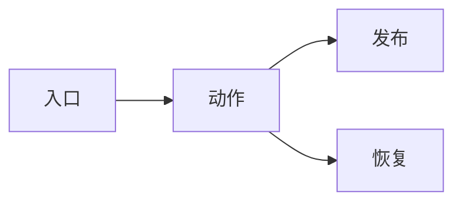

# 安全模型

[English](agent-safety.md)

Agent 的安全事故往往沿一条链路发展：外部内容进入上下文，模型把它当成指令，记忆在压缩后保留它，最后某个动作把数据发出去或修改了系统。只看一次请求，无法解释为什么动作发生在第 700 轮。SafeAgent 记录让动作成为可能的状态转移，并在副作用发生之前执行策略。

## 威胁模型

部署需要防范：

- 直接或间接提示注入，包括工具描述和被召回的记忆；
- 工具误用、参数过宽以及破坏性或高成本动作；
- 上下文压缩导致约束丢失；
- 记忆投毒与权威坍塌；
- 通过公开去向泄露数据；
- 通过委派提升权限；
- 回滚或重试后重放审批；
- 回滚后保留推理缓存状态；
- 采集缺口让记录看起来完整。

## 来源、信任与去向

每个内容片段都带完整性标签和机密性标签，每个动作都带去向：

| 属性   | 取值                                                     | 含义                   |
| ------ | -------------------------------------------------------- | ---------------------- |
| 完整性 | trusted、untrusted、unknown                              | 由谁产生，能否影响动作 |
| 机密性 | public、private、user_identity                           | 什么可以离开边界       |
| 去向   | 外发、命令执行、文件读写、凭据访问、支付、无副作用、未知 | 动作可能作用于什么     |

标签随内容经过压缩、记忆和工具 I/O，只会变强，不会静默变弱。去向依靠启发式推断，只作为发现的辅助证据，不单独作为证明。

## 关卡与恢复

- **入口**负责观察内容与上下文组装，并在模型看到工具结果之前检查它们。记忆召回由 Harness 记录并投影，而不是经过在线入口放行。
- **动作**在工具调用仍被扣留时检查它，可以阻断、要求审批或放行。
- **发布**在响应或工具结果离开网关之前检查。被阻断的流不会写出；已经发出的前缀无法收回。
- **恢复**不是在线阻断关卡。回滚或委派返回追加后，归约器记录义务，不变量投影记录发现；缓存缺失或不透明时，恢复会被标记为不完整。

预审窗口之后的文本没有在线发布检查。提供商已执行的服务端工具可能已经产生副作用；网关只能扣留结果，不能撤销执行。

## 策略与判定

每个项目保留一张有序规则表，条件可以读取认证主体、工具、目标、轨迹、发现、工具结果和响应。规则可以阻断或记录。违反不变量的动作可以要求审批；审批绑定到具体调用，并且只能消费一次。

控制台根据轨迹的发现和覆盖度计算三种判定之一：

| 判定      | 条件                                                 |
| --------- | ---------------------------------------------------- |
| `unsafe`  | 存在高危发现                                         |
| `unknown` | 覆盖低于阈值、存在采集缺口、检查失败，或只有中危发现 |
| `safe`    | 覆盖达到阈值，且没有中高危发现                       |

没有完整覆盖时，未检查的路径只能得到 `unknown`。判定描述的是证据，而不是保证。

## 决策模型

决策模型是可选项，只处理模糊尾部。它可以对确定性规则已经放行的动作追加阻断，但永远不能解除阻断。网关记录否决结果与规则标识，不保存模型提示词或输出。超时、格式错误或预算耗尽不会改变确定性结果，只会记录为不可用。模型永远不能成为不可逆动作的唯一关卡。

## 证据与验证

每个发现指向一个事件及其输入片段，证据不会引用被脱敏的区间。关系边连接内容、动作、授权与审批。事件链按轨迹签名，检查点用独立的密钥签名覆盖区间。证据包可离线验证；被修改的事件、缺失的内容片段或损坏的检查点都会被明确指出。

覆盖度由期望边界、已观察边界和记录器缺口共同计算。低于阈值的轨迹不能判为 `safe`，未经审批的不可逆动作会被阻断。

## 已知限制

- 关系检测是字面匹配，改写或变换后的值可能被漏掉。
- 去向推断依赖启发式，误导性的工具名可能导致误判。
- 图片、音频等二进制内容不参与脱敏或检查。
- 流式预审只覆盖配置的开头窗口。
- 网关只能看到真正到达它的流量和状态转移，覆盖范围取决于部署中的记录器位置。
- 未包含生产级的 Claude Code、Codex、MCP 和 eBPF 适配器；Go 版 harness SDK 是集成接口。

## 延伸阅读

- [架构设计](architecture_zh.md)
- [协议转换](protocol-conversion_zh.md)
- [验收方法](verification_zh.md)
