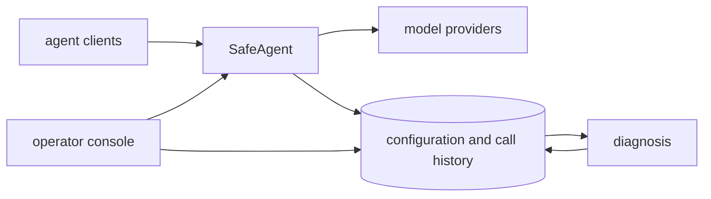

# Architecture

[中文](architecture_zh.md)

SafeAgent sits between agent clients and model providers. It translates the four API dialects agents use, masks sensitive values before they leave the organization and restores them on the way back, enforces project policy while a call is in flight, and records every call it admits in a signed, replayable audit trail. The gateway, the console and diagnosis share the same call record, so what an operator sees afterwards matches what was enforced at the time.

## Position in the system

Every model call passes through the gateway. The console reads configuration and history; diagnosis rebuilds finished calls from the same history. A client and a provider do not need to share a wire format, and one project can send different calls to different vendors through one address.

## Trust boundary

The gateway is the trust boundary. Configuration, policy, audit records and the console belong to the operator. Agents, model providers, tool output and tool descriptions sit outside it and are treated as data; text does not become an instruction just because it is phrased as one.

Caller identity comes only from the authenticated agent key. Request metadata may be displayed and used by detectors, but it cannot establish who is calling and is never exposed as a policy field. The optional session header groups calls from one agent key; it carries no identity and cannot link tenants.

## Request path

1. The gateway authenticates the agent key, decodes the request into the canonical model, and classifies the call by endpoint operation, purpose and lane.
2. Sensitive values are masked. The gateway records where each item came from, whether it is trusted, and what a tool call can act on.
3. The request checkpoint runs detectors and project rules. If the request adds tool results, the tool-result checkpoint checks them before the upstream sees them.
4. The public model name resolves to a route. An explicit route header, the exact name and an alias are tried in that order; a side or auxiliary call may fall back to the project default, while a main call fails when its model is not configured. Quota is reserved once the call may proceed.
5. The request is adapted to the target channel format and forwarded. Text and reasoning stream through; a complete tool call waits for its verdict, then is released or dropped. A failing upstream may be retried on another target before the client has received content.
6. The response checkpoint runs before the body is written, or before the first byte of a reviewed stream. Masked values are restored as content is released. When the call ends, its audit record is written and the call is queued for diagnosis; the conversation is updated for conversational lanes only.

## Calls and lanes

Not every request is agent activity. Each call carries an endpoint operation, the purpose the client declared or implied, and a lane derived from both.

| Lane | Joins a conversation | Diagnosed | Traffic metrics | In the call list |
| --- | --- | --- | --- | --- |
| Main | yes | yes | request and failure counts | shown by default |
| Side | yes, as background work | no | cost only | shown with a lane badge |
| Auxiliary | no | no | not counted | hidden by default |

Main calls are the agent's actual work. Side calls are the background jobs an agent runs alongside it: subagents, compaction, title generation and memory helpers. Auxiliary calls are protocol traffic such as model listing, token counting, embeddings and the Responses lifecycle.

Every call has an outcome. An upstream error, a rate limit, a request the upstream refused, or a client error is a failure. A policy block and an expected protocol refusal are completed protocol exchanges, not failures. The call record, the metric queries and the console all use this distinction.

## Model supply and routing

The supply graph is global. A provider describes protocol endpoints, capabilities and model discovery; a channel binds a provider to an address, credentials and limits; a model records an upstream name, its kind and its price. A route belongs to a project and maps a public model name, plus optional aliases, to a list of targets. Each target names a channel and a model, with a priority, a weight and an optional format and output limit.

Targets are tried by priority; equal priorities are chosen by weight, and a target that matches the client's format is preferred. Transient failures, authentication failures, rate limits and conversion failures fall through to the next target. A policy block or an invalid request does not. Removing a channel or model shows an impact preview first; routes that referenced it are reported as degraded and keep serving where possible.

## Trajectory and replay

A conversation is rendered as one projection rather than assembled from separate pages. The projection contains typed nodes with stable identities: the session, each call, turns, request and response items, tool calls and results, upstream attempts, policy decisions, findings and masked values. Edges connect the call chain, produced and consumed items, blocked decisions, data flows and retries.

The same projection feeds three views (a flow graph, a tree and a flat list) and the inspector beside them. Audit events are the replay steps: the console can walk a call forward and backward through its own history and highlight the nodes each step touched. The projection is read-only and bounded; when a conversation is too large, the console reports this instead of silently dropping history.

## Redaction and display

A masked value has a stable identity, so the same value keeps the same placeholder across a conversation. A call reports only the values it introduced; values in ancestor items were already recorded by the call that first included them, so they do not accumulate on every continuation.

The conversation view aggregates those identities. It shows how many distinct values and occurrences were masked, lists each distinct value with where it appears, and highlights the value in the item text without ever revealing the original. Each call keeps the redaction rules it ran under, so an old call is displayed with the rules of its time.

## Audit and diagnosis

Audit events are the single source of truth for a call. Each event is signed and chained to the one before it. When the call ends, the chain is anchored in the call record, so the gateway can locate a modified event and detect a deleted tail. Offline verification checks stored chains without starting the gateway.

The timeline is generated from events and carries metadata only; raw text is still shown according to role permissions. After the call, the diagnosis worker rebuilds the trace from the same events, expands a bounded ancestor conversation, runs every detector, asks the optional decision model for trajectory labels, and stores findings, flows, coverage and a verdict as a separate record. Diagnosis never changes online policy.

## Deployment and scope

SafeAgent runs inside the operator's infrastructure. Agents reach models through one address, and call records stay inside the operator's environment.

| Situation | Behavior |
| --- | --- |
| Upstream fails before any content | Fail over to another target; the client sees nothing |
| Upstream fails after content | End the stream with a protocol error; do not fail over |
| Client disconnects | Stop writing, cancel upstream, record a partial response and a cancellation |
| Policy or detector unavailable | Refuse the call when that phase has a blocking rule; otherwise record the gap and continue |
| Stored configuration references a deleted object | Warn and degrade the route; keep serving |

Coverage depends on how much of an agent's traffic is routed through the gateway. Binary payloads are not inspected or redacted. Stream review covers only its configured leading window. Tool destinations and data relations are inferred heuristically and need human confirmation. Human approval and cross-call semantic linking are not implemented.

## Further reading

- [Protocol conversion](protocol-conversion.md)
- [Agent safety](agent-safety.md)
- [Landscape](landscape.md)
- [Verification](verification.md)
