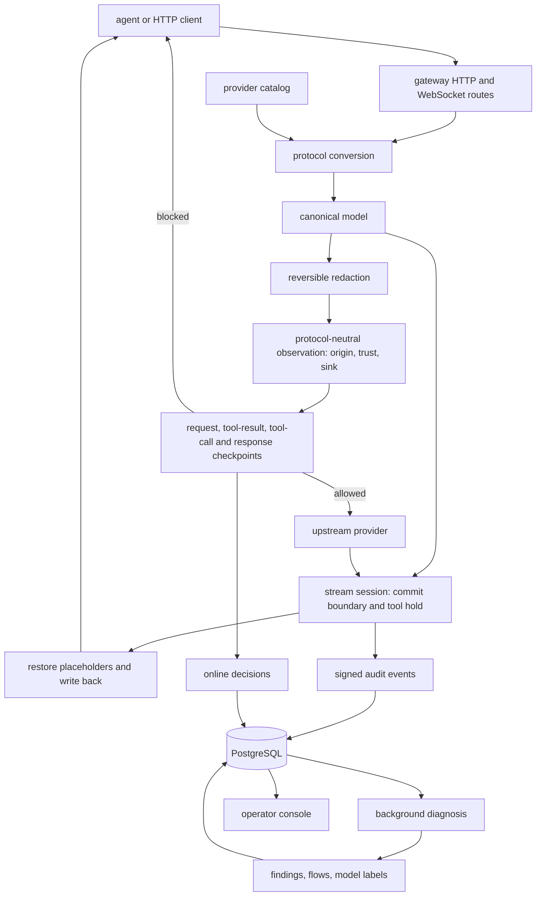
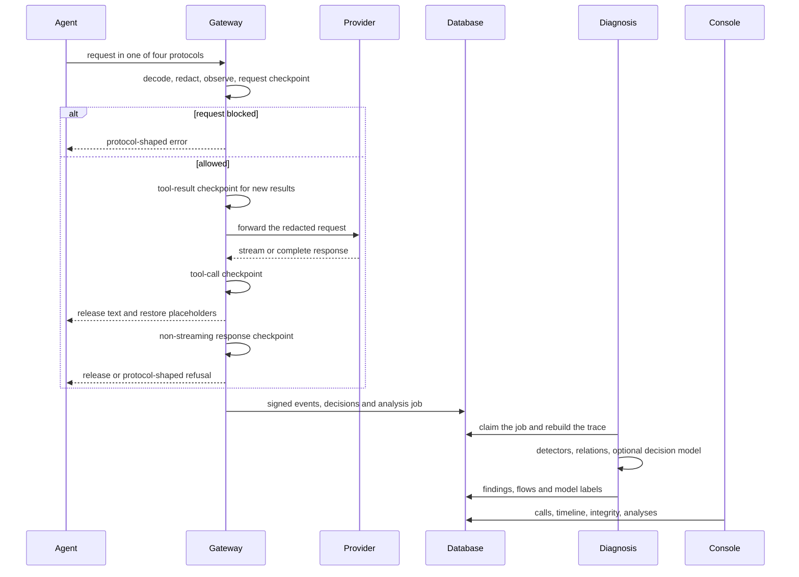

# Architecture

[中文](architecture_zh.md)

SafeAgent sits between agents and model providers. It collapses four wire protocols into one processing path and applies project policy at four points: request admission, tool-result forwarding, tool-call release and non-streaming response write. It also keeps a verifiable audit record, so an operator can reconstruct a call without relying on the agent's own account.

## Trust boundary

The gateway is the trust boundary. The database, audit chain, policy, console and instance key belong to the operator. Agents, model providers, tool output and tool descriptions lie outside it and are treated as data. Tool output does not gain instruction authority because its text is phrased as an instruction.

Caller identity comes only from the authenticated agent key. Request metadata can be displayed and used by detectors, but it does not establish who is calling and is never exposed as a policy field. The optional session header groups calls under one agent key; it does not carry identity either.

## Components and dependencies

Dependencies point in one direction:

| Module | Depends on |
| --- | --- |
| Canonical model | the standard library |
| Protocol conversion and provider catalog | the canonical model |
| Stream session | the canonical model and the protocol contract |
| Call pipeline | orchestrates the modules above |
| Observation, analysis and redaction | domain layer only; no dependency on codecs, the gateway or transport |

## One call

After admission, the gateway decodes the request, redacts it and builds the trace. Text and reasoning deltas are forwarded immediately; a tool call enters a hold once its arguments are complete and is released or discarded after the verdict.

When the call ends, events, online decisions and the analysis job are written in one transaction.

## Streaming

Text and reasoning are forwarded as they arrive; a complete tool call waits for its verdict and is then released or discarded. No header is written before the first forwardable content, so a failure before that point can fail over, while a failure after it becomes a protocol error. Terminal frames wait for audit settlement, and a cancel records what the client already received as a partial response.

Keepalive follows the protocol: an SSE comment for Chat and Responses, `event: ping` for Messages, nothing for Gemini. It starts only after the response is committed.

The four behaviors and their edge cases are described in [protocol conversion](protocol-conversion.md).

## Four checkpoints

| Checkpoint | When | What it can stop |
| --- | --- | --- |
| Request | after decode and redaction, before routing and quota | the whole request; the upstream is not called |
| Tool result | after the request adds tool results, before routing and quota | the whole request; the model never sees the blocked output |
| Tool call | when arguments are complete and frames are still held | the side effect before a client executes the tool; a committed stream ends with a protocol error |
| Response | before a non-streaming body is written | the body is replaced by a protocol error; reported usage is still settled |

Streaming response text has no online checkpoint: a token that reached the client cannot be recalled, so it is diagnosed after the call. Provider-executed server tools have already run when the gateway sees the result; the gateway can withhold the result but cannot undo the execution.

## Audit and diagnosis

Audit events are the single source of truth for a call. Each event carries a stable sequence, a type, a normalized payload, a previous hash and its own hash; when a call ends, the chain head and event count are stored with it. The HMAC key is derived from the instance key; the chain locates a modified event and detects a deleted tail.

The timeline is generated from events and contains metadata only. The console shows admission, upstream attempts, first token, tool calls and results, policy decisions, cancellation, response summaries and termination in order. Raw text is not exposed in the timeline and stays behind the existing role-based views.

After the call, background diagnosis rebuilds the trace from events, expands a bounded ancestor conversation, runs every detector and, when a decision model is configured, asks for trajectory-level labels. Diagnosis is a separate record and never changes online policy.

## Policy and verdict

Each project maintains one ordered rule table, and rule fields are checked when the document is saved. The online path stores only decisions; the asynchronous path stores only findings, relations and model labels. Versions, input hashes and evidence can be compared in the console.

A call ends with `safe`, `unsafe` or `unknown`: a high-severity finding yields `unsafe`, incomplete coverage without one yields `unknown`, and `safe` requires complete evidence. The [agent safety](agent-safety.md) page describes the conditions and the decision model.

## Sessions and chains

A call joins a session through the previous-response identifier, the latest tool result, a conversation-prefix fingerprint or the optional session header. A session header that conflicts with a previous-response parent returns 409 and records the refusal; a heuristic parent in another session is dropped without rejecting the request.

Session ids are scoped to the agent key and cannot link tenants.

The console conversation page shows the call tree, and the call detail shows the parent, session source and timeline. A session is only a grouping; it does not change authentication or promote a client-supplied value into a trusted identity.

## Deployment and persistence

One Go process serves the console, gateway and health check, backed by one PostgreSQL database. Background analysis claims jobs from the database in the same process; no message broker, Redis or separate background service is required. The database is the only coordination point, and this version runs a single instance.

## Failure and boundaries

| Failure | Behavior |
| --- | --- |
| Upstream fails before content | Fail over to another channel or key; the client sees nothing |
| Upstream fails after content | Write a protocol error; do not fail over |
| Client disconnects | Stop writing, cancel upstream, record a partial response and a cancellation event |
| Tool hold exceeds its limit | Return a resource error, not a policy refusal |
| Audit write fails | Mark the call failed; never present a successful response |
| Policy or detector unavailable | Fail closed when that phase has a blocking rule; otherwise record and continue |
| Schema fingerprint mismatch | Refuse to start; the database must be recreated |

## Design trade-offs

- **Gateway scope.** Coverage depends on where the gateway is deployed.
- **Text-only redaction.** Images, audio and other binary payloads are not rewritten.
- **Heuristic relations.** Tool destinations and content relations rely on names, arguments and literal matches; findings need human confirmation.
- **Single instance.** PostgreSQL is the only coordination point; there is no distributed queue or multi-instance mode.
- **Schema changes.** A schema change requires recreating the database; the audit contract stays deterministic.

## Related

- [Protocol conversion](protocol-conversion.md)
- [Agent safety](agent-safety.md)
- [Landscape](landscape.md)
- [Verification](verification.md)
