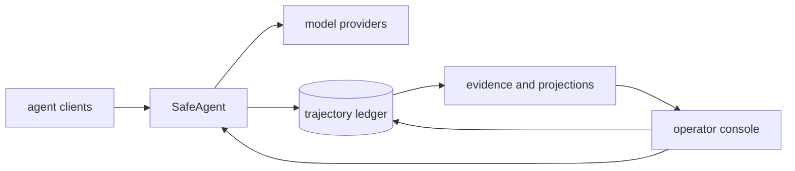

# Architecture

[中文](architecture_zh.md)

SafeAgent sits between agent clients and model providers. It translates the four API dialects agents use, masks sensitive values before they leave the organization and restores them on the way back, enforces project policy while an action is in flight, and records the whole task as a signed trajectory. The gateway, the console and the evidence tools read the same event log, so what an operator sees afterwards matches what was enforced at the time.

## Position in the system

Every model call passes through the gateway. Observations, context assembly, memory transfers, actions, approvals, rollbacks and delegations are appended to one trajectory ledger. Calls and findings are projections of that ledger, not a second source of truth.

## Trust boundary

The gateway is the trust boundary. Configuration, policy, the ledger and the console belong to the operator. Agents, model providers, tool output and tool descriptions sit outside it and are treated as data; text does not become an instruction just because it is phrased as one.

Caller identity comes only from the authenticated agent key. Request metadata may be displayed and used by detectors, but it cannot establish who is calling and is never exposed as a policy field. The optional session header groups calls from one agent key into one trajectory; it carries no identity and cannot link tenants.

## Request path

1. The gateway authenticates the agent key, decodes the request and classifies the call by endpoint operation, purpose and lane.
2. Sensitive values are masked. The gateway records where each item came from, whether it is trusted, and what an action can touch.
3. The ingress gate runs deterministic checks and project rules. A request that adds tool results is checked before the upstream sees them.
4. The public model name resolves to a route. Quota is reserved once the call may proceed.
5. The request is adapted to the target channel format and forwarded. Text and reasoning stream through; a complete tool call waits for its action gate, then is released, blocked or held for approval.
6. The release gate runs before the body or the first byte of a reviewed stream. Masked values are restored as content is released. The action interval and its outcome are appended to the trajectory; a checkpoint signs the range.

## Calls and lanes

Not every request is agent activity. Each call carries an endpoint operation, the purpose the client declared or implied, and a lane.

| Lane | Joins a trajectory | Findings | Traffic metrics | In the call list |
| --- | --- | --- | --- | --- |
| Main | yes | yes | request and failure counts | shown by default |
| Side | yes, as background work | yes | cost only | shown with a lane badge |
| Auxiliary | no | projected only | not counted | hidden by default |

Main calls are the agent's actual work. Side calls are background jobs such as subagents, compaction, title generation and memory helpers. Auxiliary calls are protocol traffic such as model listing, token counting, embeddings and the Responses lifecycle. Each auxiliary call is a short standalone trajectory.

## Model supply and routing

The supply graph is global. A provider describes protocol endpoints, capabilities and model discovery; a channel binds a provider to an address, credentials and limits; a model records an upstream name, kind and price. A route belongs to a project and maps a public model name, plus optional aliases, to targets. Targets are tried by priority, weight and format preference; transient failures fail over, while a policy block does not. Removing a channel or model shows an impact preview first.

## Trajectory and console

A trajectory is one delegated task. Its event log records observations, context changes, memory reads and writes, model and tool actions, approvals, rollbacks and delegations. The reducer derives labels, capabilities, obligations, coverage and risk. Three online gates enforce ingress, action and release; rollback and delegation are reduced and projected rather than enforced by a fourth process.

The console reads trajectory state, coverage and gaps, the event timeline, calls, findings and segments from this ledger. Finding lineage, approvals and offline evidence are described in [Agent safety](agent-safety.md).

## Deployment and scope

SafeAgent runs inside the operator's infrastructure. Agents reach models through one address, and the ledger stays inside the operator's environment.

| Situation | Behavior |
| --- | --- |
| Upstream fails before any content | Fail over to another target; the client sees nothing |
| Upstream fails after content | End the stream with a protocol error; do not fail over |
| Client disconnects | Stop writing, cancel upstream, record a partial response and a cancellation |
| Policy or detector unavailable | Refuse the call when that phase has a blocking rule; otherwise record the gap and continue |
| Stored configuration references a deleted object | Warn and degrade the route; keep serving |

Coverage depends on how much of an agent's traffic and state transfers reach a recorder. Deployment-specific limits are in [Agent safety](agent-safety.md); what the test suite can and cannot prove is in [Verification](verification.md).

## Further reading

- [Protocol conversion](protocol-conversion.md)
- [Agent safety](agent-safety.md)
- [Landscape](landscape.md)
- [Verification](verification.md)
