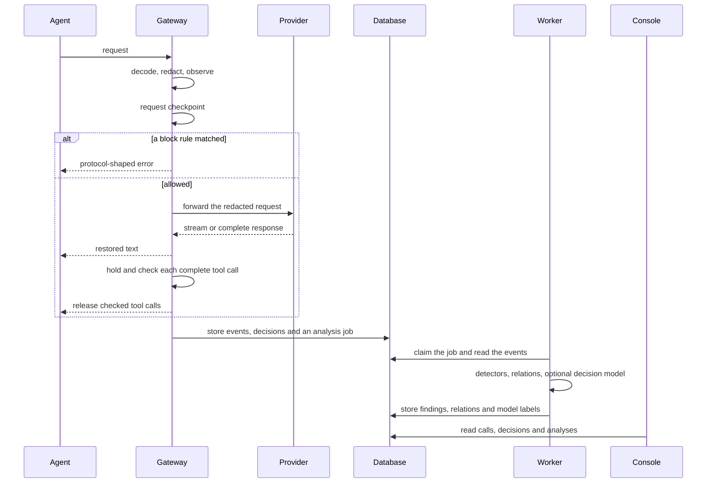

# Architecture

[中文](architecture_zh.md)

SafeAgent mediates agent traffic. It keeps operator data inside the boundary, stops requests and tool calls when project policy forbids them, and leaves an audit record that can be read without trusting the agent.

## Trust boundary

The gateway is the trust boundary. The database, audit trail, policy, console and instance keys belong to the operator. Agents, model providers, tool output and any content a tool returns are outside it and are treated as data.

Tool output and tool descriptions are labelled untrusted even when their text reads like an instruction. Caller identity comes from the authenticated agent key. Request metadata supplies context for display and policy conditions; it does not establish who is calling.

## One call

A request is decoded and observed before the request checkpoint runs; redaction happens before the upstream call. A block returns an error in the caller's protocol and skips the upstream call. Otherwise the gateway forwards the redacted request and restores masked values before the response reaches the client. Each completed tool call, including a provider-executed server tool, is held until its verdict is ready, then released or refused.

Policy evaluation does not wait for response text. In a stream, text is forwarded to the client as it arrives; only tool-call frames wait for a verdict. When the call ends, its events, online decisions and analysis job are stored together.

## Online enforcement

The request checkpoint sees the client request, the instructions, the declared tools and every message. Detectors read the raw values; policy arguments and targets use the redacted view when redaction changed them. It runs the structural and content detectors and evaluates request-phase rules.

The tool checkpoint sees the same trajectory plus one complete tool call. It runs the structural, content and relation detectors and evaluates tool-call-phase rules. A client-executed tool's frames are still held, so a block prevents the side effect. A provider-executed tool has already run at the provider; a block withholds its result but cannot undo that execution.

When a detector or rule cannot finish, the phase outcome depends on the project's rules. A project with a blocking rule in that phase fails closed; a record-only project stores a visible "guard unavailable" decision and continues. After the rules allow a side-effecting call, the decision model may add a veto. A model failure leaves the policy outcome unchanged.

## Audit and diagnosis

Stored events are the record of the call. Diagnosis rebuilds the trajectory from those events, the call's redaction snapshot and the agent key's identity, so a new detector or model can re-examine history without extra gateway state.

Diagnosis never applies policy. It stores findings, relation edges and optional model labels. Each result records its input hash and versions, and a re-analysis creates a new record beside the earlier one. Comparison is available when the input, detector and catalogue versions match.

Coverage limits without a high-severity finding produce `unknown`. A safe verdict requires complete coverage, no medium or high finding and no unsafe model answer.

## Labels

Every observed item records an origin and a trust level; every tool call records a sink. A deterministic finding fills only the three-axis fields that its code, origin and sink justify. An empty axis means "not established".

The optional decision model labels the whole trajectory on the full taxonomy. Its answers are stored beside the findings and leave the deterministic labels unchanged.

## Policy

A project owns one ordered list of typed conditions. Conditions read the agent principal, the tool, flattened arguments, the target, the tool chain, the findings and the current phase. A misspelled field is rejected at save time.

Saving validates the document and activates a new version in one transaction. Earlier versions remain available for review and can be restored as a new version. Each call pins the active version at admission. Members may edit record rules but cannot set priorities. Blocking policy rules, blocking redaction rules, priorities, version restore and decision model configuration belong to administrators.

## Durability and failure

PostgreSQL is the only durable store. The call, its online decisions and its analysis job are stored in one transaction, so a finished call always has work queued. The in-process worker claims from the database and retries with backoff. Failures remain visible as failed jobs or failed analyses.

The schema is a fresh baseline with a fingerprint. A build with a different fingerprint refuses to start and the database must be recreated. There is no migration path.

## Deployment

One process serves the console, gateway and health check, backed by one PostgreSQL database. When the console is reachable beyond loopback, serve it through a reverse proxy that handles TLS. The database is the coordination point, and the current design runs one instance.

## Related

- [Console](console.md)
- [Agent threat modeling](threat-modeling.md)
- [Getting started](getting-started.md)
- [Agent guide](../agent/README.md)
