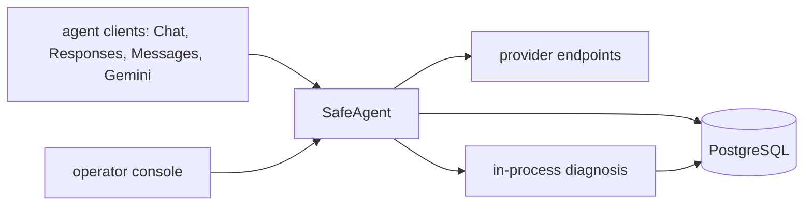

# Architecture

[中文](architecture_zh.md)

SafeAgent is a self-hosted gateway between agents and model providers. It terminates the four protocols agent clients speak, enforces project policy while a call is in flight, masks sensitive values on the way out and restores them on the way back, and records every admitted call in a signed, replayable audit chain. One Go process serves the gateway, the operator console and the health check; PostgreSQL is the only stateful dependency.

## Where it sits

The gateway is the only path a call takes. It converts between the client protocol and the upstream protocol, so a client and a provider do not need to agree on a wire format, and a project can route different calls to different vendors through one address.

Internally the system is layered by responsibility rather than by protocol:

| Layer | Responsibility |
| --- | --- |
| Protocol adapters | decode and encode four wire formats, drive streaming, track conversion losses |
| Call path | classify the request, redact, build the behavior trace, route, run the checkpoints, settle the call |
| Control plane | maintain the supply graph and project routing policy, discovery, configuration health |
| Audit and diagnosis | keep the event chain, rebuild calls, run detectors and the decision model, produce verdicts |
| Console | read-only projections for monitoring, conversation replay, risk, policy and operations |
| Platform and storage | configuration, secrets, limits, network policy, the PostgreSQL baseline and retention |

## Trust boundary

The gateway is the trust boundary. The database, the audit chain, the policy, the console and the instance key belong to the operator. Agents, model providers, tool output and tool descriptions are outside it and are treated as data; text does not gain instruction authority by being phrased as an instruction.

Caller identity comes only from the authenticated agent key. Request metadata may be displayed and used by detectors, but it cannot establish who is calling and is never exposed as a policy field. The optional session header groups calls under one agent key; it carries no identity and cannot link tenants.

## Request path

1. The gateway authenticates the agent key, decodes the request into the canonical model and classifies the call: which endpoint operation it is, why the client sent it and which lane it belongs to.
2. Redaction replaces sensitive values, and the observation layer records where each item came from, whether it is trusted and what a tool call can act on. The call keeps a redaction snapshot so history stays reproducible after rules change.
3. The request checkpoint runs detectors and the project's rules. If the request adds tool results, the tool-result checkpoint checks them before the upstream sees them.
4. The public model name is resolved to a route. An explicit route header, the exact name and an alias are tried in that order; a background or auxiliary call may fall back to the project's default route, while a main call fails when its model is not configured. Quota is reserved once the call may proceed.
5. The request is forwarded, adapted to the target channel format. Text and reasoning stream through; a complete tool call waits for its verdict, then is released or dropped. A failing upstream may be retried on another target only before the client has received content.
6. The response checkpoint runs before the body is written, or before the first byte of a reviewed stream, and placeholders are restored as content is released. When the call ends, the audit events, online decisions and diagnosis job are written in one transaction, and the conversation is updated for conversational lanes only.

## Calls and lanes

Not every request is agent activity. Each call carries three facts that decide how it is stored and counted: the endpoint operation, the purpose the client declared or implied, and the lane derived from both.

| Lane | Joins a conversation | Diagnosed | Traffic metrics | In the call list |
| --- | --- | --- | --- | --- |
| Main | yes | yes | request and failure counts | shown by default |
| Side | yes, folded as background work | no | tokens and cost only | shown with a lane badge, foldable |
| Auxiliary | no | no | not counted | hidden until explicitly shown |

Background work an agent performs alongside its main conversation (subagents, compaction, title generation, memory and review helpers) stays in the conversation but is not treated as a diagnosed main call. Auxiliary endpoints, including token counting, model listing, embeddings, moderations and the Responses lifecycle, never create conversations and do not inflate failure rates. Expected protocol refusals such as an unsupported feature or a missing response are recorded as outcomes, not as gateway failures.

A call ends with an outcome. Only an upstream or client error is a failure; a policy block or a deliberate refusal is a completed exchange. This distinction is shared by the call row, the metric queries and the console.

## Control plane

Provider configuration and routing policy are separate graphs:

- The supply graph is global: providers describe protocol endpoints, capabilities and discovery; channels hold credentials, base URLs and limits; models describe upstream names, kinds and prices. Model formats are derived from the provider's endpoints and the model kind rather than stored per channel.
- Routing policy is per project: a route maps a public model name, plus optional aliases, to a list of targets. Each target names a channel and a model, with a priority, a weight and an optional format and output limit.

Built-in providers arrive as editable rows, and a custom provider can be added for any OpenAI-compatible or self-hosted endpoint. Provider edits are reloaded into the running process, and channels, models and routes are read from the database as calls arrive, so configuration changes take effect without a restart. Removing a channel or model is a soft delete with an impact preview of the routes and projects it affects; a configuration that references a deleted or disabled object degrades routing and raises a warning instead of preventing startup.

Routes are resolved deterministically: targets are ordered by priority, equal priorities are chosen by weight, and formats that match the client are preferred. Transient failures, authentication failures, rate limits and conversion failures fall through to the next target; a policy block or an invalid request does not.

## Trajectory and replay

A conversation is rendered as one projection, not as a set of pages stitched together. The projection contains typed nodes with stable identities: the session, each call, turns, request and response items, tool calls and results, upstream attempts, policy decisions, findings and redacted values. Edges connect the call chain, produced and consumed items, blocked decisions, data flows and retries, and mark relations the reader had to infer.

The same projection feeds three views (a flow graph, a tree and a flat list) and the inspector beside them. Audit events are the replay steps: the console can walk a call forward and backward through its own history and highlight the nodes each step touched. The projection is bounded and read-only; when a conversation is too large, it says so instead of dropping history silently.

## Redaction and display

A masked value has a deterministic identity, so the same value keeps the same placeholder across a conversation. A call reports only the values it introduced: values in ancestor items were already recorded by the ancestor that admitted them, so they do not accumulate on every continuation.

The conversation view aggregates those identities. It shows a small summary of how many distinct values and occurrences were masked, lists each distinct value with where it appears, and highlights the value in the item text without ever revealing the original. Each call keeps the redaction rules it ran under, so an old call is displayed with the rules of its time.

## Audit and diagnosis

Audit events are the single source of truth for a call. Each event is chained to the one before it with a keyed hash, and when the call ends its chain head and event count are stored with it, so a modified event is located and a deleted tail is detected. The offline verification command checks stored chains without the gateway.

The timeline is generated from events and carries metadata only; raw text stays behind role-based views. After the call, the diagnosis worker rebuilds the trace from the same events, expands a bounded ancestor conversation, runs every detector, asks the optional decision model for trajectory labels and stores findings, flows, coverage and a verdict as a separate record. Diagnosis never changes online policy.

## Deployment and boundaries

One process serves the gateway, the console and the health check, and runs the diagnosis worker. PostgreSQL stores everything and is the only coordination point; a database lease keeps a second instance out. There is no message broker, Redis or separate worker.

| Failure | Behavior |
| --- | --- |
| Upstream fails before any content | Fail over to another target; the client sees nothing |
| Upstream fails after content | End the stream with a protocol error; do not fail over |
| Client disconnects | Stop writing, cancel upstream, record a partial response and a cancellation |
| Tool hold or stream size exceeds its limit | Return a resource error, not a policy refusal |
| Audit write fails | Mark the call failed; never present a success the record cannot support |
| Policy or detector unavailable | Fail closed when that phase has a blocking rule; otherwise record and continue |
| Stored configuration references a deleted object | Warn and degrade the route; do not refuse startup |
| Database schema does not match the build | Refuse to start; the database must be recreated |

The deliberate limits are the same ones that keep the design small. Coverage depends on where the gateway is deployed; binary payloads are not redacted; tool destinations and data relations are inferred heuristically and need human confirmation; and the system runs a single instance on a fresh schema with no migration path.

## Related

- [Protocol conversion](protocol-conversion.md)
- [Agent safety](agent-safety.md)
- [Landscape](landscape.md)
- [Verification](verification.md)
