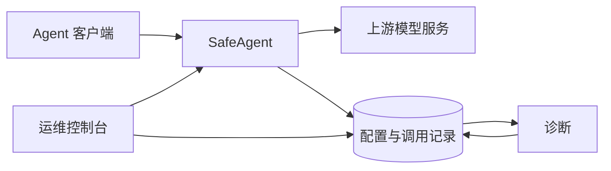

# 架构

[English](architecture.md)

SafeAgent 位于 Agent 客户端和模型服务之间。它接受 Agent 使用的四种接口，按上游渠道的格式转发请求；数据离开企业之前完成脱敏，返回时再还原；调用过程中执行项目策略，并将每次放行的调用记录成带签名、可回放的审计链。网关、控制台和诊断共享同一份调用记录，因此运维事后看到的结论与当时执行的判断一致。

## 在系统中的位置

所有模型调用都经过网关。控制台读取配置和调用记录，诊断则从同一份记录重建已经结束的调用。客户端和上游不必使用同一种协议格式，同一个项目也可以将不同调用路由到不同厂商，而对外只暴露一个地址。

## 信任边界

网关即信任边界。配置、策略、审计记录和控制台归运维方所有；Agent、模型服务、工具输出和工具描述都在边界之外，一律视为数据，文本不会因为表述得像指令就成为指令。

调用方身份只来自认证通过的 Agent 密钥。请求元数据可以展示，也可以供检测器使用，但它不能用来确认调用者身份，也不会作为策略字段暴露。可选的会话请求头只将同一 Agent 密钥下的调用归入同一个会话，不承载身份，也不能跨租户关联。

## 请求路径

1. 网关校验 Agent 密钥，将请求解码成规范模型，并按端点操作、用途和通道完成分类。
2. 网关替换敏感值，同时记录每个条目的来源、可信程度，以及工具调用可能作用的对象。
3. 请求检查点运行检测器和项目规则。请求中新增的工具结果，会在上游看到之前再经过一次工具结果检查。
4. 对外模型名解析到路由。依次尝试显式路由请求头、精确名称和别名；侧调用与辅助调用可以回退到项目默认路由，主调用在模型未配置时直接失败。调用允许继续时才预占配额。
5. 请求按目标渠道的格式改写后转发。文本与推理实时下行；完整的工具调用先等待判定，再整段放行或丢弃。客户端尚未收到内容时，上游失败可以改换其他目标重试。
6. 响应检查点在正文写出之前、或已预审的流写出首字节之前执行，脱敏值在内容放行时还原。调用结束时，网关写入审计记录并交由诊断处理，只有对话类通道会更新会话。

## 调用与通道

并非所有请求都是 Agent 的行为。每次调用都有端点操作、客户端声明或推断出的用途，以及由前两者得出的通道。

| 通道     | 进入会话         | 参与诊断 | 流量指标           | 调用列表       |
| -------- | ---------------- | -------- | ------------------ | -------------- |
| 主调用   | 是               | 是       | 计入请求数与失败率 | 默认展示       |
| 侧调用   | 是，作为后台工作 | 否       | 只计成本           | 带通道标记展示 |
| 辅助调用 | 否               | 否       | 不计入             | 默认隐藏       |

主调用代表 Agent 的实际工作。侧调用是围绕主对话发生的后台工作：子 Agent、上下文压缩、标题生成和记忆整理。辅助调用则是模型列表、Token 计数、嵌入和 Responses 生命周期这类协议流量。

每次调用都有一个结果。上游错误、限流、上游拒绝请求或客户端错误，均视为失败；策略阻断和预期中的协议拒绝不视为失败，属于正常的协议交互。调用记录、指标查询和控制台采用同一套判定标准。

## 模型供给与路由

模型供给是全局的。供应商描述协议端点、能力和模型发现；渠道为供应商配置地址、凭据和限额；模型记录上游名称、类型和价格。路由属于项目，将一个对外模型名和若干别名映射到一组目标。每个目标指定渠道与模型，并带有优先级、权重，以及可选的格式与输出上限。

目标先按优先级尝试；优先级相同时按权重选择，与客户端格式一致的目标优先。瞬时失败、鉴权失败、限流和格式转换失败会转而尝试下一个目标，策略阻断和非法请求则不会。删除渠道或模型之前会给出影响预览；引用它的路由会显示为降级，并在条件允许时继续服务。

## 轨迹与回放

整个会话用同一份投影呈现，无需拼接多个页面。投影由带稳定标识的类型化节点组成：会话、每次调用、轮次、请求与响应条目、工具调用与结果、上游尝试、策略决定、发现以及脱敏值。节点之间的边表示调用链、条目的产生与消费、阻断决定、数据流和重试。

同一份投影支撑三种视图（流程图、树形视图、平铺列表）以及旁边的检查器。审计事件即回放步骤：控制台可以沿一次调用的历史前进或后退，并高亮每一步触及的节点。投影只读且有大小上限；会话过大时会明确提示，不会静默丢弃历史。

## 脱敏与展示

脱敏值有稳定标识，同一个值在整个会话中保持同一个占位符。一次调用只记录其自身引入的值；祖先条目中的值，已在包含这些条目的先前调用中记录过，不会在每次续写时重复累加。

会话视图汇总这些标识：先给出脱敏值数量与命中次数的小结，再列出每个不同的值及其出现位置，并在条目文本中高亮对应片段，全程不展示原值。每次调用同时保留当时执行的脱敏规则，历史调用按当时的规则展示。

## 审计与诊断

一次调用的全部事实都来自审计事件。每个事件签名后与前一个事件相连。调用结束时，整条链的锚点写入调用记录，因此能定位被修改的事件，也能发现被删除的尾部。离线校验不需要启动网关就能检查已存的调用链。

时间线由事件生成，只包含元数据；原始文本仍然按角色权限展示。调用结束后，诊断从同一批事件重建轨迹，展开范围有限的祖先会话，运行全部检测器，再按配置请求决策模型给出轨迹级标签，最后将发现、数据流、覆盖情况与判定作为独立记录保存。诊断不会改变在线策略。

## 部署与适用范围

SafeAgent 部署在运维方自有的基础设施内。Agent 通过统一地址访问模型，调用记录保留在本地环境。

| 情形                 | 行为                                         |
| -------------------- | -------------------------------------------- |
| 首内容前上游失败     | 切换到其他目标，客户端无感知                 |
| 首内容后上游失败     | 以协议内错误结束，不再切换                   |
| 客户端断开           | 停止写入，取消上游，记录部分响应与取消事件   |
| 策略或检测器不可用   | 该阶段存在阻断规则时拒绝调用，否则记录后继续 |
| 配置引用了已删除对象 | 告警并降级路由，继续服务                     |

覆盖范围取决于经过网关的流量比例。图片、音频等二进制内容不参与检查或脱敏。流式预审只覆盖配置的开头窗口。工具去向和数据关系由推断得出，需要人工确认。人工审批和跨调用的语义关联暂未实现。

## 延伸阅读

- [协议转换](protocol-conversion_zh.md)
- [安全模型](agent-safety_zh.md)
- [同类方案](landscape_zh.md)
- [验收方法](verification_zh.md)
