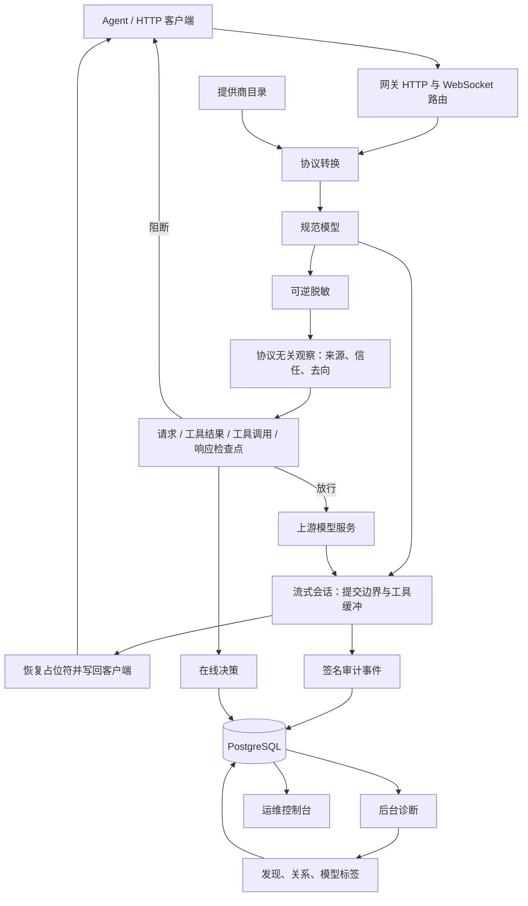
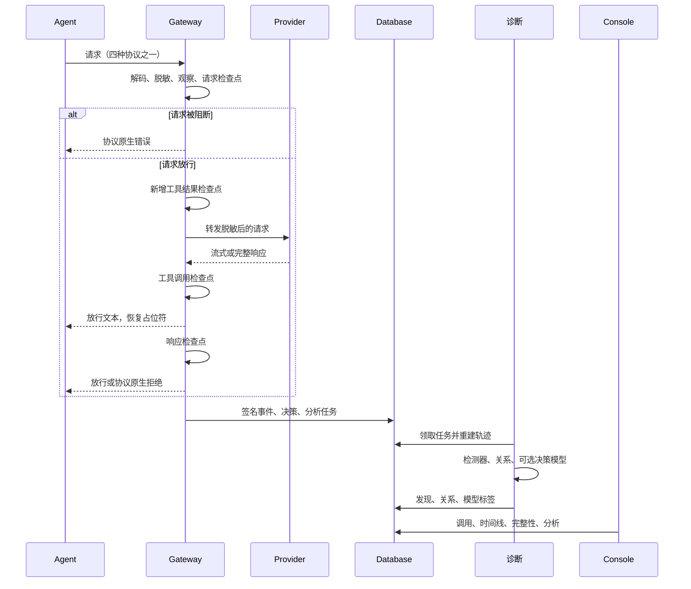

# 架构

[English](architecture.md)

SafeAgent 位于 Agent 与模型服务之间，把四种线路协议收敛到一条处理路径，并在请求准入、工具结果转发、工具调用放行和响应写出四个时点执行项目策略；流式响应可额外对首段窗口执行预审。网关同时保存可校验的审计记录，运维人员无需依赖 Agent 的自述即可还原一次调用。

## 信任边界

网关是信任边界。数据库、审计链、策略、控制台和实例密钥归运维方所有；Agent、模型服务、工具返回值与工具描述都在边界之外，一律按数据处理。工具输出即使写着“忽略之前的指令”，也不会因此获得指令权限。

调用方身份只来自通过认证的 Agent 密钥。请求中的元数据可用于展示和检测，但无法证明调用者身份，也不会作为策略字段暴露。可选的会话请求头仅将同一 Agent 密钥下的调用归入同一会话，同样不承担身份职责。

## 组件与依赖

依赖方向单一：

| 模块                 | 依赖                                     |
| -------------------- | ---------------------------------------- |
| 规范模型             | 标准库                                   |
| 协议转换与提供商目录 | 规范模型                                 |
| 流式会话             | 规范模型与协议契约                       |
| 调用管线             | 编排上述模块                             |
| 观察、分析与脱敏     | 仅依赖领域层，不依赖 codec、网关或传输层 |

## 一次调用的生命周期

请求准入后，网关依次完成解码、脱敏与轨迹构建。文本与推理增量即时转发；工具调用在参数完整后进入缓冲，等待判定结果再放行或丢弃。

调用结束时，事件、在线决策与分析任务在同一事务中写入。

## 流式转发

文本与推理随生成即时转发；完整工具调用等待判定后再放行或丢弃。项目开启流式预审后，首段文本改为等待响应检查点，命中阻断时不会写出首字节。首个可转发内容出现前不写响应头，此前的失败可以切换渠道，写出之后的失败只能以协议内错误结束。规范编码路径的终止帧等待审计写入完成，原始透传则保留提供商自己的终止帧。取消时把客户端已收到的内容记为部分响应。

心跳跟随协议：Chat 与 Responses 使用 SSE 注释，Messages 使用 `event: ping`，Gemini 不发送。心跳仅在响应提交后启动。

五个行为及其边界见[协议转换](protocol-conversion_zh.md)。

## 四个检查点

| 检查点   | 时机                                                 | 能阻止什么                                                   |
| -------- | ---------------------------------------------------- | ------------------------------------------------------------ |
| 请求     | 解码、脱敏之后，路由与配额之前                       | 整个请求；上游不会被调用                                     |
| 工具结果 | 请求新增工具结果之后，路由与配额之前                 | 整个请求；模型不会看到被阻断的工具输出                       |
| 工具调用 | 工具参数完整、帧尚未释放时                           | 客户端执行工具前的副作用；已提交流以协议内错误结束           |
| 响应     | 非流式响应写出之前，或已开启预审的流式响应首字节之前 | 将响应正文或已缓冲的首段替换为协议原生错误；上游用量仍会结算 |

项目可以开启有上限的流式预审窗口：网关缓冲首段文本，执行响应检查点，然后提交或阻断。窗口之外的文本仍没有在线检查点，已到达客户端的 token 无法撤回，只能在调用结束后诊断。提供商执行的服务端工具在看到结果时已经运行，网关可以扣留结果，但无法撤销执行。

## 审计与诊断

审计事件是调用的唯一事实来源。每个事件包含稳定序号、类型、规范化载荷、前序哈希与自身哈希；调用结束时同时写入链头与事件数。哈希链使用实例密钥派生的 HMAC 密钥，能够定位被修改的事件，也能发现被删除的尾部。

时间线由事件生成，只包含元数据。控制台按顺序展示准入、上游尝试、首 token、工具调用与结果、策略决定、取消、响应摘要和终止，不暴露原始正文；正文仍按角色可见性控制。

调用结束后，后台诊断从事件重建轨迹，展开有界的祖先会话，运行全部检测器，并在配置了决策模型时请求轨迹级标签。诊断结果是独立记录，不会改变在线策略。

## 策略与判定

每个项目维护一张有序规则表，规则字段在保存时校验。在线路径只保存决策；异步路径只保存发现、关系和模型标签。两者的版本、输入哈希与证据都可以在控制台对照。

判定结果为 `safe`、`unsafe` 或 `unknown`：存在高危发现时为 `unsafe`，覆盖不完整且没有高危发现时为 `unknown`，`safe` 需要完整证据。具体条件与决策模型见 [Agent 安全模型](agent-safety_zh.md)。

## 会话与调用链

调用可以通过上一响应标识、最新工具结果、历史前缀指纹或可选的会话请求头归入同一会话。会话请求头与上一响应的父调用冲突时返回 409 并记录拒绝；启发式父调用跨会话时只丢弃链接，不拒绝请求。

会话 ID 按 Agent 密钥隔离，不能用于跨租户关联。

控制台的会话页展示调用树，调用详情展示父调用、会话来源与时间线。会话仅用于分组，不改变鉴权，也不会把客户端提供的值升级为可信身份。

## 部署与持久化

一个 Go 进程同时提供控制台、网关与健康检查，后端只有 PostgreSQL 数据库。后台分析在同一进程内从数据库领取任务，不需要消息队列、Redis 或独立后台服务。数据库是唯一协调点，当前版本运行单个实例。

## 失败与边界

| 失败               | 行为                                         |
| ------------------ | -------------------------------------------- |
| 首内容前上游失败   | 切换渠道或密钥，客户端无感                   |
| 首内容后上游失败   | 写协议内错误，不再切换                       |
| 客户端断开         | 停止写入，取消上游，记录部分响应与取消事件   |
| 工具缓冲超限       | 返回资源错误，不当作策略拒绝                 |
| 审计写入失败       | 调用标记失败，响应不冒充成功                 |
| 策略或检测器不可用 | 该阶段存在阻断规则时失败关闭，否则记录后继续 |
| schema 指纹不匹配  | 拒绝启动，要求重建数据库                     |

## 设计取舍

- **网关范围**：覆盖范围取决于网关部署位置。
- **文本脱敏**：图片、音频与其他二进制内容不参与替换。
- **启发式关系**：工具去向与内容关系依赖名称、参数和字面匹配，发现结果需要人工确认。
- **单实例**：PostgreSQL 是唯一协调点，不提供分布式队列或多实例模式。
- **结构变更**：schema 变化需要重建数据库，审计契约保持确定性。

## 相关

- [协议转换](protocol-conversion_zh.md)
- [Agent 安全模型](agent-safety_zh.md)
- [同类方案](landscape_zh.md)
- [验收方法](verification_zh.md)
