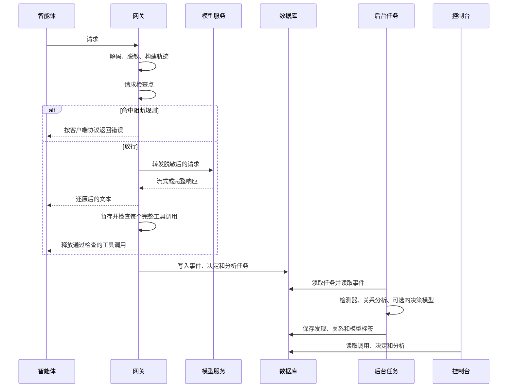

# 架构

[English](architecture.md)

SafeAgent 部署在智能体与模型服务之间。系统让敏感数据留在运维边界内，在项目策略禁止时阻断请求或工具调用，并生成可供独立审阅的审计记录。

## 信任边界

网关是信任边界。数据库、审计记录、策略、控制台和实例密钥由运维方管理。智能体、模型服务以及工具返回的内容位于边界之外，按数据处理。

工具输出和工具描述始终标记为不可信，即使文本内容类似指令。调用方身份来自通过认证的 Agent 密钥。请求元数据可提供展示和策略条件所需的上下文，但不能用于确定调用方身份。

## 一次调用

请求解码后先脱敏并构建轨迹，再执行请求检查点。请求在此被阻断时，网关按客户端协议返回错误，不调用上游。放行后，网关转发脱敏请求，并在响应到达客户端之前还原被替换的值。客户端执行的工具调用会一直暂存到检查完成，然后放行或拒绝。

策略判断不会等待完整的响应文本。在流式响应中，已经到达的文本会继续转发给客户端，只有工具调用帧等待结论。调用结束时，事件、在线决定和分析任务一起写入数据库。

## 在线检查

请求检查点处理脱敏后的请求、指令、已声明工具以及客户端发来的全部消息。它运行结构与内容检测器，并计算 `request` 阶段的规则。

工具检查点的输入是同一条轨迹，外加一个完整的工具调用。它运行结构、内容和关系检测器，并计算 `tool_call` 阶段的规则。客户端执行的工具此时仍被暂存，阻断可以阻止副作用；服务商执行的工具已经在服务商侧运行，阻断只能扣留结果，无法撤销这次执行。

检测器或规则无法完成时，结果取决于项目配置。该阶段存在阻断规则的项目按失败关闭处理；仅记录的项目会保存一条可见的“防护不可用”决定并继续执行。规则放行有副作用的调用后，决策模型可以追加一次否决。模型失败不会改变策略结果。

## 审计与诊断

审计事件构成调用的记录。诊断从这些事件、调用当时的脱敏快照以及 Agent 密钥身份重建轨迹，因此更换检测器或模型后可以重新检查历史调用，不需要网关保留额外状态。

诊断不应用策略。它保存发现、关系边和可选的模型标签。每条结果记录输入哈希和版本，重新分析会在旧结果旁生成新记录；输入、检测器和分类目录版本一致时，两份结果可以比较。

覆盖受限且没有高危发现时，结论为 `unknown`。仅当覆盖完整、没有中等或高危发现，且模型未判定不安全时，调用结论才为 `safe`。

## 标签

每个条目记录来源和信任级别，每个工具调用记录去向。确定性发现只填写检测码、来源和去向能够支持的三个分类维度；维度为空表示尚未确认。

可选的决策模型对整条轨迹给出完整分类标签。模型答案与发现并列保存，不会改写确定性标签。

## 策略

每个项目维护一张有序的类型化条件列表。条件可以读取 Agent 身份、工具、扁平化参数、目标、工具链、发现和当前阶段。字段名拼写错误会在保存时被拒绝。

保存时校验文档，并在一个事务中启用新版本。旧版本保留用于查看，也可以恢复为新版本。每次调用在准入时固定当前版本。成员可以编辑记录规则，但不能设置优先级；阻断类策略规则、阻断类脱敏规则、优先级、版本恢复和决策模型配置由管理员管理。

## 持久化与失败

PostgreSQL 是唯一持久化存储。调用、在线决定和分析任务在同一个事务中写入，因此已结束的调用一定有诊断任务排队。进程内的后台任务从数据库领取工作，失败后按退避重试；失败的任务和分析会保留为可见结果。

数据库结构是一份带指纹的全新基线。构建版本与指纹不一致时进程拒绝启动，数据库必须重建，系统不提供迁移路径。

## 部署

一个进程提供控制台、网关和健康检查，使用一个 PostgreSQL 数据库。控制台如需从回环地址之外访问，应通过反向代理对外提供服务，并由反向代理处理 TLS。数据库是协调点，当前设计运行单个实例。

## 相关文档

- [控制台](console_zh.md)
- [Agent 威胁建模](threat-modeling_zh.md)
- [快速上手](getting-started_zh.md)
- [Agent 开发指南](../agent/README.md)
