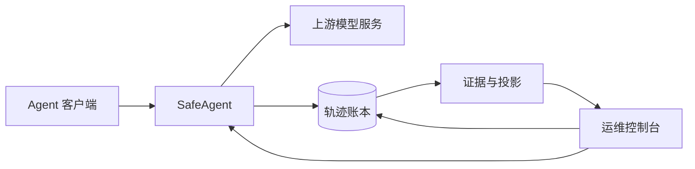

# 架构

[English](architecture.md)

SafeAgent 位于 Agent 客户端和模型服务之间。它接受 Agent 使用的四种接口，按上游渠道的格式转发请求；数据离开企业之前完成脱敏，返回时再还原；动作执行过程中运行项目策略，并把整项任务记录成带签名的轨迹。网关、控制台和证据工具读取同一份事件日志，因此运维事后看到的结论与当时执行的判断一致。

## 在系统中的位置

所有模型调用都经过网关。观察内容、上下文组装、记忆读写、动作提议与执行、审批、回滚和委派都会追加到同一条轨迹账本。调用与发现都是账本的投影，而不是第二份事实来源。

## 信任边界

网关即信任边界。配置、策略、账本和控制台归运维方所有；Agent、模型服务、工具输出和工具描述都在边界之外，一律视为数据，文本不会因为表述得像指令就成为指令。

调用方身份只来自认证通过的 Agent 密钥。请求元数据可以展示，也可以供检测器使用，但它不能用来确认调用者身份，也不会作为策略字段暴露。可选的会话请求头只将同一 Agent 密钥下的调用归入同一条轨迹，不承载身份，也不能跨租户关联。

## 请求路径

1. 网关校验 Agent 密钥，解码请求，并按端点操作、用途和通道完成分类。
2. 网关替换敏感值，同时记录每个条目的来源、可信程度，以及动作可能作用的对象。
3. 入口关卡运行确定性检查和项目规则。请求中新增的工具结果，会在上游看到之前接受检查。
4. 对外模型名解析到路由；调用允许继续时才预占配额。
5. 请求按目标渠道格式改写后转发。文本与推理实时下行；完整工具调用先等待动作关卡，再整段放行、阻断或转为待审批。
6. 发布关卡在正文写出之前、或已预审的流写出首字节之前执行，脱敏值在内容放行时还原。动作区间及其结果追加到轨迹，检查点随后签名覆盖该区间。

## 调用与通道

并非所有请求都是 Agent 的行为。每次调用都有端点操作、客户端声明或推断出的用途，以及由前两者得出的通道。

| 通道     | 进入轨迹         | 参与发现 | 流量指标           | 调用列表       |
| -------- | ---------------- | -------- | ------------------ | -------------- |
| 主调用   | 是               | 是       | 计入请求数与失败率 | 默认展示       |
| 侧调用   | 是，作为后台工作 | 是       | 只计成本           | 带通道标记展示 |
| 辅助调用 | 否               | 仅投影   | 不计入             | 默认隐藏       |

主调用代表 Agent 的实际工作。侧调用是围绕主任务发生的后台工作：子 Agent、上下文压缩、标题生成和记忆整理。辅助调用则是模型列表、Token 计数、嵌入和 Responses 生命周期这类协议流量；每次辅助调用都是一条独立的短轨迹。

## 模型供给与路由

模型供给是全局的。供应商描述协议端点、能力和模型发现；渠道为供应商配置地址、凭据和限额；模型记录上游名称、类型和价格。路由属于项目，将一个对外模型名和若干别名映射到一组目标。目标按优先级、权重和格式偏好尝试；瞬时失败会切换，策略阻断不会。删除渠道或模型之前会给出影响预览。

## 轨迹与控制台

一条轨迹是一项被委派的任务。它的事件日志记录观察内容、上下文变化、记忆读写、模型与工具动作、审批、回滚和委派。归约器据此计算标签、能力、义务、覆盖度和风险；三个在线关卡分别守住入口、动作和发布，回滚与委派由归约和投影记录，而不是由第四个在线关卡执行。

控制台从账本读取轨迹状态、覆盖度与缺口、事件时间线、调用、发现和内容片段。发现溯源、审批与离线证据见[Agent 安全](agent-safety_zh.md)。

## 部署与适用范围

SafeAgent 部署在运维方自有的基础设施内。Agent 通过统一地址访问模型，轨迹账本保留在本地环境。

| 情形                 | 行为                                         |
| -------------------- | -------------------------------------------- |
| 首内容前上游失败     | 切换到其他目标，客户端无感知                 |
| 首内容后上游失败     | 以协议内错误结束，不再切换                   |
| 客户端断开           | 停止写入，取消上游，记录部分响应与取消事件   |
| 策略或检测器不可用   | 该阶段存在阻断规则时拒绝调用，否则记录后继续 |
| 配置引用了已删除对象 | 告警并降级路由，继续服务                     |

覆盖范围取决于经过网关的流量和状态转移是否被记录器采到。部署层面的限制见[安全模型](agent-safety_zh.md)，测试能证明与不能证明的内容见[验收方法](verification_zh.md)。

## 延伸阅读

- [协议转换](protocol-conversion_zh.md)
- [安全模型](agent-safety_zh.md)
- [同类方案](landscape_zh.md)
- [验收方法](verification_zh.md)
