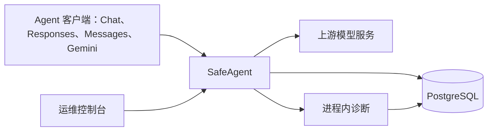

# 架构

[English](architecture.md)

SafeAgent 是部署在 Agent 与模型服务之间的自托管网关。它接住 Agent 客户端使用的四种协议，在调用进行中执行项目策略，把敏感值脱敏后再发给上游、收到回复后还原，并把每一次准入的调用写进可校验、可回放的审计链。网关、运维控制台和健康检查由同一个 Go 进程提供，PostgreSQL 是唯一的有状态依赖。

## 它所在的位置

所有调用只走这一条路径。网关在客户端协议与上游协议之间转换，因此客户端和模型服务不必使用同一种线路格式；同一个项目也可以把不同调用路由到不同厂商，而对外只暴露一个地址。

系统内部按职责分层，不按协议分叉：

| 层         | 职责                                                     |
| ---------- | -------------------------------------------------------- |
| 协议适配   | 四种线路格式的编解码、流式驱动与转换损失记录             |
| 调用路径   | 请求分类、脱敏、行为轨迹构建、路由、检查点执行与调用收尾 |
| 控制面     | 维护供给图与项目路由策略，负责模型发现和配置健康         |
| 审计与诊断 | 维护事件链、重建调用、运行检测器与决策模型、给出判定     |
| 控制台     | 面向监控、会话回放、风险、策略与操作记录的只读投影       |
| 平台与存储 | 配置、密钥、限额、网络策略、PostgreSQL 基线与数据保留    |

## 信任边界

网关就是信任边界。数据库、审计链、策略、控制台与实例密钥归运维方所有；Agent、模型服务、工具返回值与工具描述都在边界之外，一律当作数据处理，文本不会因为写着指令就获得指令权限。

调用方身份只来自通过认证的 Agent 密钥。请求元数据可以展示、可以给检测器使用，但无法证明调用者是谁，也不会作为策略字段暴露。可选的会话请求头只把同一 Agent 密钥下的调用归入同一会话，不承载身份，也不能跨租户关联。

## 请求路径

1. 网关认证 Agent 密钥，把请求解码为规范模型，并判断这次调用的端点操作、客户端用途以及所属通道。
2. 脱敏替换敏感值；观察层同时记录每个条目的来源、可信程度以及工具调用可能触达的目标。调用会保存当时的脱敏快照，规则日后修改也能还原历史。
3. 请求检查点运行检测器与项目规则。如果请求新增了工具结果，工具结果检查点会在上游看到之前再检查一遍。
4. 对外模型名被解析为一条路由。依次尝试显式路由请求头、精确名称和别名；后台调用与辅助调用可以回退到项目默认路由，主调用在模型未配置时直接失败。调用允许继续时才预占配额。
5. 请求按目标渠道的格式改写后转发。文本与推理实时下行；完整工具调用先等待判定，再整段放行或丢弃。客户端尚未收到内容时，上游失败可以换一个目标重试。
6. 响应检查点在正文写出之前、或已预审的流写出首字节之前执行，占位符在内容放行时还原。调用结束时，审计事件、在线决策与诊断任务在同一事务中写入；只有对话类通道会更新会话。

## 调用与通道

并非所有请求都是 Agent 的行为。每次调用都带着三个事实，它们共同决定这次调用如何存储、如何计数：端点操作、客户端声明或推断出的用途，以及由前两者得出的通道。

| 通道     | 进入会话             | 参与诊断 | 流量指标           | 调用列表               |
| -------- | -------------------- | -------- | ------------------ | ---------------------- |
| 主调用   | 是                   | 是       | 计入请求数与失败率 | 默认展示               |
| 侧调用   | 是，作为后台调用折叠 | 否       | 只计 Token 与成本  | 带通道标记展示，可折叠 |
| 辅助调用 | 否                   | 否       | 不计入             | 默认隐藏，需显式打开   |

Agent 在主对话之外执行的后台工作（子 Agent、上下文压缩、标题生成、记忆与审阅助手）仍属于同一会话，但不作为需要诊断的主调用。辅助端点，包括 Token 计数、模型列表、嵌入、审核以及 Responses 生命周期，从不创建会话，也不会抬高失败率。能力不支持、响应不存在这类预期中的协议拒绝会记录成结果，不算网关故障。

调用以结果收尾。只有上游错误或客户端错误算失败；策略阻断和明确的拒绝都是完成了一次协议交互。调用记录、指标查询与控制台使用同一套口径。

## 控制面

供给与路由策略是两张分开的图：

- 供给图是全局的：供应商描述协议端点、能力与模型发现；渠道保存凭据、基础地址与限额；模型描述上游名称、类型与价格。模型支持的格式由供应商端点与模型类型推导，不在渠道上单独保存。
- 路由策略属于项目：一条路由把一个对外模型名（以及若干别名）映射到一组目标。每个目标指定渠道与模型，并带有优先级、权重、可选的格式与输出上限。

内置供应商以可编辑的记录出现，也可以添加自定义供应商来接入任意兼容 OpenAI 或自建的模型服务端点。供应商的修改会重新加载到运行中的进程，渠道、模型与路由则在每次调用时从数据库读取，因此配置变更无需重启进程。删除渠道或模型是软删除，删除前会给出一份受影响路由与项目的预览；引用了已删除或已停用对象的配置只会让路由降级并给出告警，不会阻止进程启动。

路由解析是确定的：目标先按优先级排序，同优先级按权重选择，并优先使用与客户端一致的格式。瞬时失败、鉴权失败、限流与格式转换失败会落到下一个目标；策略阻断和非法请求不会。

## 行为轨迹与回放

一次会话渲染成一份投影，不靠拼接若干页面。投影里是带稳定标识的类型化节点：会话、每次调用、轮次、请求与响应条目、工具调用与结果、上游尝试、策略决定、发现以及脱敏值；边连接调用链、产生与消费的条目、阻断决定、数据流和重试，并标出读取时只能推断的关系。

同一份投影同时供三种视图（流程图、树形列表、平铺列表）以及旁边的检查器使用。审计事件就是回放步：控制台可以沿一次调用的历史前进或后退，并高亮每一步触及的节点。投影有大小上限且只读；会话过大时会明确提示，不会悄悄丢掉历史。

## 脱敏与展示

脱敏值有确定性标识，同一个值在整个会话里保持同一个占位符。一次调用只上报它自己引入的值：祖先条目中的值已由当初准入的调用记录过，不会在每次续写时重复累加。

会话视图聚合这些标识：先给出脱敏值数量与命中次数的小结，再列出每个不同的值及其出现位置，并在条目文本中高亮对应片段，全程不展示原值。每次调用同时保留当时执行的脱敏规则，老调用按当时的规则展示。

## 审计与诊断

审计事件是调用的唯一事实来源。每个事件都用密钥哈希挂接到前一个事件上，调用结束时链头与事件数一并保存，因此被篡改的事件可以定位，被删除的尾部也能发现。离线校验命令不需要启动网关就能检查已存的调用链。

时间线由事件生成，只包含元数据；原始文本仍按角色可见性控制。调用结束后，诊断进程从同一批事件重建轨迹，展开有界的祖先会话，运行全部检测器，再按配置向决策模型询问轨迹级标签，最后把发现、数据流、覆盖情况与判定作为独立记录保存。诊断不会改变在线策略。

## 部署与边界

一个进程同时提供网关、控制台与健康检查，并运行诊断任务。PostgreSQL 保存全部状态，也是唯一的协调点；数据库租约阻止第二个实例接管同一个库。系统不需要消息队列、Redis 或独立的后台服务。

| 故障                   | 行为                                         |
| ---------------------- | -------------------------------------------- |
| 首内容前上游失败       | 切换到其他目标，客户端无感                   |
| 首内容后上游失败       | 以协议内错误结束，不再切换                   |
| 客户端断开             | 停止写入，取消上游，记录部分响应与取消事件   |
| 工具缓冲或流大小超限   | 返回资源错误，不当作策略拒绝                 |
| 审计写入失败           | 调用标记为失败，不呈现记录无法支撑的成功响应 |
| 策略或检测器不可用     | 该阶段存在阻断规则时失败关闭，否则记录后继续 |
| 配置引用了已删除对象   | 告警并降级路由，不拒绝启动                   |
| 数据库结构与构建不一致 | 拒绝启动，要求重建数据库                     |

这些边界也是设计刻意保持小的部分。覆盖范围取决于网关部署的位置；图片等二进制内容不参与脱敏；工具去向与数据关系依赖启发式推断，需要人工确认；系统以单实例运行，schema 是全新基线，不提供迁移路径。

## 相关

- [协议转换](protocol-conversion_zh.md)
- [Agent 安全模型](agent-safety_zh.md)
- [同类方案](landscape_zh.md)
- [验收方法](verification_zh.md)
