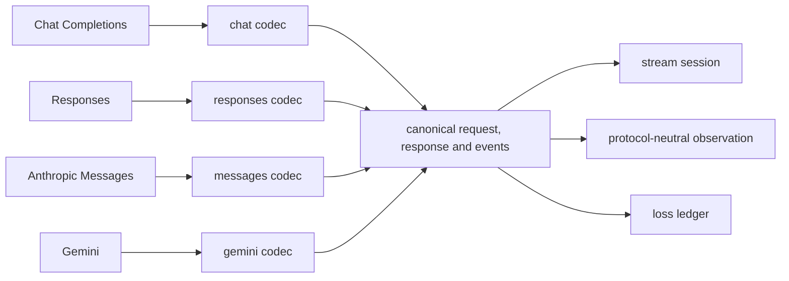

# Protocol conversion

[中文](protocol-conversion_zh.md)

Agent clients and model providers do not agree on a protocol. A client may speak Chat Completions, Responses, Anthropic Messages or Gemini, an upstream may accept only one of them, and models in one project may sit behind different channels. Pairwise converters multiply with every protocol and force streaming termination, tool arguments and error semantics to be implemented again for each pair.

SafeAgent keeps one path: four codecs translate between a wire format and a canonical model, and policy, redaction, audit and the streaming engine all work on that model.

## Canonical model

Messages, reasoning, tool calls, tool results, server tools, media and native objects become explicit items and parts. Vendor-private fields go into a raw overlay tagged with their source, so a format-specific field survives a round trip without teaching the rest of the system about that vendor.

Policy and audit read the canonical model and never branch on the client protocol. The cost is an abstract layer that has to carry the intersection and the gaps of four protocols; the benefit is that a new provider is usually a configuration entry rather than a new converter.

## Codec contract

Each codec decodes and encodes requests, responses and streams. It reads an endpoint description from the provider catalog and does not branch on a vendor name.

| Endpoint field | Contents |
| --- | --- |
| Formats | the wire formats the provider exposes, each with its base address and path |
| Capability | media, tools, reasoning, counting and usage fields the endpoint can carry |
| Compatibility | required output limit, optional fields that are ignored, reasoning or tools that are rejected, error bodies returned with HTTP 200 |
| Discovery and auxiliary paths | how to list models, and where token counting, embeddings or moderations live |

A new OpenAI-compatible provider usually needs one endpoint declaration. A codec changes only when a protocol gains semantics the canonical model does not yet express.

## Streaming

The hard part of streaming conversion is deciding when bytes may reach the client. The stream session has five behaviors:

1. **Commit boundary.** No HTTP header is written before the first forwardable content. A failure before that point can fail over to another target; a failure after it can only become a protocol error.
2. **Stream review.** When a project enables it, the leading text waits for the response checkpoint before the commit boundary is crossed. The window is reviewed when it fills, when the next frame arrives after the configured timeout, or when a short stream ends. A block prevents the first byte; once the window is committed, later text is not reviewed.
3. **Tool hold.** Text and reasoning stream through, but a complete tool item is queued until the policy verdict and then released or discarded as a whole. Holding has a size limit, and exceeding it is a resource error.
4. **Termination.** Terminal frames on the re-encoded path are staged until losses and audit are settled; raw pass-through keeps the provider's own terminal frame. A clean end of stream may synthesize termination, while a truncated stream must fail.
5. **Cancellation.** Stop writing, cancel the upstream, and store what the client already received as a partial response.

Only what the client actually received is recorded. When a committed stream fails, items still held or queued are removed before the partial response is stored, so a withheld sibling tool call cannot appear in the audit record.

Keepalive follows the protocol: an SSE comment for Chat and Responses, an `event: ping` for Messages, nothing for Gemini. It starts only after the response is committed.

## Loss ledger

Cross-protocol conversion cannot be lossless. Every conversion records a loss with a path, a code, a class and a direction.

| Class    | Meaning                                  | Behavior                           |
| -------- | ---------------------------------------- | ---------------------------------- |
| fatal    | the target cannot express core semantics | reject before calling the upstream |
| degraded | secondary information is dropped         | continue the request               |

A streaming response carries the request-side summary in its headers and keeps response-side losses in the audit record. A non-streaming response is encoded before its headers are sent, so both sides appear in the headers and in the audit. The ledger lets an operator see what a conversion discarded instead of guessing from the client's behaviour.

## Raw pass-through

Same-format traffic skips re-encoding when nothing needs to change:

- source and target are the same Chat, Messages or Gemini format;
- no redaction hit and no gateway signature is waiting to be restored;
- no history expansion, repair, compatibility rewrite or capability loss changed the request;
- the target codec would keep every modelled field, so raw bytes do not preserve something canonical encoding would drop;
- for Messages, the request carries an output limit.

Responses requests and responses always take the canonical path because the gateway owns response state, include selections and retrievable identifiers. Other same-format responses may be forwarded raw while they contain only text, refusal or reasoning content; a tool, media or native item switches back to the canonical encoder. Stream review buffers raw frames until its window is released; it does not force conversion.

## Providers and channels

A provider describes protocol endpoints, capabilities, discovery and auxiliary paths. Built-in providers ship as editable records, and a custom provider can be added for any compatible endpoint. A channel binds a provider to a base address, credentials, headers and limits; it does not list models. Models belong to the provider catalog and record the upstream name, kind and prices. A model's usable formats are derived from the provider endpoints and the model kind.

A route target combines a channel and a model. It prefers the client's format when both sides support it and otherwise uses the first enabled format, so routes choose a channel and model, not a format. Changing a provider endpoint or adding a format is a catalog change, not a per-channel edit.

## Auxiliary endpoints

Agent clients also list models, retrieve one model, count tokens, manage Responses and occasionally send embeddings or moderations.

| Endpoint | Behavior |
| --- | --- |
| model list and retrieval | served from the project's routes, in the client's protocol shape |
| token counting | the native endpoint when the channel offers one; otherwise a local estimate marked as such |
| Responses lifecycle | retrieve, input items, cancel and delete share authentication, rate limiting and audit with generation |
| embeddings and moderations | same-format forwarding when the selected model is of that kind and the channel declares the capability; the route's upstream model name is applied to the body |
| undeclared capability | a protocol-shaped unsupported error |

Auxiliary endpoints are protocol traffic, not agent activity. They are authenticated, limited and audited like any other call, but they do not create conversations, do not enter diagnosis and do not count towards traffic metrics. Their expected refusals are recorded as outcomes so they cannot look like gateway failures.

## Trade-offs

- **Abstraction cost.** The canonical model carries the intersection and gaps of four protocols, but avoids pairwise growth.
- **Raw pass-through.** It covers same-format requests that need no rewrite; complex paths still use the canonical path.
- **Visible loss.** Every degradation is recorded, at the cost of more metadata and response headers.
- **Owned response state.** The gateway stores and retrieves Responses while the upstream stays stateless, at the cost of keeping history.
- **Narrow auxiliary support.** Only endpoints with clear semantics are served; other capabilities remain unsupported.

## Related

- [Architecture](architecture.md)
- [Agent safety](agent-safety.md)
- [Landscape](landscape.md)
- [Verification](verification.md)
