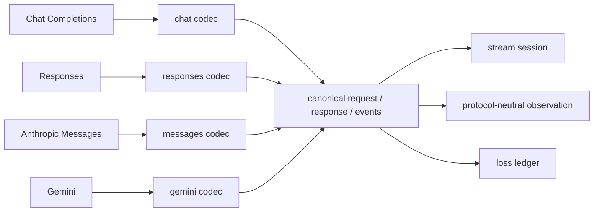

# Protocol conversion

[中文](protocol-conversion_zh.md)

Agent clients and model providers do not share one protocol. A client may speak Chat Completions, Responses, Anthropic Messages or Gemini, while an upstream accepts one of them, and different models in one project may sit behind different channel types. Pairwise converters multiply with every protocol and duplicate streaming termination, tool argument handling and error semantics.

SafeAgent keeps one path: four codecs translate between a wire format and the canonical model, and policy, redaction, audit and the streaming engine work on that model.

## Canonical model

Messages, reasoning, tool calls, tool results, server tools, media and native objects become explicit items and parts. Vendor-private fields go into a raw overlay tagged with their source.

The model layer covers the intersection and the gaps of four protocols. Policy and audit work on the canonical model and do not need to know which protocol the client spoke.

## Codec contract

Each codec decodes and encodes requests, responses and streams. It reads the endpoint capability profile from the provider catalog and does not branch on a vendor name.

| Capability profile field | Contents |
| --- | --- |
| Capability | media, tool, reasoning and counting fields the endpoint can carry |
| Compatibility | required output limit, ignored optional fields, rejected reasoning or tools, HTTP-200 failure bodies and similar flags |

A new OpenAI-compatible provider usually needs one endpoint declaration; a codec changes only when the protocol gains a new semantic.

## Stream session

The hard part of streaming conversion is deciding when bytes may reach the client. The session has four behaviors:

1. **Commit boundary.** No HTTP header is written before the first forwardable content. A failure before that point can fail over; after it, only a protocol error is possible.
2. **Tool hold.** Text and reasoning stream through; a complete tool item is queued until the policy verdict, then released or discarded as a whole. Holding has a limit, and exceeding it is a resource error.
3. **Termination.** Terminal frames are staged until losses and audit are settled. A clean EOF may synthesize termination; a truncated stream must fail.
4. **Cancellation.** Stop writing, cancel upstream, and store what the client already received as a partial response.

When a Chat, Messages or Gemini request is same-format and needs no rewrite, it can be forwarded as raw bytes with only the model name, the streaming flag and Chat usage selection patched. A response can be forwarded raw while it contains only text, refusal or reasoning text. A tool, media or native item switches back to the canonical encoder. The text hot path avoids re-encoding, while complex paths still get termination and audit from one set of logic.

## Loss ledger

Cross-protocol conversion cannot be lossless. Every conversion records a loss with a path, code, class and direction.

| Class      | Meaning                                  | Behavior                       |
| ---------- | ---------------------------------------- | ------------------------------ |
| `fatal`    | the target cannot express core semantics | reject before calling upstream |
| `degraded` | secondary information is dropped         | continue the request           |

A streaming response carries the request-side summary in its headers and keeps response-side losses in the audit record. A non-streaming response is encoded before its headers are sent, so both appear in the headers and in the audit.

The ledger lets an operator see what a conversion discarded.

## Raw pass-through

Raw pass-through has strict conditions:

- source and target are the same Chat, Messages or Gemini format;
- no redaction hit and no gateway signature waiting to be restored;
- no history expansion, repair, compatibility rewrite or capability loss changed the request;
- the target codec would keep every modelled field, so raw bytes do not preserve something canonical encoding would drop;
- for Messages, the request carries an output limit.

Responses requests and responses always take the canonical path because the gateway owns response state, include selections and retrievable IDs; other same-format responses may still be forwarded raw while they contain plain text only.

## Provider catalog

The provider catalog is a built-in registry. Each built-in provider declares its formats, endpoints, authentication, static headers, capabilities, compatibility, discovery and auxiliary endpoints. A channel keeps the provider id, keys, endpoint overrides, its own headers and model prices, and limits.

Endpoint entries are overrides:

| Entry            | Effect                      |
| ---------------- | --------------------------- |
| absent           | the catalog default applies |
| base URL or path | replaces the catalog value  |
| `disabled`       | hides that format           |

Adding a format or correcting an endpoint changes the catalog, not every channel.

## Auxiliary endpoints

Agent clients also list models, retrieve one model, count tokens, manage Responses and occasionally send embeddings or moderations.

| Endpoint | Behavior |
| --- | --- |
| model list and retrieval | served from the project's routes in the client's protocol shape |
| token counting | native endpoint when available; otherwise a local estimate marked as such |
| Responses lifecycle | retrieve, input_items, cancel and delete share authentication, rate limiting and audit |
| embeddings and moderations | same-format forwarding when the channel declares the capability |
| undeclared capability | a protocol-shaped unsupported error |

Responses lifecycle endpoints go through the same authentication, rate limiting and audit as generation. A failed audit refuses the operation, so every action keeps its record.

## How this differs from peers

AxonHub also uses a unified intermediate representation, shaped like OpenAI Chat Completions; non-OpenAI semantics travel through extra fields and provider-specific handling. Sub2API mostly uses pairwise conversion, with Responses as a hub for some paths, plus direct bridges and some chained paths.

SafeAgent builds the canonical model from items, parts and capability profiles. All four protocols use the same codec contract, so policy, audit and compensation logic are implemented once. The cost is a more abstract model layer. See [the landscape](landscape.md) for the detailed comparison.

## Design trade-offs

- **Abstraction cost**: the canonical model maintains the intersection and gaps of four protocols, but avoids pairwise growth.
- **Raw pass-through**: it covers only same-format requests that need no rewrite; complex paths still use the canonical path.
- **Visible loss**: every degradation is recorded, at the cost of more metadata and response headers.
- **Response state**: the gateway owns Responses storage and retrieval while the upstream stays stateless, at the cost of keeping history.
- **Auxiliary endpoints**: only endpoints with clear semantics are served; other capabilities remain unsupported.

## Related

- [Architecture](architecture.md)
- [Agent safety](agent-safety.md)
- [Landscape](landscape.md)
- [Verification](verification.md)
