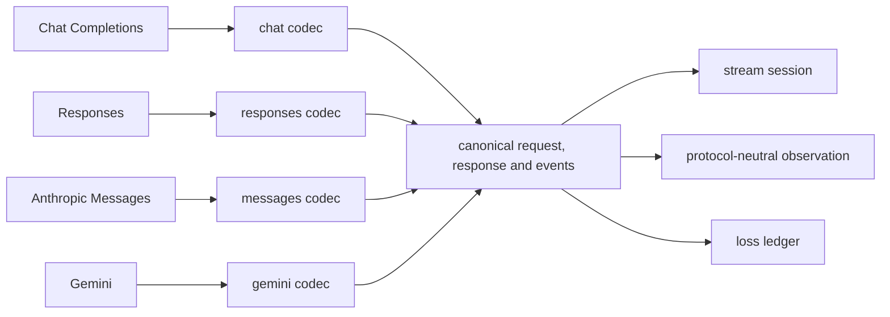

# Protocol conversion

[中文](protocol-conversion_zh.md)

Agent clients and model providers do not agree on a protocol. A client may speak Chat Completions, Responses, Anthropic Messages or Gemini, an upstream may accept only one of them, and models in one project may sit behind different channels. Pairwise converters multiply with every protocol, and streaming termination, tool arguments and error semantics must be implemented again for each pair.

SafeAgent keeps one path: four codecs translate between a wire format and a canonical model, and policy, redaction, audit and the streaming engine all work on that model.

## Canonical model

Messages, reasoning, tool calls, tool results, server tools, media and native objects become explicit items and parts. Vendor-private fields are stored in a raw overlay tagged with their source, so a format-specific field survives a round trip without requiring the rest of the system to understand that vendor.

Policy and audit read the canonical model and never branch on the client protocol. The cost is an abstract layer that must cover what four protocols share and where they diverge; the benefit is that a new provider is usually a configuration entry, not a new converter.

## Codec contract

Each codec decodes and encodes requests, responses and streams. It reads an endpoint description from the provider catalog and does not branch by vendor name.

An endpoint declares the formats it exposes, what its protocol can carry, and the compatibility quirks of that vendor. Discovery and auxiliary endpoints are part of the same description.

A new OpenAI-compatible provider usually needs one endpoint declaration. A codec changes only when a protocol gains semantics the canonical model does not yet express.

## Streaming

The central difficulty of streaming conversion is deciding when bytes may reach the client. The stream session has five behaviors:

1. **Commit boundary.** Before the first forwardable content, the gateway sends nothing to the client. A failure before that point can fail over to another target; a failure after it can only become a protocol error.
2. **Stream review.** When a project enables it, the leading text waits for the response checkpoint before the commit boundary is crossed. The window is reviewed when it fills, when the next frame arrives after the configured timeout, or when a short stream ends. A block prevents the first byte; once the window is committed, later text is not reviewed.
3. **Tool hold.** Text and reasoning stream through, but a complete tool item is queued until the policy verdict and then released or discarded as a whole. Holding has a size limit, and exceeding it is a resource error.
4. **Termination.** On the converted path, the end of the stream waits until losses and audit are settled; raw pass-through keeps the provider's original ending. The gateway can complete a clean end of stream, while a truncated stream must fail.
5. **Cancellation.** Stop writing, cancel the upstream, and store what the client already received as a partial response.

Only what the client actually received is recorded. When a committed stream fails, items still held or queued are removed before the partial response is stored, so a withheld sibling tool call cannot appear in the audit record.

## Loss ledger

Cross-protocol conversion cannot be lossless. Every conversion records what could not be carried and how serious it is.

| Class    | Meaning                                  | Behavior                           |
| -------- | ---------------------------------------- | ---------------------------------- |
| fatal    | the target cannot express core semantics | reject before calling the upstream |
| degraded | secondary information is dropped         | continue the request               |

For a streaming response, request-side losses are reported before the first byte and response-side losses stay in the call record. A non-streaming response reports both sides before it is sent. The ledger allows an operator to see what a conversion discarded instead of guessing from the client's behavior.

## Raw pass-through

Same-format traffic that needs no rewrite takes a raw fast path. Redaction, history expansion, compatibility rewrites or capability checks send the request back through the canonical encoder; Responses always takes the canonical path because the gateway owns response state. A same-format response stays raw while it contains only text, refusal or reasoning; if a tool, media or native item appears, the response is re-encoded through the canonical path. Stream review buffers raw frames, so review does not force conversion.

## Providers and channels

A provider describes protocol endpoints, capabilities, discovery and auxiliary paths. Built-in providers are provided as editable records, and a custom provider can be added for any compatible endpoint. A channel binds a provider to a base address, credentials, headers and limits; it does not list models. Models belong to the provider catalog and record the upstream name, kind and prices. A model's usable formats are derived from the provider endpoints and the model kind.

A route target combines a channel and a model. It prefers the client's format when both sides support it and otherwise uses the first enabled format, so routes choose a channel and model, not a format. Changing a provider endpoint or adding a format is a catalog change, not a per-channel edit.

## Auxiliary endpoints

Agent clients also list models, retrieve one model, count tokens, manage Responses and occasionally send embeddings or moderations.

| Endpoint | Behavior |
| --- | --- |
| model list and retrieval | served from the project's routes in the client's protocol format |
| token counting | the native endpoint when the channel offers one; otherwise a local estimate marked as such |
| Responses lifecycle | retrieve, input items, cancel and delete share authentication, rate limiting and audit with generation |
| embeddings and moderations | same-format forwarding when the selected model is of that kind and the channel declares the capability; the route's upstream model name is applied to the body |
| undeclared capability | an unsupported error in the client's protocol format |

Auxiliary endpoints are protocol traffic, not agent activity. They are authenticated, limited and audited like any other call, but they do not join a session, do not run the online threat detectors and do not count toward traffic metrics. Their appended events are still projected, so an invariant finding can still be recorded. Their expected refusals are recorded as outcomes so they are not mistaken for gateway failures.

## Trade-offs

- **Abstraction cost.** The canonical model must cover what four protocols share and where they diverge, but avoids pairwise growth.
- **Raw pass-through.** It covers same-format requests that need no rewrite; complex paths still use the canonical path.
- **Visible loss.** Every degradation is recorded, at the cost of more metadata and response headers.
- **Owned response state.** The gateway stores and retrieves Responses while the upstream stays stateless, at the cost of keeping history.
- **Narrow auxiliary support.** Only endpoints with clear semantics are served; other capabilities remain unsupported.

## Further reading

- [Architecture](architecture.md)
- [Agent safety](agent-safety.md)
- [Landscape](landscape.md)
- [Verification](verification.md)
