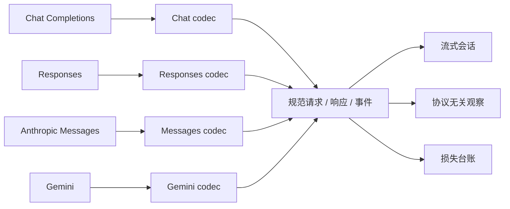

# 协议转换

[English](protocol-conversion.md)

Agent 客户端与模型服务使用的协议并不一致。客户端可能使用 Chat Completions、Responses、Anthropic Messages 或 Gemini，上游只接受其中一种；同一项目中的不同模型也可能位于不同类型的渠道。逐对编写转换器会让转换器数量随协议增长，流式终止、工具参数与错误语义也要反复实现。

SafeAgent 只保留一条路径：四个 codec 在 wire format 与规范模型之间转换，策略、脱敏、审计和流式引擎都在规范模型上工作。

## 规范模型

消息、推理、工具调用、工具结果、服务端工具、媒体与原生对象都表示成显式的 item/part，厂商私有字段放入带来源标记的 raw overlay。

模型层覆盖四种协议的交集与差集。策略与审计在规范模型上工作，不需要知道客户端使用哪种协议。

## Codec 契约

每个 codec 实现请求、响应与流的解码和编码。codec 读取提供商目录给出的端点 capability profile，不按厂商名分支。

| capability profile 字段 | 内容                                                                                 |
| ----------------------- | ------------------------------------------------------------------------------------ |
| 能力                    | 端点能携带的媒体、工具、推理和计数字段                                               |
| 兼容性                  | 是否强制输出上限、忽略哪些可选字段、是否拒绝推理或工具、是否以 HTTP 200 返回错误体等 |

新增兼容 OpenAI 的厂商通常只需要一条端点声明；只有协议本身出现新语义时才修改 codec。

## 流式会话

流式转换的关键是判断何时可以把字节交给客户端。会话包含四个行为：

1. **提交边界**：首个可转发内容出现前，不写 HTTP 头。此前的失败可以切换渠道；此后的失败只能写协议内错误。
2. **工具缓冲**：文本与推理实时转发；完整工具项先排队，等待策略判定后整段放行或丢弃。缓冲有上限，超限按资源错误处理。
3. **终止**：终止帧先暂存，损失与审计处理完成后再写出。干净的 EOF 可以合成终止，截断的流必须报错。
4. **取消**：停止写入、取消上游，并把已发送内容记为部分响应。

Chat、Messages 或 Gemini 请求同格式且无需改写时，可以按原始字节透传，只修补模型名、流式标记和 Chat 的用量选择；响应只含文本、拒绝或推理文本时也可以原始转发。一旦出现工具、媒体或原生项，就切回规范编码器。这样纯文本请求避免重复编解码，复杂路径仍由同一套逻辑保证终止与审计完整。

## 损失台账

跨协议转换无法做到无损。每次转换都会产生一条损失记录，包含路径、代码、类别和方向。

| 类别       | 含义                 | 处理           |
| ---------- | -------------------- | -------------- |
| `fatal`    | 目标无法表达核心语义 | 调用上游前拒绝 |
| `degraded` | 次要信息被丢弃       | 请求继续       |

流式响应只在响应头中放置请求侧损失摘要，响应侧损失进入审计；非流式响应在写出响应头前完成编码，两类损失都会出现在响应头与审计中。

损失台账让运维人员能够看到一次转换丢弃了哪些内容。

## 原始透传

原始透传需要满足以下条件：

- 源与目标同为 Chat、Messages 或 Gemini 格式。
- 没有脱敏命中，也没有等待恢复的网关签名。
- 没有历史展开、修复、兼容性改写或能力损失改动请求。
- 目标编码器会保留所有已建模字段，原始字节不会保留规范编码本应丢弃的内容。
- 目标为 Messages 时，请求必须带有输出上限。

Responses 的请求与响应总走规范路径，因为网关接管了响应状态、include 选择与可检索 ID；其他同格式响应只要只含纯文本，仍可原始转发。

## 提供商目录

提供商目录是内置注册表。每个内置提供商声明支持的格式、各格式的端点、鉴权方式、静态头、能力、兼容性、发现方式与辅助端点。渠道保存提供商标识、一组有序的启用格式、逐格式的端点覆盖、密钥、启用的目录模型、请求头和限额；模型定义与价格位于全局模型目录。

每个目标将渠道格式顺序与模型格式取交集，双方都支持时优先客户端格式，否则使用第一个启用格式。base URL 与路径默认来自目录，也可按格式覆盖；自定义提供商必须填写 base URL。路由选择渠道和模型，不选择格式。

新增格式或修正端点只需修改目录，不需要迁移所有渠道。

## 辅助端点

Agent 客户端还会列模型、取单个模型、计数 token、管理 Responses，偶尔发送 embeddings 或 moderations。

| 端点                      | 行为                                              |
| ------------------------- | ------------------------------------------------- |
| 模型列表与检索            | 按项目路由生成，并使用客户端的协议格式            |
| token 计数                | 有原生端点时转发；否则本地估算并标记              |
| Responses 生命周期        | 检索、input_items、取消和删除共用鉴权、限流与审计 |
| embeddings 与 moderations | 模型类型匹配且渠道格式声明能力时同格式转发        |
| 未声明能力                | 返回协议原生的不支持错误                          |

Responses 的生命周期端点与生成请求一样经过鉴权、限流和审计。审计写入失败时拒绝操作，确保动作与记录一致。

## 与同类方案的差异

AxonHub 同样使用统一中间表示，但它的 IR 以 OpenAI Chat Completions 为形状，非 OpenAI 语义通过附加字段和提供商特化承载。Sub2API 主要使用成对转换，以 Responses 作为部分路径的中枢，同时保留直接桥接和链式路径。

SafeAgent 的规范模型围绕 item/part 与能力描述构建。四种协议通过同一套 codec 契约接入，策略、审计和恢复逻辑只需实现一次；代价是模型层更抽象。具体对比见[同类方案](landscape_zh.md)。

## 设计取舍

- **抽象成本**：规范模型需要维护四种协议的交集与差集，但避免了逐对组合的增长。
- **原始透传**：只覆盖同格式且无需改写的场景，复杂场景仍走规范路径。
- **损失可见**：每个降级都会记录，代价是更多元数据与响应头。
- **响应状态**：网关接管 Responses 的存储与检索，上游保持无状态，代价是网关需要保存历史。
- **辅助端点**：只提供语义明确的端点，其他能力保持不支持。

## 相关

- [架构](architecture_zh.md)
- [Agent 安全模型](agent-safety_zh.md)
- [同类方案](landscape_zh.md)
- [验收方法](verification_zh.md)
