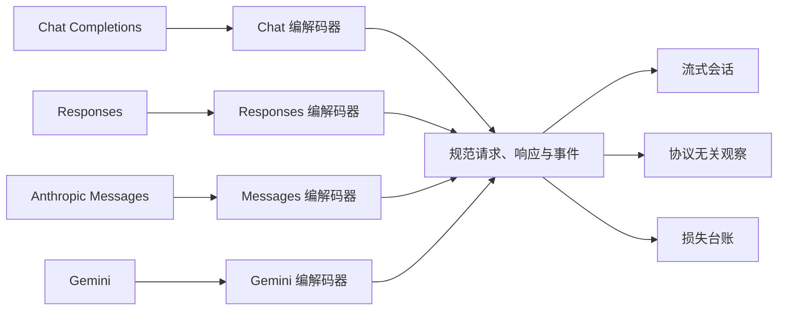

# 协议转换

[English](protocol-conversion.md)

Agent 客户端与模型服务使用的协议并不一致。客户端可能使用 Chat Completions、Responses、Anthropic Messages 或 Gemini，上游只接受其中一种；同一个项目里的模型也可能分布在不同渠道。逐对编写转换器，转换器数量会随协议数目增长，流式终止、工具参数和错误语义还要为每种组合重新实现一遍。

SafeAgent 只保留一条路径：四个编解码器在线路格式与规范模型之间转换，策略、脱敏、审计和流式引擎都在规范模型上工作。

## 规范模型

消息、推理、工具调用、工具结果、服务端工具、媒体与原生对象都会变成显式的条目与片段。厂商私有字段放进带来源标记的原始层，这样某个格式特有的字段可以完整往返，而系统其他部分不必了解这个厂商。

策略与审计读取规范模型，不按客户端协议分支。代价是多了一层抽象，需要承载四种协议的交集与差异；收益是新增供应商通常只需一条配置，不必再写转换器。

## 编解码器契约

每个编解码器负责请求、响应与流的解码和编码。它读取供应商目录里的端点描述，不按厂商名分支。

| 端点字段       | 内容                                                                                   |
| -------------- | -------------------------------------------------------------------------------------- |
| 格式           | 供应商暴露的线路格式，每种带有基础地址与路径                                           |
| 能力           | 端点能承载的媒体、工具、推理、计数与用量字段                                           |
| 兼容性         | 是否强制输出上限、忽略哪些可选字段、拒绝哪些推理或工具参数、是否用 HTTP 200 返回错误体 |
| 发现与辅助路径 | 如何列出模型，以及 Token 计数、嵌入、审核端点在哪里                                    |

新增一个兼容 OpenAI 的供应商通常只需要一条端点声明。只有当协议出现规范模型尚未表达的新语义时，才需要修改编解码器。

## 流式转发

流式转换的难点是判断什么时候可以把字节交给客户端。流式会话包含五个行为：

1. **提交边界**：首个可转发内容出现之前不写 HTTP 头。此前的失败还可以切换到别的目标；此后的失败只能变成协议内错误。
2. **流式预审**：项目开启预审后，首段文本先等待响应检查点，通过后才越过提交边界。窗口填满、超时后收到下一帧，或短流结束时触发检查。命中阻断则一个字节都不写出；窗口提交之后，后续文本不再预审。
3. **工具缓冲**：文本与推理照常下行，完整的工具条目先排队，等策略判定后整段放行或丢弃。缓冲有大小上限，超限按资源错误处理。
4. **终止**：重新编码的路径会暂存终止帧，等损失与审计处理完毕再写出；原始透传保留上游自己的终止帧。干净的流结束可以合成终止，被截断的流必须报错。
5. **取消**：停止写入，取消上游，并把客户端已经收到的内容记为部分响应。

只有真正送达客户端的内容才会进入接收记录。已经提交的流出错时，仍在缓冲或排队中的条目会在保存部分响应之前移除，因此被扣留的并行工具调用不会出现在审计记录里。

心跳跟随协议：Chat 与 Responses 用 SSE 注释，Messages 用 `event: ping`，Gemini 不发。心跳只在响应提交之后开始。

## 损失台账

跨协议转换无法无损。每次转换都会记下一条损失，包含路径、代码、类别和方向。

| 类别 | 含义                 | 处理             |
| ---- | -------------------- | ---------------- |
| 致命 | 目标无法表达核心语义 | 调用上游之前拒绝 |
| 降级 | 次要信息被丢弃       | 请求继续         |

流式响应把请求侧的摘要放进响应头，把响应侧的损失留在审计记录中。非流式响应在写出响应头之前完成编码，两侧的损失都会出现在响应头与审计里。损失台账让运维人员看到一次转换丢掉了什么，而不必从客户端的行为去猜。

## 原始透传

同格式流量在不需要改写时跳过重新编码：

- 源与目标同为 Chat、Messages 或 Gemini 格式；
- 没有被脱敏命中，也没有等待还原的网关签名；
- 没有因历史展开、修复、兼容性改写或能力损失而改动请求；
- 目标编解码器会保留所有已建模字段，原始字节不会留下规范编码本应丢弃的内容；
- 目标为 Messages 时，请求带有输出上限。

Responses 的请求与响应始终走规范路径，因为响应状态、include 选择与可检索标识都由网关接管。其他同格式响应只要只含文本、拒绝或推理内容，就可以按原始字节转发；一旦出现工具、媒体或原生条目，就切回规范编码。流式预审缓冲的是原始帧，不会因为预审而强制转换。

## 供应商与渠道

供应商描述协议端点、能力、模型发现与辅助路径。内置供应商以可编辑记录的形式提供，也可以为任意兼容端点添加自定义供应商。渠道把供应商绑定到基础地址、凭据、请求头和限额上，本身不列出模型。模型属于供应商目录，记录上游名称、类型与价格；模型可用的格式由供应商端点与模型类型推导。

路由目标由渠道与模型组合而成。渠道和模型都支持客户端格式时优先使用客户端格式，否则使用第一个可用格式，因此路由选择渠道与模型，不选择格式。修改供应商端点或新增格式属于目录层面的变更，不需要逐个渠道调整。

## 辅助端点

Agent 客户端还会列出模型、读取单个模型、统计 Token、管理 Responses，偶尔发送嵌入或审核请求。

| 端点               | 行为                                                                         |
| ------------------ | ---------------------------------------------------------------------------- |
| 模型列表与读取     | 由项目的路由生成，按客户端协议形状返回                                       |
| Token 计数         | 渠道有原生计数端点时直接调用，否则本地估算并明确标注                         |
| Responses 生命周期 | 读取响应、读取 input items、取消与删除，与生成请求共用鉴权、限流与审计       |
| 嵌入与审核         | 所选模型类型匹配且渠道声明能力时按同格式转发，并把路由的上游模型名写入请求体 |
| 未声明的能力       | 返回协议形状的“不支持”错误                                                   |

辅助端点是协议流量，不是 Agent 的行为。它们和普通调用一样经过认证、限流与审计，但不创建会话、不进入诊断，也不计入流量指标。预期中的拒绝会记录成结果，因此不会看起来像网关故障。

## 设计取舍

- **抽象成本**：规范模型要承载四种协议的交集与差异，但避免了逐对组合增长。
- **原始透传**：只覆盖同格式且无需改写的场景，复杂路径仍走规范路径。
- **损失可见**：每个降级都会记录，代价是更多元数据与响应头。
- **响应状态归网关**：网关保存并检索 Responses，上游保持无状态，代价是网关需要存历史。
- **辅助能力有限**：只提供语义明确的端点，其余能力保持不支持。

## 相关

- [架构](architecture_zh.md)
- [Agent 安全模型](agent-safety_zh.md)
- [同类方案](landscape_zh.md)
- [验收方法](verification_zh.md)
