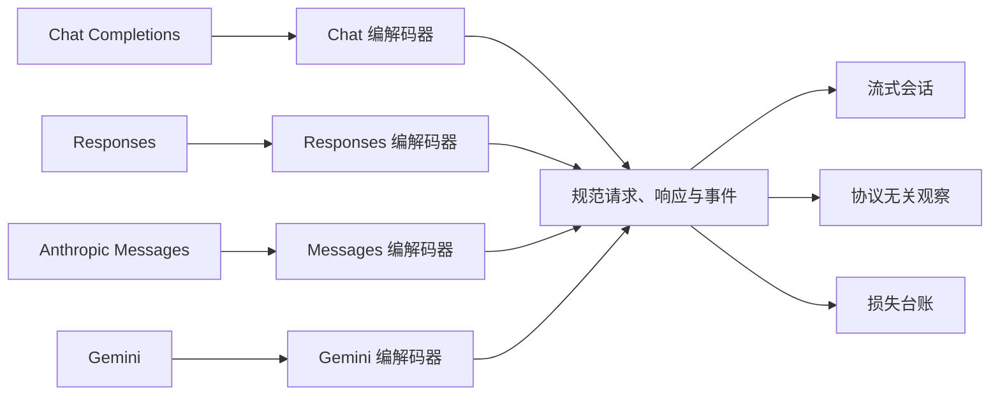

# 协议转换

[English](protocol-conversion.md)

Agent 客户端与模型服务使用的协议并不一致。客户端可能使用 Chat Completions、Responses、Anthropic Messages 或 Gemini，上游只接受其中一种；同一个项目中的模型也可能分布在不同渠道。如果为每一对协议单独编写转换器，数量会随协议数目增长，流式终止、工具参数和错误语义均需为每种组合重新实现。

SafeAgent 只保留一条路径：四个编解码器在协议格式与规范模型之间转换，策略、脱敏、审计和流式引擎均基于规范模型工作。

## 规范模型

消息、推理、工具调用、工具结果、服务端工具、媒体与原生对象都表示为明确的条目与片段。厂商私有字段存入带来源标记的原始字段层，这样某个格式特有的字段可以完整往返，而系统其他部分无需了解该厂商。

策略与审计读取规范模型，不按客户端协议分支。代价是增加一层抽象，需要同时容纳四种协议共有的部分和各自的差异；收益是新增供应商通常只需增加一条配置，不必再写转换器。

## 编解码器契约

每个编解码器负责请求、响应与流的解码和编码。它读取供应商目录中的端点描述，不会按厂商单独分支。

一个端点会声明其支持的格式、协议能够承载的能力，以及该厂商的兼容性差异。模型发现和辅助端点也包含在同一份描述中。

新增一个兼容 OpenAI 的供应商通常只需要一条端点声明。只有当协议出现规范模型尚未表达的新语义时，才需要修改编解码器。

## 流式转发

流式转换的难点是判断何时可以向客户端发送字节。流式会话处理五类情况：

1. **提交边界。** 在出现第一段可以转发的内容之前，网关不向客户端发送任何内容。此前的失败还可以切换到其他目标；此后的失败只能变成协议内错误。
2. **流式预审。** 项目开启预审后，首段文本先等待响应检查点，通过后才越过提交边界。窗口填满、超时后收到下一帧，或者短流结束时，均会触发一次检查。命中阻断则不写出任何字节；窗口提交之后，后续文本不再预审。
3. **工具缓冲。** 文本与推理照常下行，完整的工具条目先排队，等策略判定后整段放行或丢弃。缓冲有大小上限，超限按资源错误处理。
4. **终止。** 转换后的流需等待损失记录和审计写入完成后才结束，原始透传沿用上游原有的结束帧。上游正常结束时，网关可以补全结束帧；流被截断时，则必须报错。
5. **取消。** 停止写入，取消上游，并将客户端已经收到的内容记为部分响应。

只有真正送达客户端的内容才会进入记录。已经提交的流出错时，网关会在保存部分响应之前移除仍在缓冲或排队中的条目，因此被拦下的并行工具调用不会出现在审计记录中。

## 损失台账

跨协议转换无法无损。每次转换都会记录哪些内容无法传递，以及严重程度。

| 类别 | 含义                 | 处理             |
| ---- | -------------------- | ---------------- |
| 致命 | 目标无法表达核心语义 | 调用上游之前拒绝 |
| 降级 | 次要信息被丢弃       | 照常发起请求     |

流式响应在首字节之前报告请求侧的损失，响应侧的损失则保留在调用记录中。非流式响应在发送之前将两侧的损失一并报告。损失台账使运维人员能够看到一次转换丢弃了哪些内容，而无需从客户端的行为推测。

## 原始透传

同格式且无需改写的流量采用原始字节的快速路径。脱敏、历史展开、兼容性改写或能力检查改动了请求时，会回到规范编码；Responses 的请求状态由网关接管，始终经过规范路径。同格式响应如果只包含文本、拒绝或推理内容，也保持原始转发；一旦出现工具、媒体或原生条目，则转回规范编码。流式预审缓冲的是原始帧，不会因为预审而强制转换。

## 供应商与渠道

供应商描述协议端点、能力、模型发现与辅助路径。内置供应商以可编辑的记录预置，可直接编辑，也可以为任意兼容端点添加自定义供应商。渠道为供应商配置基础地址、凭据、请求头和限额，本身不列出模型。模型属于供应商目录，记录上游名称、类型与价格；模型可用的格式由供应商端点和模型类型决定。

路由目标由渠道与模型组合而成。渠道和模型都支持客户端格式时优先使用客户端格式，否则使用第一个可用格式，因此路由选择渠道与模型，不选择格式。修改供应商端点或新增格式属于目录层面的变更，不需要逐个渠道调整。

## 辅助端点

Agent 客户端还会列出模型、读取单个模型、计算 Token 数、管理 Responses，偶尔发送嵌入或审核请求。

| 端点               | 行为                                                                         |
| ------------------ | ---------------------------------------------------------------------------- |
| 模型列表与读取     | 由项目的路由生成，按客户端协议的格式返回                                     |
| Token 计数         | 渠道有原生计数端点时直接调用，否则本地估算并明确标注                         |
| Responses 生命周期 | 读取响应、读取 input items、取消与删除，与生成请求共用鉴权、限流与审计       |
| 嵌入与审核         | 所选模型类型匹配且渠道声明能力时按同格式转发，并将路由的上游模型名写入请求体 |
| 未声明的能力       | 返回符合客户端协议格式的“不支持”错误                                         |

辅助端点属于协议流量，并非 Agent 的行为。它们和普通调用一样经过认证、限流与审计，但不加入会话轨迹、不参与威胁分析，也不计入流量指标。预期中的拒绝会作为调用结果记录下来，因此看起来不像网关故障。

## 设计取舍

- **抽象成本。** 规范模型需兼顾四种协议共有的部分和各自的差异，但不必为每一对协议单独写转换。
- **原始透传。** 只覆盖同格式且无需改写的场景，复杂路径仍经过规范路径。
- **损失可见。** 每个降级都会记录，代价是更多元数据与响应头。
- **响应状态归网关。** 网关保存并检索 Responses，上游保持无状态，代价是网关需要保存历史。
- **辅助能力有限。** 只提供语义明确的端点，其余能力保持不支持。

## 延伸阅读

- [架构](architecture_zh.md)
- [安全模型](agent-safety_zh.md)
- [同类方案](landscape_zh.md)
- [验收方法](verification_zh.md)
