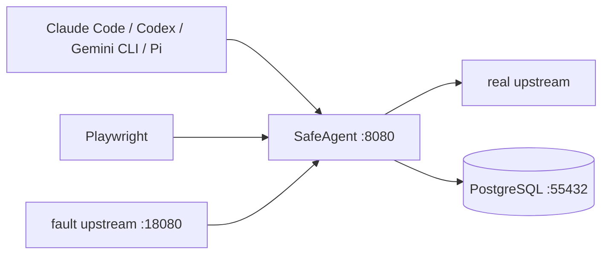

# Verification

[中文](verification_zh.md)

SafeAgent is verified by four layers of evidence: static checks, unit and race tests, real-database integration tests, and an end-to-end matrix in a Docker lab. The first two check the implementation; the last two run against a real database and a real upstream.

## Layers

| Layer | Command | What it proves |
| --- | --- | --- |
| Static and contract | `make check` | formatting, staticcheck, vet, TypeScript, OpenAPI and generated client consistency |
| Unit and race | `make test` | four protocol conversions, stream session, four checkpoints, audit chain, policy and detectors |
| Database integration | `make integration` (requires a test database) | transactions, cascades, quota, retention, audit-chain verification and tamper location |
| Lab | `make lab-acceptance` | protocol matrix, agent CLIs, policy, diagnosis, security, faults, browser, load and audit verification against a real upstream |

`make verify` runs the first two layers. `make security` additionally writes dependency inventories, SBOMs and vulnerability reports, and fails on a symbol-reachable vulnerability.

## Lab



The gateway runs on the host, as does the local fault upstream during the fault suite; PostgreSQL, four agent CLIs and the browser run in containers. Only the database port is published.

Agent containers reach SafeAgent through the Docker host gateway. Lab channels allow private addresses because Docker resolves external names to its fake-IP range; that exception must not be copied into a deployment.

Each of Chat Completions, Responses, Anthropic Messages and Gemini is configured independently. A format without a URL creates no channel; the matrix and agent suite size themselves to the routes that exist, and a case that cannot run on a configured route is recorded as a skip with its reason.

## Protocol matrix

The matrix covers four client formats × every configured channel format × stream/JSON.

| Case group | Cases |
| --- | --- |
| Core | plain text, one tool call, parallel tool calls, a tool-result continuation, reversible redaction |
| Extension | reasoning, media, structured output, server tools |

Multiple candidates are accepted only through a same-format streaming pass-through with no redaction or history expansion. Every other combination is rejected as unsupported multi-choice.

Each case records attempts, HTTP status, terminal events and the failure reason. The protocol report lists every skip with a reason. Tool cases may retry because the model chooses tools; text and redaction cases must pass on the first attempt.

## Agent clients

Claude Code, Codex, Gemini CLI and Pi use their native entry points against every configured route, and each native route also runs a multi-step task. The suite records the CLI version, each run log and the final answer, and verifies that a client works unchanged; answer quality is outside its scope.

The native Gemini deep task needs a real Gemini upstream; without one it is recorded as a skip. Cross-format routes are still covered because the client protocol and the channel format may differ.

## Policy and diagnosis

The policy suite saves request-phase, tool-result and tool-call rules, then sends traffic through every client format.

| Blocked phase           | Live result                       |
| ----------------------- | --------------------------------- |
| Request                 | 403                               |
| Tool result             | 403                               |
| Tool call before commit | 403                               |
| Tool call after commit  | 200, ending with a protocol error |
| Response                | covered by unit tests             |

The live suite does not force a model to emit a blockable response. It restores the empty policy at the end.

The diagnosis suite sends an injection phrase, an e-mail address and an exfiltration URL, waits for asynchronous analysis, and checks the redaction hit, both findings, complete coverage and an `unsafe` verdict. It also checks the console timeline and audit-integrity status, confirming that online decisions, events and diagnosis come from the same record.

## Security and faults

The security suite uses separate projects and checks invalid keys, cross-project isolation, rate and token quotas, member and administrator permissions, raw-event access and the operation log.

The fault suite uses a local deterministic upstream and checks failover before content, behavior after content, truncated streams, tool holds, header forwarding, route output limits, rejection cases and multi-choice rules.

## Console and load

The browser suite visits every page at desktop and mobile widths and runs desktop flows for projects, channels, routes, keys, policies, redaction rules, users and members. It checks page errors, failed API calls, empty bodies and horizontal overflow.

The load suite compares the same scenario directly against the provider and through the gateway, on every native route plus a cross-format sample. It checks scenario agreement, baseline validity, gateway error classes and the error-rate delta.

Latency and throughput describe this sample only and do not establish production capacity.

## Performance gate

The hard gate uses a longer run, 150 requests per scenario at concurrency 4 by default. It allows a candidate P95 of up to 1.2 × the direct baseline plus a fixed allowance (100 ms by default), requires throughput of at least 90% of the direct baseline, and also checks protocol correctness, terminal events and error rates. The short smoke is a regression signal and makes no capacity claim.

The measured path covers protocol conversion, redaction, observation, online policy, audit persistence and streaming relay; it does not cover tool holding, console traffic, background diagnosis, retention or multi-instance behavior.

## Skips

Skips record capability or harness gaps.

| Skipped area                             | Reason                                              |
| ---------------------------------------- | --------------------------------------------------- |
| Media input                              | the configured text-only channel has no media input |
| Reasoning content                        | the configured Chat model returned no reasoning     |
| Schema-less JSON mode                    | the configured Messages channel does not support it |
| Server tools for Chat and Gemini clients | the matrix has no scripted case                     |
| Embeddings                               | no configured channel declares the capability       |
| Native Gemini deep task                  | no real Gemini upstream is configured               |

## Reproduce

```sh
make deps
cp testenv/env.example testenv/.env   # fill in a real upstream
make lab-acceptance
```

The first run builds the console and binary, starts the database, and creates the project and routes; a successful run stops the lab. A failure leaves it running for inspection, and `KEEP_LAB=1` keeps the evidence. The lab's environment file holds provider keys and its runtime directory holds generated credentials; neither should be committed.

## Limits

- Acceptance depends on real model behavior; tool cases vary with model choice.
- No matched benchmark against peer projects is part of the lab, so it does not imply a ranking.
- Performance numbers are relative comparisons only.
- Security review covers code and dependencies, not the operator's network, database or key management.

## Related

- [Architecture](architecture.md)
- [Agent safety](agent-safety.md)
- [Landscape](landscape.md)
- [Lab guide](../agent/testenv.md)
