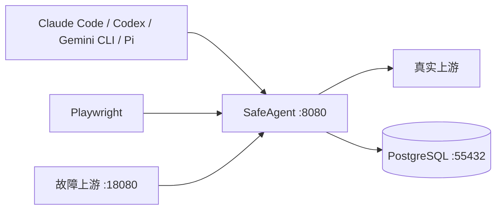

# 验收方法

[English](verification.md)

SafeAgent 的验收由四层证据组成：静态检查、单元与竞态测试、真实数据库集成测试，以及 Docker 实验环境中的端到端矩阵。前两层检查实现本身，后两层在真实数据库与真实上游上运行。

## 分层

| 层         | 命令                                 | 证明什么                                                                          |
| ---------- | ------------------------------------ | --------------------------------------------------------------------------------- |
| 静态与契约 | `make check`                         | 格式、staticcheck、vet、TypeScript、OpenAPI 与生成客户端一致                      |
| 单元与竞态 | `make test`                          | 四种协议转换、流式会话、四个检查点、审计链、策略与检测器                          |
| 数据库集成 | `make integration`（需要测试数据库） | 事务、级联、配额、保留策略、审计链校验与篡改定位                                  |
| 实验环境   | `make lab-acceptance`                | 真实上游下的协议矩阵、Agent CLI、策略、诊断、安全、故障、浏览器、负载与审计链校验 |

`make verify` 运行前两层。`make security` 另外生成依赖清单、SBOM 与漏洞报告，存在符号可达漏洞时失败。

## 实验环境



网关运行在宿主机，故障套件期间本地故障上游也在宿主机；数据库、四个 Agent CLI 和浏览器运行在容器中。只有数据库端口发布到宿主机。

Agent 容器经 Docker 主机网关访问 SafeAgent。实验环境中的渠道允许私网地址，这是 Docker 的 fake-IP 解析所需，不能复制到生产部署。

实验环境支持按格式独立配置 Chat Completions、Responses、Anthropic Messages 和 Gemini。没有配置的上游不会创建对应渠道，矩阵和 Agent 套件按实际路由收缩；已配置路由上无法运行的用例会记录为跳过并说明原因。

## 协议矩阵

矩阵覆盖四种客户端格式 × 每个已配置的渠道格式 × 流式/JSON。

| 用例组 | 用例                                                     |
| ------ | -------------------------------------------------------- |
| 核心   | 纯文本、单工具调用、并行工具调用、工具结果续接、可逆脱敏 |
| 扩展   | 推理、媒体、结构化输出、服务端工具                       |

多候选只在同格式流式透传且没有脱敏或历史展开时可用，其余组合按不支持的多候选请求拒绝。

每个用例都记录尝试次数、HTTP 状态、终止事件和失败原因。协议报告会列出每个跳过项及原因；工具类用例允许因模型选择而重试，文本和脱敏用例必须一次通过。

## Agent 客户端

Claude Code、Codex、Gemini CLI 和 Pi 分别通过各自的原生入口访问每个已配置路由，各自的原生路由还会额外运行一个多步任务。套件记录 CLI 版本、每次运行的日志和最终答案，验证接入方无需修改即可工作；回答质量不在验收范围内。

原生 Gemini 深度任务需要真实 Gemini 上游，没有配置时记录为跳过。跨格式路由仍会覆盖，因为客户端协议和渠道格式可以不同。

## 策略与诊断

策略套件保存请求阶段、工具结果阶段和工具调用阶段的规则，再通过每种客户端格式发送请求。

| 被阻断阶段         | 实时结果              |
| ------------------ | --------------------- |
| 请求               | 403                   |
| 工具结果           | 403                   |
| 工具调用（提交前） | 403                   |
| 工具调用（提交后） | 200，以协议内错误结束 |
| 响应               | 由单元测试覆盖        |

实时套件不强制模型产出可阻断的响应，并在结束后恢复空策略。

诊断套件发送注入短语、邮箱地址和外泄 URL，等待异步分析，检查脱敏命中、两类发现、完整覆盖和 `unsafe` 结论。它还验证控制台时间线和审计完整性状态，确认在线决策、事件和诊断结果来自同一份记录。

## 安全与故障

安全套件使用独立项目，检查无效密钥、跨项目隔离、速率与 token 配额、成员与管理员权限、原始事件访问和操作日志。

故障套件使用本地确定性上游，检查首个内容到达前的故障转移、首个内容之后的行为、截断流、工具缓冲、请求头转发、路由输出上限、拒绝场景和多候选规则。

## 控制台与负载

浏览器套件在桌面和移动宽度访问所有页面，并在桌面执行项目、渠道、路由、密钥、策略、脱敏规则、用户和成员的创建、修改、删除或禁用流程。它检查页面错误、失败的 API、空页面和横向溢出。

负载套件把同一场景的直连调用与经过网关的调用做对比，覆盖原生路由和一组跨格式样本。它检查场景一致、基线有效、网关错误分类和错误率差。

延迟与吞吐只代表当前样本，不构成生产容量结论。

## 性能口径

硬门禁使用更长的一轮运行，默认每个场景 150 个请求、并发 4。允许的 P95 上限为直连基线的 1.2 倍加上固定余量（默认 100 ms），吞吐不低于直连基线的 90%，同时检查协议正确性、终止事件和错误率。短冒烟只作为回归信号，不作容量承诺。

性能路径覆盖协议转换、脱敏、观察、在线策略、审计持久化和流式转发；不覆盖工具缓冲、控制台流量、后台诊断、保留策略或多实例行为。

## 跳过项

跳过项记录能力或测试装置缺口。

| 跳过范围                          | 原因                               |
| --------------------------------- | ---------------------------------- |
| 媒体输入                          | 已配置的纯文本渠道没有媒体输入     |
| 推理内容                          | 已配置的 Chat 模型没有返回推理内容 |
| 无 schema 的 JSON 模式            | 已配置的 Messages 渠道不支持       |
| Chat 与 Gemini 客户端的服务端工具 | 矩阵没有编排该用例                 |
| embeddings                        | 已配置渠道没有声明该能力           |
| 原生 Gemini 深度任务              | 没有配置真实 Gemini 上游           |

## 复现

```sh
make deps
cp testenv/env.example testenv/.env   # 填写真实上游
make lab-acceptance
```

首次运行会构建控制台与二进制、启动数据库、创建项目与路由；成功结束后会停止实验环境。失败时保留环境以便检查，设置 `KEEP_LAB=1` 可以保留证据。实验环境的环境文件保存提供商密钥，运行时目录保存生成的凭据，两者都不应提交。

## 局限

- 验收依赖真实上游的模型行为，工具类用例存在模型选择带来的波动。
- 验收环境不含与同类项目的同条件基准，因此不能从中推导排名。
- 性能数字仅用于相对比较。
- 安全审查覆盖代码与依赖，不覆盖部署方的网络、数据库和密钥管理。

## 相关

- [架构](architecture_zh.md)
- [Agent 安全模型](agent-safety_zh.md)
- [同类方案](landscape_zh.md)
- [实验环境](../agent/testenv.md)
